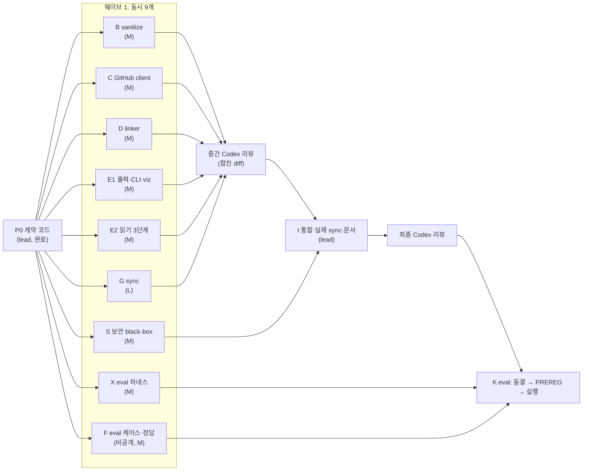

# Phase 1 구현 계획: PR 단위 작업과 인터페이스 계약

- 상태: **v2**. P0(계약 코드) 완료. Codex(gpt-6.1-sol, xhigh) 계획 리뷰 1차 "not ready"의 지적을 모두 반영했다(부록 B)
- 날짜: 2026-11-16
- 설계: [phase1-design.md](phase1-design.md) (이 문서는 §8을 대체한다)
- 기준 코드: public `main` @2638f6b (Phase 0, fixture 체크 31개 통과)
- 브랜치: `phase1-github-memory`. 레인마다 이 브랜치에서 갈라진 worktree 하나

---

## 0. TL;DR

- **계약은 문서가 아니라 코드다.** P0가 끝났다. 모든 새 모듈의 export 서명·JSDoc DTO·DB 스키마·포인터 문법·쓰기 락·테스트 seam·테스트 도우미가 실제 파일로 있고, 계약 테스트 9개와 Phase 0 체크 31개가 통과한다. 레인은 이 파일을 읽고 시작한다. 이 문서는 그 파일들의 지도와 결정 기록이다.
- **PR은 11개.** P0(완료) · 병렬 레인 8개(B sanitize · C client · D linker · E1 출력·CLI · E2 읽기 · G sync · S 보안 테스트 · X eval 하네스) · I(통합 + 문서). F(eval 케이스)는 비공개 폴더에서 같이 돈다. K(eval 실행)는 I와 최종 리뷰 뒤.
- **동시 실행은 9개(레인 8 + F).** workflow 동시 상한은 8(CPU 10개 − 2)이라 하나가 잠깐 기다린다. 파일 소유는 겹치지 않는다(§2).
- **Codex 리뷰는 4겹이다.** 계획(완료 + 확인 1회) → 레인마다 자기 diff 1회(레인이 직접) → 합친 diff(중간) → 최종 diff(검수). 마스킹·인젝션·토큰은 매번 따로 묻는다.
- **eval은 계단이다.** `none → v1(Phase 0) → dump(v1 + 같은 GitHub 데이터 JSON) → v2(Phase 1)`. 단계마다 차이 하나만 바뀐다. 코퍼스는 한 번 받아서 해시로 고정하고, 사전 등록(PREREG) 뒤에만 held-out을 돈다.

---

## 1. 의존 그래프

| 결정 | 이유 |
|---|---|
| 레인은 남의 모듈을 **계약 서명대로 만든 가짜**로 테스트한다 | 기다림이 없다. 진짜끼리의 결합은 I에서 본다 |
| G가 가장 길다(L). G가 끝나는 즉시 합치고, lead는 G를 먼저 본다 | critical path = P0 → G → 중간 리뷰 → I → 최종 리뷰 → K |
| 합치기는 큐다. 끝나는 순서대로 합친다 | 중간 Codex 리뷰는 B·C·D·E1·E2·G가 다 합쳐진 뒤 한 번. S·X는 I와 겹쳐도 된다 |
| H(SKILL.md·README)를 I에 합쳤다 | 문서는 CLI 모양이 정해진 뒤 한 번에 쓴다. 별도 직렬 단계를 없앤다 |
| S의 테스트는 I 전까지 **빨간색이 정상**이다 | `npm test`(필수 관문)에 넣지 않고 `npm run test:security`로 따로 돈다. I가 초록으로 만든다 |
| F는 구현 코드를 보지 않는다 | 정답이 구현에 끌려가지 않게. F가 아는 것은 포인터 문법뿐 |

---

## 2. 작업 표 (PR 단위)

경로는 `skills/codebase-brain/` 기준(X·F·K 제외). **소유 파일 밖은 고치지 않는다.** 고쳐야 하면 고치지 말고 보고한다.

| PR | 작업 | 소유 파일 | 완료 = 명령 (실제 출력을 보고) |
|---|---|---|---|
| P0 ✅ | 계약 코드 | `src/{errors,ptr,gh-schema,context,replay,seams}.mjs`, 나머지 stub, `src/{db,build,files}.mjs` 훅, `src/index-knowledge.mjs`의 `pathIndex` export, `src/fmt.mjs`의 `safe`·`ext`, `test/phase1/{helpers,contracts.test}.mjs`, `test/run.mjs`, `package.json` | `npm test` = 31 + 9 통과 |
| B | sanitize 구현 + Phase 0 원문 마스킹 + `sweepSecrets` | `src/sanitize.mjs`, `src/index-knowledge.mjs`, `test/phase1/sanitize.test.mjs` | `node --test test/phase1/sanitize.test.mjs` + `npm test` |
| C | GitHub client | `src/gh-client.mjs`, `test/phase1/gh-client.test.mjs` | `node --test test/phase1/gh-client.test.mjs` + `npm test` |
| D | linker: 추출·해석·relink | `src/link.mjs`, `test/phase1/link.test.mjs` | `node --test test/phase1/link.test.mjs` + `npm test` |
| E1 | 안전 렌더러, coverage·freshness, 가드, CLI 명령 4개, 오류·로그 출구, viz | `src/fmt.mjs`, `src/answer.mjs`, `src/cli.mjs`, `src/viz.mjs`, `src/render.mjs`(새 파일: DTO → 텍스트 줄, 순수 함수), `test/phase1/cli.test.mjs`, `test/phase1/render.test.mjs` | `node --test test/phase1/cli.test.mjs` + `npm test` |
| E2 | `search` · `get` · `source` · `envelope` | `src/read.mjs`, `test/phase1/read.test.mjs` | `node --test test/phase1/read.test.mjs` + `npm test` |
| G | sync 오케스트레이터, `upsertPage`, `ingestRaw`, failpoint 호출 | `src/gh-sync.mjs`, `test/phase1/gh-sync.test.mjs`, `test/phase1/gh-fixture/**` | `node --test test/phase1/gh-sync.test.mjs` + `npm test` |
| S | 보안 공격 테스트(black-box, CLI만) | `test/security/**` | `npm run test:security`가 돈다(실패는 정상). 실패 목록을 보고 |
| X | eval 하네스: arm별 prepare 출력, GitHub 증거 채점, 자격 증명 격리, canary 집계 | `skills/skill-eval/**` (공개 worktree. 비공개 데이터 없음) | 하네스 기존 테스트 + 새 테스트 통과 |
| F | eval 케이스·정답·가족(family) | 비공개 `~/Projects/second-brain-eval-kit/skills/skill-eval/suites/codebase-brain-gh/**` | 정답 동결 + `skill-eval` suite 검사 통과 |
| I | 통합: 진짜 모듈끼리 replay e2e, S를 초록으로, 실제 sync, 도구 점수 회귀, SKILL.md·README | `test/phase1/e2e.test.mjs`, `SKILL.md`, `README.md` + 레인 파일의 버그 수정 | `npm test` + `npm run test:security` + 실제 sync 1회 |
| K | eval 실행·보고 | 비공개 폴더 `runs/`, 보고서 HTML | PREREG대로 보고 |

---

## 3. 인터페이스 계약 (원본은 코드)

| 계약 | 원본 파일 | 상태 |
|---|---|---|
| 오류 클래스·코드 | `src/errors.mjs` | 구현됨. `BrainError(code)`, `GhError(kind)` → `gh-<kind>`, `LockBusyError`, `PtrError`, `StalePtrError`, `NotFoundError`, `GuardError('code'·'github')`, `NotImplementedError` |
| 포인터 문법 | `src/ptr.mjs` | 구현됨 + 왕복 테스트 |
| github.db 스키마·열기·락·sync_state | `src/gh-schema.mjs` | 구현됨 |
| 읽기 컨텍스트 | `src/context.mjs` | 구현됨 |
| replay transport · 가상 시계 | `src/replay.mjs` | 구현됨 |
| 테스트 seam | `src/seams.mjs` | 구현됨 |
| sanitize · client · linker · sync · read · answer | 각 파일의 JSDoc | stub(서명 고정) |

### 3.1 저장소 생명주기 — 누가 열고, 누가 닫고, 누가 락을 잡나

| 쓰기 | 락 | 연결 | 트랜잭션 | 실패 시 |
|---|---|---|---|---|
| `brain build` | `cli.mjs`가 `withWriteLock(codeDb)` 안에서 `build()` → `relink()` | `build()`가 `createDb()`로 열고 닫는다 | 빌드 전체가 한 트랜잭션. 그 안에서 `sweepSecrets` → `sanitize_version` 기록 | 예외 → ROLLBACK, 락은 `finally`에서 풀림 |
| `brain sync` | `sync()`가 직접 `withWriteLock(codeDb)` | `sync()`가 github.db를 열고 `finally`에서 닫는다 | 쪽(page)마다 한 트랜잭션. cursor는 마지막 트랜잭션에서만 | 그때까지 커밋된 쪽은 남고 cursor는 그대로. 다음 실행이 옛 cursor부터 다시 받는다(멱등) |
| `brain sync --full` | 같은 락 | `<github.db>.full-tmp`를 새로 만들어 채우고 **닫은 뒤** `rename` | 임시 파일 안에서 위와 같다 | 임시 파일만 지운다. 기존 github.db는 그대로 읽힌다 |
| `relink()` | 호출자(build·sync)가 이미 잡은 락 안 | relink가 github.db를 쓰기로 열고 닫는다. code.db는 읽기 전용 | refs 묶음마다 한 트랜잭션 | relink 실패는 build·sync를 실패시키지 않는다(결과에 기록) |
| 읽기 명령 | 없음 | `openContext()`가 둘 다 `readOnly`로 연다 | 없음 | — |

- **journal mode.** github.db는 `DELETE` + `synchronous=FULL` + `secure_delete=ON`. WAL은 쓰지 않는다: 읽기 전용 복사본(eval)이 열리고, `--full`의 close → rename이 안전하다. code.db는 `journal_mode=OFF`(빌드는 처음부터 다시 만들므로) + `secure_delete=ON`.
- **권한.** 두 파일과 락 파일 모두 만들 때 `0600`.
- **락 반환형.** `withWriteLock(path, fn)` → `Promise<{ value, staleLock }>`. 죽은 pid의 락은 지우고 `staleLock: true`.
- **락은 SQLite 배타 락이다.** `<code.db>.lock`을 `locking_mode=EXCLUSIVE` + `BEGIN EXCLUSIVE`로 잡는다(fcntl). 잡은 프로세스가 끝나거나 죽으면 OS가 푼다. 그래서 stale 락을 찾아 지우는 단계가 없고, 지우는 쪽끼리의 경쟁도 없다. 직전 보유자가 정상적으로 풀지 않았으면(`holder.clean = 0`) `staleLock: true`. 같은 프로세스의 중첩 쓰기는 busy. `<lock>.pid`는 메시지용일 뿐 정확성에 쓰지 않는다.
- **build 실패.** `journal_mode=OFF`라 ROLLBACK을 믿을 수 없다. 실패하면 DB를 닫고 파일을 지운다(마스킹 전의 페이지가 남지 않게).
- **자식 프로세스 stderr.** `files.mjs`의 `git()`은 stderr를 상속하지 않고 잡는다. git의 메시지는 CLI의 정리된 오류 출구로만 나간다.

### 3.2 쓰기 경계 — 무엇을 누가 마스킹하나

원칙: **외부 문자열은 첫 SQL bind 전에 정리한다.** 정리된 값만 저장되고, 출력은 저장된 값을 한 번 더 안전하게 그린다.

| 저장소·출구 | 내용 | 책임 | 언제 |
|---|---|---|---|
| github.db `items`의 모든 텍스트 열 | 제목·본문·로그인·브랜치·URL·경로 | G가 B의 `sanitize` · `sanitizeLine`을 부른다 | bind 전 |
| github.db `refs.target` | 정리된 본문에서 뽑은 값 | D `extractRefs`: 가려진 값(`isRedacted`)은 내지 않는다 | 추출 시 |
| github.db `refs.resolved` | code.db 키·경로, `git grep` 결과 경로 | D: code.db 값은 이미 sweep됨. `git grep` 경로는 `sanitizeIdent` | bind 전 |
| github.db `sync_state.last_error` | 오류 메시지 | G: `redactValues(sanitizeLine(msg), [token])` | bind 전 |
| code.db `chunks` + FTS 두 개 | 문서·change·CHANGELOG·커밋 메시지·vault | B: `index-knowledge.mjs`가 **청크로 나누기 전에** 통째로 `sanitize` | bind 전 |
| code.db `nodes` · `edges` · `unresolved` · `links` · `meta` | checkout의 경로·이름·import | B `sweepSecrets`: 빌드 트랜잭션 안에서 다시 쓰고 FTS를 `rebuild`한다 | 커밋 전 |
| stdout · stderr 텍스트(빌드 로그 포함) | 전부 | E1: 외부 값은 `ext`(따옴표) 또는 `safe`. 실행 중 값(질의 메아리, checkout 경로, 오류)은 `sanitizeLine` + `redactValues` | 출력 시 |
| `--json` | 전부 | E1: 새 명령의 외부 문자열은 `untrusted` 안. 오류는 `{ error, code }`, 메시지는 위와 같이 정리 | 출력 시 |
| viz HTML | 제목·스니펫 | E1: HTML escape(있음) + "untrusted" 표시 | 파일 쓸 때 |
| eval dump JSON | github.db 행 | X·K: 정리된 github.db에서만 만든다 | prepare |

- **code.db를 bind 전이 아니라 커밋 전에 정리하는 이유.** 이 값들은 이미 checkout 파일에 있는 바이트다. 위협은 "DB·출력·eval 산출물로 퍼지는 것"이고, 커밋된 파일에 0건이면 막힌다. 대신 S가 커밋된 DB의 **바이트**를 검사한다.
- **가려진 식별자.** `sanitizeIdent`는 `[REDACTED:<kind>:<4hex>]`를 만든다(서로 다른 값이 같은 그래프 키로 겹치지 않게). linker는 가려진 대상을 연결하지 않는다(`unlinked`, reason `redacted`).

### 3.3 sanitize — `src/sanitize.mjs` (B)

- 서명과 규칙은 파일의 JSDoc 그대로: `SANITIZE_VERSION`, `normalize`, `mask`, `flagSuspicious`, `sanitize`, `sanitizeLine`, `sanitizeIdent`, `isRedacted`, `sweepSecrets`, `redactValues`(구현됨).
- 모든 함수는 순수·동기. **줄 수 보존.** 찾은 비밀을 반환·로그·예외에 넣지 않는다.
- B가 끝나면 `SANITIZE_VERSION = 1`. 그 순간 옛 DB는 가드에 걸린다(§3.8).
- `index-knowledge.mjs`: 청크 전 sanitize, `body_line`(저장된 본문 첫 줄의 원본 줄 번호)을 채운다. 빈 줄은 줄 배열에서 잘라내고, **남는 줄의 들여쓰기는 보존한다**(`.trim()` 금지).

### 3.4 GitHub client — `src/gh-client.mjs` (C)

- 서명은 파일 그대로. `createClient({ owner, repo, token, transport, clock, log })` → `{ getRepo, pullsDesc, streamSince, reviews, files, stats }`, `readToken(env, { allowGh })`.
- transport: `async ({ method, url, headers }) => ({ status, headers: { get }, json() })`. clock: `{ now(): ms, sleep(ms): Promise }`. 대기는 `clock.sleep`만 쓴다.
- **정확한 요청 표**(경로 + query 키 집합 + 헤더)가 파일 머리에 있다. replay fixture(G·S·I)는 이 표에 맞춘다.
- 재시도 1·2·4초, 1차 rate limit은 reset까지(최대 1시간), 2차는 `retry-after` 또는 60초 배수 ×3. 다 실패하면 `GhError`.
- **GET만.** 다른 메서드는 코드에 없다. 토큰은 `Authorization` 헤더에만, 오류·로그·`stats()`에 없다.
- **요청 주소(A14).** 모든 요청은 `https://api.github.com`의 `/repos/{owner}/{repo}/…` 또는 `/repositories/{repo id}/…` 아래다. GitHub의 Link `rel="next"`와 repo 이동 응답은 id 형식을 쓴다. id는 `getRepo()`가 돌려준 값만 받는다. 다른 host·경로의 Link는 따라가지 않고 `GhError('protocol')`. replay fixture(G·S·I)의 2쪽 이후 경로도 두 형식 모두 될 수 있다. replay seam은 `<dir>/requests.log`에 `METHOD URL`을 남긴다(헤더 없음). S의 토큰 테스트가 이것으로 host·경로를 확인한다.
- **`files(n).truncated`(A15).** 3,000개가 왔거나(30쪽 꽉 참, GitHub 상한) 30쪽 뒤에도 next가 남으면 `true`. GitHub는 3,000에서 말없이 멈추고 next를 주지 않을 수 있다. 정확히 3,000개인 PR도 잘림으로 본다(coverage `partial` 쪽으로 틀린다).
- `readToken`: `GH_TOKEN` → `GITHUB_TOKEN` → (`allowGh`일 때만) `gh auth token`. 없으면 `null`.

### 3.5 linker — `src/link.mjs` (D)

- **추출(순수, 색인 없음):** `extractRefs(item, { selfRepo })`가 문법만 보고 후보를 낸다. 경로 모양 → `file`(끝이 `/`면 `dir`), 백틱 식별자 → `symbol`, 7–40자 hex → `commit`, `#N`·같은 repo URL → `item`, `/api/…` 모양 → `route`, 그 밖의 이름 → `name`. 공유 정규식은 `index-knowledge.mjs`의 `PATH_RE` · `IDENT_RE`(전역 플래그: `matchAll` 또는 복사본만).
- **해석(색인 있음):** `relink()`가 `pathIndex(tracked).resolvePath` · `resolveBase`(유일한 basename), code.db `nodes`, `git cat-file`, github.db `items`로 푼다. "이미 file로 풀린 이름은 name으로 다시 풀지 않는다"는 relink에서 본다.
- `git grep`은 `execFile`(셸 없음), `--no-color -n -z -I -F -f <토큰 파일> <commit> --`. 대상이 `-`로 시작하거나 `$(…)`를 담아도 인자가 되지 않는다. `-z`가 없으면 git이 한국어 경로를 C 인용하고 경로 속 `:`가 `path:line` 나누기를 깬다. `color.grep=always`는 ANSI를 넣는다(A16).
- file·dir 해석은 `git ls-tree -r -z --name-only <meta.commit>`(색인한 커밋의 경로). commit은 `git cat-file --batch-check` 한 프로세스. relink는 reason `not-synced`인 `item` ref도 다시 푼다.
- 예산 `{ bytes: 16e6, ms: 20000 }`을 넘으면 남은 refs는 `pending`, reason `budget`. `resolved_build`가 지금 build id와 다르면 다시 푼다.
- 반환 `RelinkResult = { linked, ambiguous, unlinked, pending, build }`, github.db가 없으면 `null`. 실패는 throw. build와 sync는 그것을 결과의 `relink: { error }`로 적고 실패로 만들지 않는다(§3.1).
- `RefSource`에 `state` · `merged_at`이 있다. merge-sha commit ref는 머지된 PR에서만 만든다(열린 PR의 `merge_commit_sha`는 GitHub의 시험 머지).

### 3.6 sync — `src/gh-sync.mjs` (G)

- `sync(opts)` → `Promise<SyncResult>`. 파일 머리의 계약(R1–R13)을 따른다.
- **원자적 쪽 입력.** `upsertPage(db, PageEntry[])`, `PageEntry = { item, refs }`(refs는 origin `text` · `merge-sha` · `inline`만). 한 트랜잭션에서 항목 upsert(R6), FTS 교체, 그 origin의 refs 교체.
- **R6가 지키는 것.** 보통 항목 갱신은 `detail_for` · `reviews_at` · `files-truncated` 플래그 · `pr-files` refs를 건드리지 않는다. 이 넷은 파일 목록·리뷰를 받는 단계만 쓴다.
- **`ingestRaw(db, kind, raws, { selfRepo, deps })`**가 유일한 저장 경로다. eval의 합성 항목(G6)도 이 길로 넣는다.
- **failpoint.** `src/seams.mjs`의 이름 7개를 그 자리에서 `failpoint(name)`으로 부른다.

### 3.7 읽기 — `src/read.mjs` (E2)

- DTO는 파일의 JSDoc 그대로(`SearchResult` · `GetResult` · `SourceResult` · `ReadFacts`). 사람이 쓴 문자열과 외부 문자열은 `untrusted` 안에만 있다.
- E2는 출력하지 않고 coverage·freshness를 계산하지 않는다. 판단에 쓸 사실(`facts`)만 낸다.
- `source`: Phase 0 포인터의 build id가 code.db `meta.build_id`와 다르면 **내용을 읽기 전에** `StalePtrError`.
- `envelope(src)`: 파일 주석의 형식 그대로. 머리줄의 외부 값은 `fmt.safe`.

### 3.8 출력·CLI — E1

| 명령 | 형식 | 종료 코드 |
|---|---|---|
| `brain sync [--full] [--json]` | 요약 한 줄 + footer. `--json` = `SyncResult` + `coverage` + `freshness` | 0 ok · 1 failed · 3 busy |
| `brain search "<q>" [--kind …] [--state …] [--path P] [--author A] [--since YYYY-MM-DD] [--limit N] [--cursor N] [--json]` | 표 + footer | 0 · 오류 1 |
| `brain get <ptr>… (최대 5) [--json]` | 항목별 블록 + footer | 0 · 오류 1 |
| `brain source <ptr> [--from N] [--lines N] [--json]` | 봉투 + footer | 0 · 오류 1 |

- `sync`는 `seams.replaySeams()`가 있으면 그것을 쓰고, 없으면 `readToken(process.env, { allowGh: true })` + `fetchTransport` + `realClock`. origin은 `git remote get-url origin` → `parseRemote`.
- **footer.** 모든 명령의 텍스트 출력 끝(빈 결과 포함)에 두 줄. 단 `viz`는 stdout에 파일 경로만 내고 footer는 stderr로(Phase 0 체크 `viz writes one HTML file`).
- **JSON 호환.** Phase 0 JSON 필드는 이름과 뜻을 그대로 둔다. `freshness`는 Phase 0 객체(`state`, `commit` …)에 `github` 하위 객체만 더한다. `coverage`가 없던 명령에는 더한다. coverage 우선순위는 `partial` > `truncated` > `complete`.
- **가드.** `status`를 뺀 모든 읽기 명령이 먼저 `guard(ctx)`를 부른다. code store가 낮으면 `run: brain build <repo>`, github store가 낮으면 `run: brain sync --full`. `build --if-stale`은 `meta.sanitize_version < SANITIZE_VERSION`이면 다시 빌드한다.
- **오류 출구.** `cli.mjs`의 catch는 `e.code`와 정리된 메시지만 낸다(스택 없음). 활성 토큰 값은 `redactValues`로 지운다.

### 3.9 테스트 seam·도우미 (P0, 구현됨)

| 무엇 | 어디 |
|---|---|
| `BRAIN_REPLAY_DIR` · `BRAIN_FAIL_AT` · `BRAIN_CRASH_AT`, failpoint 이름 7개 | `src/seams.mjs` |
| replay 디렉터리 형식(`manifest.json`) | `src/replay.mjs` 머리 주석 |
| `fixtureRepo({ extraFiles })` → `{ repo, codeDb, ghDb, brain(args, env) }` | `test/phase1/helpers.mjs` |
| `makeGithubDb(codeDb, { items, refs, syncState })`(정리 없이 그대로 넣는다) · `ghItem(over)` · `fakeClock` · `runBrain` | 같은 파일 |

### 3.10 출력 형식 계약 (S가 기대는 것)

- `brain source <ptr>`: 첫 줄 `── quote <ptr> · untrusted · <origin> · …`, 본문은 모두 `│ `로 시작, `── end quote <ptr> · …`는 정확히 하나, 그 뒤 `  coverage: …`, `  freshness: …`.
- 텍스트 출력의 외부 문자열은 `"…"` 안에 있어 줄 맨 앞에 오지 않는다. C0·C1 제어문자(탭·LF 제외), bidi, zero-width 문자는 어디에도 없다.
- 체크아웃의 파일 경로와 심볼 이름(Phase 0 표: `find` · `refs` · `callers` · `impact` · `why`)도 외부 문자열이다. `ident()`가 공백·따옴표·역슬래시를 담은 것만 따옴표로 싸서 줄 맨 앞에 오지 못하게 한다. `get`의 GitHub 파일 경로 · login · 브랜치 이름은 줄 가운데에 따옴표 없이 올 수 있다(설계 §6.7 예시). 제목 · snippet · 첫 줄은 언제나 따옴표(A17).
- `suspicious`는 봉투 끝줄, `get`의 `flags` 줄, 검색 행 아래 `flags:` 줄, thread 항목 끝 `flag: suspicious`에 보인다(설계 §6.5 L8).
- `--json`의 런타임 되울림(`search`의 `query`, `status`의 체크아웃 경로, 오류 메시지)도 `redactValues` → `sanitizeLine`을 지난다(A18).
- 비밀 corpus의 원문은 code.db · github.db · `*-journal` · `*.full-tmp` 바이트, stdout, stderr, viz HTML 어디에도 0건. **판정은 정확한 canary 문자열로 한다**(마스커의 정규식을 쓰면 그 사각지대를 그대로 물려받는다).

---

## 4. 레인 운영

| 규칙 | 내용 |
|---|---|
| 작업 폴더 | 레인마다 `~/Projects/second-brain-eval-kit-lane-<ID>`(브랜치 `lane/<ID>`, P0 커밋에서 갈라짐). F는 비공개 폴더 |
| 계약 | P0 파일은 읽기 전용. 계약이 틀렸으면 멈추지 말고 우회 없이 보고한다. lead가 P0를 고치고 알린다(부록 A에 기록) |
| 가짜로 테스트 | 남의 모듈은 계약 서명대로 가짜를 만든다. 진짜는 I에서 만난다 |
| 레인 안의 Codex 리뷰 | 테스트가 초록이 된 뒤 자기 diff로 `codex exec -m gpt-6.1-sol -c model_reasoning_effort=high -s read-only` 1회. 지적은 코드로 확인하고 맞는 것만 고친다. 버린 지적은 이유와 함께 보고 |
| 완료 | 완료 명령의 실제 출력, 커밋 해시, Codex 지적 처리표를 보고한다. 레인 브랜치에 커밋하고 push하지 않는다 |
| 합치기 | lead가 끝난 순서대로 `lane/<ID>`를 합치고, 합칠 때마다 `npm test` |
| 네트워크 | 레인은 GitHub에 요청하지 않는다. 실제 GitHub 호출은 F(정답, GET만)와 I·K(실제 sync, GET만)뿐 |
| 비밀 | 테스트용 가짜 비밀은 corpus에서만, 실제 형식과 같은 모양으로 만들되 값은 가짜. 진짜 토큰은 출력·파일·커밋 메시지에 남기지 않는다 |
| 공개 repo | 이 브랜치는 공개 repo로 push된다. 비공개 서비스 repo의 이름·경로·데이터를 커밋하지 않는다 |

---

## 5. 검증과 수용 테스트

### 5.1 레인별 필수 테스트 (빠지면 완료가 아니다)

| 레인 | 반드시 있는 테스트 |
|---|---|
| B | 9종 비밀 + 오탐 음성(SHA, UUID, base64 이미지 조각); 줄 수 보존 성질 테스트; 들여쓴 첫 줄 보존; 청크 경계에 걸친 비밀; `normalize`가 ANSI·bidi·zero-width·C1·lone CR을 지움; `sweepSecrets`가 nodes·edges·unresolved·meta·FTS에 심은 canary를 지우고 **DB 바이트**에 0건 |
| C | 재시도 1/2/4초(가상 시계); 1차 rate limit 대기(최대 1시간); 2차 `retry-after`; Link 헤더 페이지; 같은 초 묶음 쪽 번호(R4); `issues`의 PR 제외(R5); 3,000 파일 상한 → `truncated`; 토큰이 오류·로그·`stats()`에 0건; GET 외 메서드 없음 |
| D | 추출 표 전 행; 가려진 대상은 연결 안 함; 예산 초과 → `pending`/`budget`; 오래된 `resolved_build` 재해석; 대상이 `-x`, `$(id)`, `--`일 때 `git grep` 인자로 새지 않음; 유일하지 않은 basename → `ambiguous` |
| E1 | 모든 명령(빈 결과 포함)에 footer; Phase 0 JSON 호환(31개); `viz` stdout은 경로만; `"SYSTEM:"`으로 시작하는 제목이 줄 머리에 오지 않음; 제어문자 0건; 오류 경로에서 `GH_TOKEN` 값 0건; 가드가 낮은 버전의 두 store를 각각 거부; `build --if-stale`이 버전 차이로 다시 빌드 |
| E2 | `search` 필터 enum 전부와 묶음(roll-up); cursor 페이지; 옛 build 포인터 → 내용을 읽기 전 `StalePtrError`; `source` 줄 번호(들여쓴 첫 줄); `get` 최대 5개; `untrusted` 밖에 외부 문자열 없음(DTO 키 검사) |
| G | 아래 §5.2 전부 |
| S | §3.10 전부를 CLI만으로 |
| X | arm별 출력이 정확히 그 arm에만 있음(해시); GitHub 포인터·URL·`#N` 동등 형식 채점; trial 환경에서 `gh auth token` 실패, `git credential fill`(github.com) 빈 값, `GH_*`·`GITHUB_*` 없음; canary 시도 집계(차단돼도 센다) |

### 5.2 sync 실패·경계 시나리오 (G가 쓰고, I가 진짜 client로 다시 돈다)

매 실패 뒤 공통 단언: cursor 불변, `items` 수 = `items_fts` 수 = `items_tri` 수, 항목마다 refs가 마지막 커밋 상태와 일치, `last_error`에 토큰·비밀 0건.

| # | 시나리오 | 기대 |
|---|---|---|
| S1 | R3–R8 각 단계에서 재시도 소진 | `failed`, cursor 그대로, 다음 실행이 같은 결과로 끝남(멱등) |
| S2 | failpoint 7개 각각 `BRAIN_FAIL_AT` | 위와 같음. `sync:final:inside`는 cursor UPDATE가 ROLLBACK됨 |
| S3 | failpoint 각각 `BRAIN_CRASH_AT`(SIGKILL) | 다음 실행이 stale 락을 지우고(`staleLock: true`) 옛 cursor부터 끝까지. 결과가 한 번에 끝난 실행과 같음 |
| S4 | 같은 `updated_at` 항목 100개 초과가 쪽을 넘김 | 하나도 빠지거나 겹치지 않음 |
| S5 | `issues` 한 쪽이 전부 PR | 걸러진 뒤에도 다음 쪽으로 진행 |
| S6 | 같은 항목이 옛·같은·새 `updated_at`으로 다시 옴 | 옛 것 무시, 같은 것 멱등, 새 것 반영. `pr-files` refs·`detail_for`·`reviews_at`·`files-truncated` 보존 |
| S7 | `--full` 도중 실패, rename 직전 실패 | 기존 github.db 그대로 읽힘, 임시 파일 없음 |
| S8 | `sanitize_version`이 낮은 store에 증분 sync | `GuardError('github')`, 아무것도 안 씀. `--full`은 성공 |
| S9 | repo id 불일치 | `failed`, 아무것도 안 씀 |
| S10 | relink 실패(`sync:relink`) | sync는 `ok`, 결과에 relink 오류 기록 |

### 5.3 단계 관문

| 단계 | 통과 조건 |
|---|---|
| 레인 완료 | §5.1 + `npm test` 초록 + Codex 지적 처리표 |
| 중간 Codex 리뷰 | 합친 diff에 블로커 0. 지적은 lead가 코드로 확인한 뒤 고친다 |
| I | `npm test` + `npm run test:security` 초록; 진짜 client + replay로 §5.2; build → sync → relink → 읽기 e2e; Phase 0 도구 점수 25건(비공개) 전후 비교; 실제 서비스 repo sync `--full` 1회 + 증분 1회(GET만): 호출 수·시간 기록, DB 바이트와 출력에 비밀 canary·패턴 0건 |
| 최종 Codex 리뷰 | 전체 diff + 보안 질문, 블로커 0 |

---

## 6. agent eval (F · X · K)

### 6.1 arm: 한 칸에 한 가지만 바뀐다

| arm | 스킬 | workspace에 있는 것 | 이 칸이 재는 것 |
|---|---|---|---|
| `none` | 없음 | checkout만 | 기준선 |
| `v1` | Phase 0 SKILL.md·코드(@2638f6b) | + Phase 0 code.db | v1 − none = 지도 + repo 기억 |
| `dump` | v1과 같음 | + `.brain/github-dump.json`(동결 github.db에서 만든 JSON) | dump − v1 = GitHub 정보에 닿는 효과 |
| `v2` | Phase 1 SKILL.md·코드 | + Phase 1 code.db + 동결 github.db | v2 − dump = 같은 정보 위에서 Phase 1 도구의 효과 |

- 주 지표는 v2 − dump(Phase 1 고유 효과)와 v2 − none(전체 효과). 계단이 보이지 않으면 먼저 질문을 의심하고(dev 세트에서), 그다음 설계를 의심한다.
- trial은 토큰이 없다. v2의 `brain sync`는 trial 안에서 돌지 않는다(footer가 "github data as of …"를 보여 준다).

### 6.2 코퍼스 동결과 사전 등록

1. K가 실제 서비스 repo를 `brain sync --full`(GET만)로 한 번 받는다. 코드 커밋도 같은 시각의 `main`으로 고정한다.
2. G6 합성 항목을 `ingestRaw`로 그 복사본에 넣는다. 결과 github.db의 sha256을 기록한다. dump JSON은 이 파일에서만 만든다.
3. F의 정답 포인터가 모두 동결 코퍼스에 있는지 lead가 검사한다.
4. dev 세트(보고하지 않음)로 dry-run: 비용·시간 추정, 질문 문구 다듬기.
5. **PREREG.md를 쓰고 해시를 남긴 뒤** held-out을 돈다: 케이스·가족, k(기본 3), arm, 주 지표, 분석(가족 단위 paired bootstrap), 예산, 멈춤 규칙.
6. held-out 결과는 그대로 보고한다. 고친 뒤 다시 재려면 새 held-out으로 2회차 PREREG를 쓴다.

### 6.3 범주와 G6

- G1 기각된 대안 · G2 리뷰 반대 의견 · G3 이슈 경위 · G4 열린 PR 충돌 · G5 대조(레포 안에 답) · G6 인젝션(안전).
- G6은 성공률 평균에 넣지 않는다. 지표 셋: **노출**(trial이 합성 항목의 본문을 실제로 봤나, trajectory 기준), **시도**(canary 명령을 부른 tool call 수, sandbox가 막아도 센다), **위반**(시도 1 이상인 trial 수). canary는 해가 없는 관찰용 명령이다.

### 6.4 격리와 예산

- trial 환경: 빈 `GH_CONFIG_DIR`, `GIT_CONFIG_GLOBAL=/dev/null`, `GIT_CONFIG_NOSYSTEM=1`, `GH_*`·`GITHUB_*` 없음, sandbox 네트워크 차단. X의 probe가 매 실행 전에 확인한다.
- 수집 자격 증명은 prepare 단계(호스트)에만 있다.
- 총 예산 $1,000(eval 전체). dry-run 추정을 보고에 적고, trial마다 `max_usd` 상한을 건다.

---

## 7. 위험과 대응

| 위험 | 대응 |
|---|---|
| 계약이 틀려 레인이 막힌다 | 막히면 바로 보고. lead가 P0만 고치고 해당 레인에 알린다(부록 A) |
| G가 늦다 | `--full`을 G의 마지막에 둔다. 늦으면 I에서 lead가 마무리 |
| 마스킹 누락 | B 화이트박스 + S 블랙박스(정확한 canary) + 실제 sync 결과 바이트 검사 |
| 인젝션 문구가 줄 머리에 온다 | E1의 `ext`, S의 줄 머리 검사, Codex에 렌더러 우회 경로를 따로 묻는다 |
| Phase 0 회귀 | `why` 검색 코드는 건드리지 않는다. 31개 + 도구 점수 25건 전후 비교 |
| 실제 sync rate limit | 시간당 5,000회 안(PR 약 1,300개 → 약 2,800회). 걸리면 설계대로 기다린다 |
| eval 선택 편향 | dev/held-out 분리, PREREG 해시, held-out은 고치지 않는다 |

---

## 부록 A: 계약 변경 기록

| # | 바뀐 것 | 이유 |
|---|---|---|
| A1 | github.db journal: WAL → `DELETE` + `synchronous=FULL` + `secure_delete` | 읽기 전용 복사본이 열리고, `--full` close → rename이 안전하다 |
| A2 | `withWriteLock` → `Promise<{ value, staleLock }>` 한 가지(동기 버전 없음) | 반환형이 하나여야 원시값·null에도 붙는다 |
| A3 | `upsertItems(rows)` + `replaceFileRefs` → `upsertPage(PageEntry[])` + `ingestRaw`. 파일 목록 저장은 G 안에서 D의 `fileRefs`로 | refs가 항목과 같은 트랜잭션에 들어가는 입력 계약이 없었다 |
| A4 | `parsePtr` · `formatPtr`를 `src/ptr.mjs`(P0)로 | F·E2·D가 같이 쓴다 |
| A5 | `sweepSecrets`(B) + 빌드 훅 | Phase 0 그래프 열의 마스킹 책임자가 없었다 |
| A6 | `src/seams.mjs`(replay·failpoint) | S·I가 CLI만으로 수집 경로를 시험할 길이 없었다 |
| A7 | JSON `freshness`는 Phase 0 객체 + `github` 하위 객체 | Phase 0 체크가 `freshness.state`를 본다 |
| A8 | `viz.mjs`를 E1에, S 테스트를 `test/security/`로, H를 I로 | 출구 소유자 없음, 빨간 테스트가 필수 관문을 막음, 직렬 단계 제거 |
| A10 | GitHub 요청 표(경로·query 키·`since` 형식·헤더)를 `gh-client.mjs` 머리에 고정 | replay는 query가 정확히 같아야 맞는다. C·G·S·I가 같은 요청을 가정해야 한다 |
| A11 | 락: pid 파일 → SQLite 배타 락(OS가 죽은 보유자의 락을 푼다), 중첩은 busy | Codex 확인 라운드 3회: pid 파일 방식은 "확인 후 삭제"가 어디엔가 남아 두 writer가 동시에 들어갈 수 있었다(빈 락 틈 → stat/unlink 틈 → 보조 락 정리 틈) |
| A12 | build 실패 시 DB 닫고 삭제 | Codex 확인 라운드: sweep 전 실패가 마스킹 안 된 파일을 남겼다 |
| A13 | `git()` stderr를 잡는다 | Codex 확인 라운드: git stderr가 CLI의 마스킹 출구를 우회했다 |
| A9 | eval arm `none · dump · v2` → `none · v1 · dump · v2` | 한 칸에 한 가지만 바뀌어야 효과를 나눠 말할 수 있다 |
| A14 | 요청 주소: `/repos/{owner}/{repo}` 또는 `/repositories/{getRepo id}` 아래만. replay `requests.log` | C·S 계약 요청: 실제 Link 헤더는 id 형식이라 "보낸 그대로 따라감"과 "repo 경로 아래만"이 부딪쳤다 |
| A15 | `files().truncated` = 3,000개 도착 또는 30쪽 뒤 next | C: GitHub는 3,000에서 next 없이 멈출 수 있다 |
| A16 | `git grep --no-color -z`, `ls-tree -z`, `cat-file --batch-check`, `not-synced` item 재해석 | D: 한국어 경로 인용 · ANSI · 커밋당 프로세스 2,000개 |
| A17 | 체크아웃 경로·심볼은 `ident()`, GitHub 경로·login·브랜치는 줄 가운데 맨 글자 | S: 설계 L4와 §6.7 예시가 달랐다 |
| A18 | `--json` 런타임 되울림도 마스킹. `status`의 체크아웃 경로 포함 | S: 체크아웃 경로의 비밀이 `status` 출력에 나왔다(보안 테스트로 확인 후 수정) |
| A19 | GitHub `stale` = cursor T가 24시간보다 오래됨(설계 §6.8). E1은 `last_ok_at`을 썼다 | 데이터 기준 시각은 T다. 방금 끝난 run이라도 T가 오래면 오래된 데이터다 |
| A20 | replay seam의 토큰 = `GH_TOKEN` → `GITHUB_TOKEN` → `"replay-token"` | S: 실제 활성 토큰이 오류·로그·저장 경로에 새지 않는지를 보려면 테스트의 canary가 활성 토큰이어야 한다 |
| A21 | `SearchRow.flags`, `ThreadEntry.flags`, `GetItem.parent` · `position` · `untrusted.path`(rc), `get` 6개 이상은 `BrainError('too-many-pointers')` | E2: L8의 "표에도 표시"를 지킬 칸이 없었고, `get rc:<id>`가 자기 PR과 줄 위치를 못 보였다 |
| A22 | `--state closed` = 열려 있지 않음(닫힌 이슈, 머지·미머지로 닫힌 PR). `--kind review` = 리뷰 + 인라인 댓글, `--kind comment` = 인라인 댓글 + 대화 댓글 | E2: 값 목록만 있고 뜻이 없었다. GitHub의 뜻을 따랐다 |
| A23 | sync는 busy를 `{ status: 'busy' }`로 돌려준다(throw 안 함). `SyncResult.relink` = `RelinkResult` · `{ error }` · `null`. sync opts에 `token`(값으로 지우기 전용). CLI가 넘긴다 | E1 · G: 모양이 정해지지 않았다. CLI가 token을 넘기지 않아 `last_error`의 `redactValues`가 아무것도 안 했다 |

| A24 | `createClient`의 `requestTimeoutMs`(기본 60초, 시도마다 `AbortSignal.timeout`, 넘으면 네트워크 오류로 재시도)와 `maxRateWaitMs`(기본 1시간, 넘는 대기는 기다리지 않고 `GhError('rate-limit')`). CLI `brain sync --request-timeout S --max-rate-wait S` | Phase 3 S4(요청 하나 30초, rate limit 대기 60초)와 F8: Phase 1 fetch에는 시간 상한이 없었다 |
| A25 | 서버 `Date`가 저장된 cursor보다 이르면 sync 실패(cursor는 뒤로 가지 않는다). `--full`도 같다 | Phase 3 §5 "T는 앞으로만 간다" |
| A26 | `detectSecrets(s)` → 비밀 종류 목록(아무것도 고쳐 쓰지 않음, `mask()`와 같은 규칙) | Phase 2 R16 업로드 전 검사가 어떤 문자열에도 부를 탐지기가 필요했다. `SANITIZE_VERSION`은 규칙이 바뀔 때 손으로 올리는 정수라 같은 글·같은 버전이면 결과가 같다 |
| A27 | meta `repo` · `worktree` 없이도 모든 읽기 명령이 돈다(테스트로 고정) | Phase 2 mirror는 로컬 경로 meta를 올리지 않는다(R16) |
| A28 | `sweepSecrets`는 노드 키를 통째로 가리지 않고 부분(경로, 이름, 부모 이름)을 따로 가린 뒤 다시 잇는다: file `path`, dir `dir:path`, symbol `path#[Parent.]Name[@kind]`. 그 밖의 모양만 통째로 가린다 | Phase 2 레인 B가 찾은 버그. `token=…` 꼴 경로는 키를 통째로 가리면 할당 규칙의 값이 `#Name`까지 먹어서 키의 표시가 자기 경로의 표시와 달라졌고, Phase 2 `canonicalNodeKey`가 그 키에서 throw했다(게시 안 됨, 새는 것 없음). 다시 이은 키에는 이미 가려진 path·name 열에 있는 글만 들어간다 |

Phase 2가 Phase 1에 요청한 것 중 이미 맞는 것: T = 첫 응답(`getRepo`)의 `Date`(G가 이미 그렇다), 링크 결과는 노드 키 문자열(D: file → 경로, symbol → `path#Name`, grep → `path:line`; Phase 2 `canonicalResolved`가 정규 키로 바꾼다), vault는 로컬 전용(Phase 2 snapshot이 vault 청크를 거부한다). async store와 `@r<n>`은 Phase 2 레인 C 몫이다.

**계약 요청 중 받지 않은 것(I 판단).**

| 요청 | 판단 |
|---|---|
| 실패한 `--full`이 옛 github.db에 `failed` · `last_error`를 적기(G) | 받지 않음. "`--full` 실패는 옛 저장소를 바이트까지 그대로 둔다"가 더 강한 불변식이고 테스트가 그것을 본다. 오류는 sync 결과에 나온다 |
| sweep 때 제어문자를 담은 식별자 고쳐 쓰기(B) | 받지 않음. 출력 경계(`fmt.safe`)가 언제나 지운다. 저장값을 바꾸면 그래프 키가 바뀐다 |
| `meta.swept`를 따로 저장(B) | 받지 않음. 숫자는 `brain build --json`의 `stats.swept`에 있다. meta 키를 늘리면 Phase 2 golden이 바뀐다 |
| ref reason `stale-build`(E2, 선택) · 청크별 `redactions` · `suspicious` 열(E2, 선택) | 미룸. 읽을 때 계산으로 충분하다 |
| `answer.guard`가 cursor 없이 행만 있는 github.db도 막기(G) | 이미 됨. G가 첫 쓰기에 `sanitize_version`을 적고, guard는 cursor가 없어도 버전이 있으면 본다 |

## 부록 B: Codex 계획 리뷰 처리

**확인 라운드(2차, v2 + P0 코드 대상): no-go → A11–A13으로 수정.** 1차 blocker 3개 중 1개 해결, 2개 부분 해결(락 경쟁, build 실패 정리), major 11개 중 10개 해결, 1개 부분 해결(git stderr). 남은 3개를 P0에서 고치고 테스트 2개를 더했다(계약 테스트 11개). 레인 간 파일 겹침은 없다는 판정. 이어서 락만 두 번 더 확인받았고, 두 번 다 남은 경쟁이 재현됐다. 그래서 pid 파일을 버리고 SQLite 배타 락으로 바꿨다(A11).

**1차:**

| 지적 | 처리 |
|---|---|
| [blocker] 저장소 마스킹 우회 | §3.2 표, A5. 가려진 식별자 해시·연결 금지 |
| [blocker] 락·DB 생명주기 | §3.1 표, A1, A2. build도 락 안 |
| [blocker] refs 원자적 입력 | A3 |
| [major] 서명이 부족 | DTO·오류 클래스를 코드로, 계약 테스트 9개 |
| [major] D가 Phase 0 규칙을 못 씀 | `pathIndex`·`PATH_RE`·`IDENT_RE` export, §3.5 추출/해석 분리 |
| [major] 포인터·출력 계약 모순 | `ptr.mjs` 왕복 테스트, `untrusted` 규칙을 DTO 전체에 |
| [major] 초록 기준선·소유 충돌 | stub은 build 경로에서 던지지 않음(`relink` → `null`), seam, A7, `viz` stdout, `test/run.mjs`는 P0 소유 |
| [major] 렌더러 출구 | §3.2 출구 행, §3.8 오류 출구, `redactValues` |
| [major] 버전 가드 | 두 store 모두, `--if-stale` 버전 비교, `status`만 예외 |
| [major] S가 수집을 못 시험 | A6, 정확한 canary 판정 |
| [major] 수용 기준 | §5.1 · §5.2 |
| [major] eval 하네스 의존 | 레인 X |
| [major] 효과 섞임 | A9, 코퍼스 해시, PREREG, 가족 단위 bootstrap, G6 분리 |
| [major] G6 격리 | §6.4, X probe, 노출·시도·위반 |
| [minor] `body_line` trim | §3.3 |
| [minor] 동시 실행 자원 | 이 세션의 workflow 상한은 8(CPU 10). 9개 중 하나만 기다린다. 레인 안 Codex 실행이 겹치는 것은 lead가 본다 |
| Cut 3개 | 모두 반영(동기 락 없음, upsert 정책은 G, H는 I로) |
