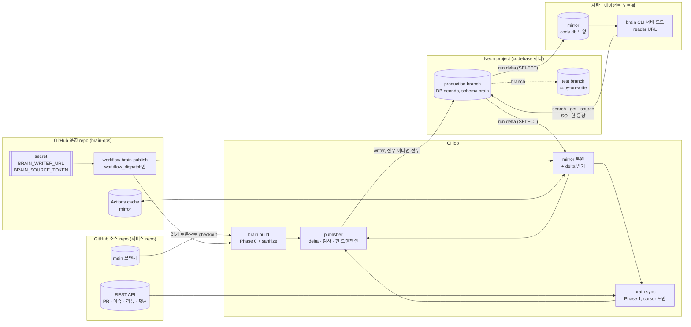
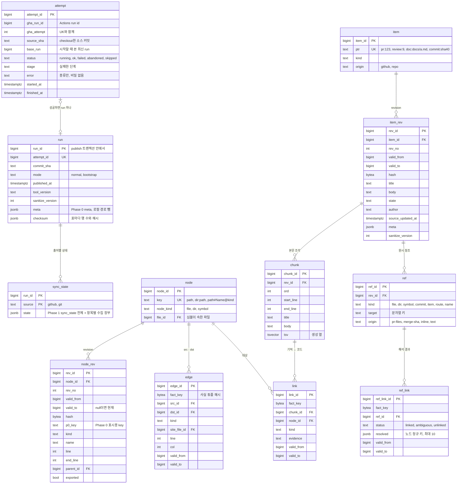
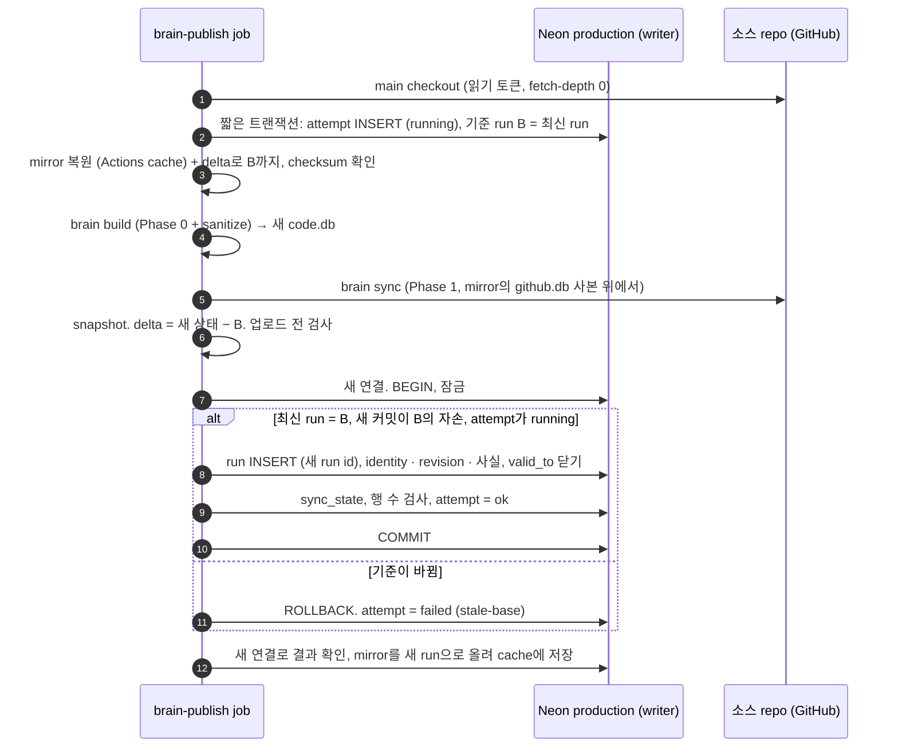
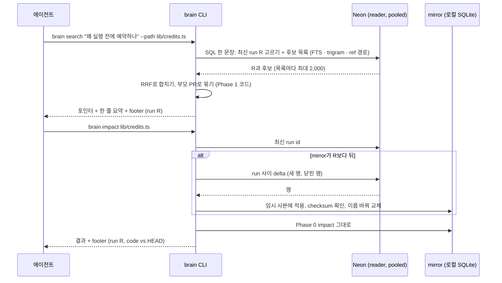
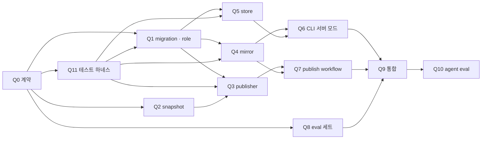

# Phase 2 설계: 팀이 같이 쓰는 brain (Neon Postgres, 쓰기는 CI 한 곳)

- 상태: 설계 리뷰용 (코드 없음) · Codex(gpt-6.1-sol, xhigh) 리뷰 반영
- 날짜: 2026-11-16
- 대상: Phase 1 설계(`docs/phase1-design.md`, GitHub 기억 + 3단계 읽기) 위에 쌓는다
- 외부 의존 추가: Neon(관리형 Postgres) 1개, npm `pg`(node-postgres) 1개

---

## 0. TL;DR

- **문제.** Phase 1까지 brain은 사람마다 로컬 SQLite다. 각자 `brain build`와 첫 `brain sync`를 돌려야 하고, 각자 GitHub 토큰이 필요하다. 서비스 repo(비공개, PR 약 1,300개)는 첫 sync만 약 2,700번 호출한다. 사본마다 시점이 달라서 같은 질문에 사람마다 다른 답이 나온다.
- **Phase 2가 하는 일.** brain의 진실을 Neon Postgres 하나로 옮긴다. 쓰기는 CI 한 곳만 한다. 사람이 수동으로 돌리는 workflow(`workflow_dispatch`)다. 사람과 에이전트는 SELECT만 되는 reader 연결로 같은 내용을 읽는다.
- **데이터 모델.** 파일·심볼·기억 항목마다 빌드가 바뀌어도 그대로인 id가 있다. 간선·링크·참조는 그 id를 가리킨다. 내용은 **revision 행을 쌓기만** 하고 덮어쓰지 않는다. 버전은 성공한 publish(run) 하나다. 기본 검색은 최신 run만 본다. `--as-of run:42 | commit:<sha> | <날짜>`를 주면 그때를 본다.
- **읽는 길 둘.** 기억 검색(`search` · `get` · `source`)은 서버에서 SQL 한 문장으로 끝낸다. 지도 명령(`impact` 등)은 노트북의 **mirror**(run 하나의 SQLite 사본)에서 Phase 0 코드로 돈다. mirror는 처음 한 번 전부 받고, 그 뒤에는 run 사이에 바뀐 행만 받는다. Neon Free의 월 5 GB 전송 한도 때문이다.
- **안전.** writer 비밀은 CI secret에만 있다. reader role은 DB가 쓰기를 거부한다. 마스킹과 인젝션 표시(Phase 1 §6.4–6.5)는 CI 안에서 업로드 전에 끝나고, 올리기 직전에 한 번 더 검사한다.

---

## 1. 왜 이 phase가 필요한가

### 1.1 로컬 brain의 비용

| 비용 | Phase 1 (사람마다 로컬) | 근거 |
|---|---|---|
| 준비 시간 | 사람마다 `brain build`(서비스 repo 노트북 기준 56초) + 첫 `brain sync`(약 2,700 호출, rate limit에 따라 수십 분) | 서비스 repo로 잰 값: 파일 4,648개, 노드 2.8만, 간선 16만, 청크 5,057개, `code.db` 61.5 MB |
| 토큰 | 사람마다 GitHub 토큰을 노트북에 둔다. 읽기만 필요한데 실제로는 쓰기 권한이 있는 토큰을 쓰게 된다 | Phase 1 §4 가정(`GH_TOKEN` · `gh auth token`) |
| 사본 불일치 | cursor와 빌드 커밋이 사람마다 다르다. 같은 질문에 A의 brain은 PR을 찾고 B의 brain은 못 찾는다. "누구 brain이 맞나"를 알 수 없다 | Phase 1 cursor는 로컬 `github.db`의 `sync_state` |
| 배달 | 새 팀원이나 새 노트북은 처음부터 다시 만든다. 파일을 건네면 파일마다 시점이 또 다르다 | |
| 이력 없음 | `code.db`는 빌드마다 지우고 다시 만든다(`createDb`가 파일을 지움). `github.db`는 upsert로 덮어쓴다. "지난주에는 이 문서가 뭐라고 했나"에 답할 수 없다 | `src/db.mjs` `createDb`, Phase 1 R6 |

### 1.2 왜 지금인가

Phase 0의 로컬 빌드는 1분 안쪽이라 사람마다 돌려도 견딜 만했다. Phase 1이 GitHub 기억을 더하면서 사람마다 토큰과 긴 첫 sync가 필요해졌다. 팀이 brain을 같이 쓰려면 지금 한 곳으로 모아야 한다. 그래야 Phase 3에서 그 한 곳을 자동으로 갱신할 수 있다.

### 1.3 왜 서버 DB인가

| 대안 | 무엇이 남나 | 판단 |
|---|---|---|
| CI가 SQLite 파일을 만들어 artifact나 release로 배포 | 여전히 사람마다 파일 전체를 받는다. 파일을 통째로 바꾸므로 revision 이력이 없다. 권한은 파일을 받느냐 마느냐뿐이다. artifact 저장 용량은 GitHub 플랜 한도에 걸린다 | 버림. Neon을 못 쓰게 되면 이 안으로 물러난다 |
| 공유 드라이브에 SQLite 하나 | 여러 사람이 동시에 열면 잠금·손상 위험. 원격 파일 시스템에서 SQLite 잠금은 믿을 수 없다 | 버림 |
| **Postgres (Neon)** | 한 곳의 진실. DB 권한으로 쓰기를 막는다. revision 이력과 as-of 질의. Neon branch로 테스트를 production과 떼어 놓는다 | **택함** |

---

## 2. Impact와 성공 기준

| 영역 | Phase 1 (로컬) | Phase 2 이후 (팀 서버) |
|---|---|---|
| 처음 쓰기까지 | 각자 build + sync + 토큰 | reader URL 하나, 첫 지도 명령에서 mirror 한 번 받기 |
| 같은 질문, 같은 답 | 보장 없음 | 같은 run을 읽으면 같다. footer에 run id가 찍힌다 |
| 쓰기 | 누구나 자기 로컬 DB에 | CI만. 에이전트의 쓰기는 DB가 거부한다 |
| 이력 | 빌드·sync마다 덮어씀 | revision 누적. `--as-of`로 옛 내용 검색 |
| GitHub 토큰 | 사람마다 | CI 하나 |

**성공 기준 (구현 후 확인).** 모두 sandbox repo와 Neon test branch에서 잰다(§4).

1. 불변식 테스트 V1–V23(§7.1)가 전부 통과한다.
2. **지도 동등성.** 같은 커밋에서 로컬 빌드 `code.db`와 mirror로 `find` · `refs` · `impact` · `deps` · `why`를 돌린 `--json` 결과가 의미상 같다. 비교에서 빼는 것은 시간(`ms`)과 freshness 줄뿐이다(§7.2).
3. **기억 검색 동등성.** 같은 커밋·같은 cursor에서 서버 `search`가 로컬 `search`보다 정답 키 기준 hit@3이 낮지 않다. 바뀐 케이스는 모두 목록으로 낸다(§7.3).
4. **권한.** reader로 직접 SQL을 보내 시도한 쓰기·DDL·임시 표가 전부 거부된다. writer는 DDL과 `DELETE`가 거부된다. 에이전트 환경에는 writer 비밀이 없다.
5. **지연.** 서울 노트북에서 `search` p95 1.5초 이하(compute가 깨어 있을 때, 30회). 잠든 compute의 첫 질의 5초 이하(5회). 실측값을 보고한다.
6. **전송량.** full mirror와 run 하나의 delta를 바이트로 잰다. 팀 10명, 월 90 run 기준 예상 월 전송량이 Free 한도(5 GB)의 50% 이하다.
7. **agent eval.** skill-eval로 v2(로컬) 대 v3(서버)를 비교한다. A/A 쌍의 통과율 차이가 ±0.05 안일 때만 판정하고, v3 − v2의 95% CI 하한이 −0.10보다 크면 통과다.

---

## 3. 범위

**한다.**

- codebase마다 Neon project 하나. 그 기본 branch가 production이다.
- 스키마와 migration: 바뀌지 않는 id, revision, 유효 구간(`valid_from` · `valid_to`), 덮어쓰기 금지 trigger, role 셋.
- publisher(CI): CI가 새로 만든 SQLite(`code.db` + `github.db`)를 기준 run의 mirror와 비교해, 바뀐 행만 한 트랜잭션으로 쓴다.
- mirror: 서버의 run 하나를 SQLite 사본으로 받는다. 처음은 전부, 그 뒤는 delta만. CI는 mirror의 `github.db`로 Phase 1 sync를 그대로 돌리고, 노트북은 mirror의 `code.db`로 지도 명령을 돌린다.
- brain CLI 서버 모드와 `--as-of`.
- `brain-publish` workflow(수동)와 설치 문서.
- 실제 질문과 키워드로 만든 eval 세트와 실행.

**하지 않는다.**

- 자동 갱신(schedule, 스킬이 직접 dispatch). Phase 3에서 한다.
- 로컬에서 production에 publish하기. publish는 workflow로만 한다. 수동 갱신은 Run workflow 버튼이다.
- migration workflow. migration은 관리자가 owner URL로 직접 돌린다. 드물고, CI에 owner 비밀을 두지 않기 위해서다.
- 사람마다 계정, SSO, 팀별 행 수준 권한(RLS). 한 codebase 안에서는 모두 같은 것을 읽는다.
- 웹 UI, 임베딩, 여러 repo를 묶은 검색.
- 옛 revision 정리(retention). 지금 규모에서는 필요 없다(§6.9).
- vault(개인 Obsidian 노트). CI에는 vault가 없다. vault는 로컬 모드에서만 쓴다.
- Neon IP Allow. Scale 플랜에만 있다.

---

## 4. 요청 해석과 가정

음성 전사에서 뜻을 추정한 부분이다. 틀렸으면 리뷰에서 바로잡아 주세요.

| 요청 원문(전사) | 이 설계의 해석 |
|---|---|
| "팀이 같이 쓰는 체크브레인" | 팀이 같이 쓰는 brain. 서버 DB 하나를 모두가 읽는다 |
| "neon을 쓸 거야" | Neon 관리형 Postgres |
| "프로덕션 데이터베이스는 프로젝트 단위로 분리" | codebase마다 Neon project 하나. 그 기본 branch가 production. 다른 codebase와 DB·role·비밀을 나누지 않는다. 테스트는 같은 project 안의 Neon branch에서 한다 |
| "파일이랑 심볼에 유니크 id, 프라이머리 키 잘 디퍼런스" | 파일과 심볼에 빌드가 바뀌어도 그대로인 id를 준다. 간선·링크가 그 id를 외래 키로 가리킨다(reference) |
| "기억은 절대 덮어쓰지 말고 리디전으로" | 내용이 바뀌면 새 revision 행을 쓴다. 옛 행의 내용은 바꾸지 않는다 |
| "검색은 최신 버전만, 옛 버전은 버전을 지정해서" | 기본은 최신 run. `--as-of`로 run · 커밋 · 날짜를 지정한다 |
| "읽는 거는 선택만" | SELECT만 |
| "라이트는 ci 시크릿에만" | writer 연결 문자열은 GitHub Actions secret에만 둔다. 에이전트와 사람의 노트북에는 없다 |
| "빌드는 한 곳, ci 수동 실행으로만" | `workflow_dispatch`만 쓴다. 로컬 `brain build`는 로컬 모드에서만 쓴다 |
| "실제 질문이랑 키워드로 이벨" | 팀이 실제로 한 질문과 코드·PR에서 뽑은 키워드로 케이스를 만든다(§7.3) |

가정과 확인한 사실:

- **Neon project.** 사용자의 Neon project를 production으로 쓴다(Free 플랜, `aws-us-west-2`). 2026-11-16 그 project에서 직접 확인했다: PostgreSQL 18.7, 기본 branch 이름 `production`, DB `neondb`, collation · ctype `C.UTF-8`(builtin provider), 기본값 `statement_timeout = 0` · `idle_in_transaction_session_timeout = 5min` · `lock_timeout = 0`. `pg_trgm` 1.6은 쓸 수 있고 아직 설치되지 않았다.
- **한국어 trigram.** 같은 locale(`C.UTF-8`, builtin)의 다른 Neon project(PostgreSQL 17.12)에서 확인했다(2026-11-16): `show_trgm('크레딧 예약')`이 trigram 7개, `similarity('실행 전에 크레딧을 예약', '크레딧 예약') = 0.4`, `ILIKE '%크레딧%'`이 맞는다. `to_tsvector('simple', …)`는 한국어를 공백으로만 자른다(`크레딧을`이 한 토큰). 그래서 한국어는 trigram이 맡는다. production에는 확장 설치 뒤 V14로 다시 확인한다.
- **Free 한도.** project당 저장 1 GB, 월 100 CU-hour, branch 10개, 공개망 전송 월 5 GB. 전송 한도를 넘으면 다음 결제 주기까지 compute가 멈춘다. compute는 5분 쉬면 잠들고 끌 수 없다([Neon plans](https://neon.com/docs/introduction/plans)).
- **비밀 위치.** 연결 문자열은 저장소에 넣지 않는다. 노트북은 brain 자기 디렉터리의 `.env.local`(0600, gitignore. `neon init`이 쓰는 파일)이나 환경 변수에서 읽는다. CI는 Actions secret에서 읽는다. Neon API 키는 `~/.config/neon/`에 둔다.
- 규모: 지도 행 약 19만(노드 2.8만 + 간선 16만), 청크 5천, 링크 2.3만, 청크 본문 5.5 MB, PR·리뷰·댓글 수만 행.
- 팀은 20명 이하다. reader 연결 수는 적다.
- **서비스 repo는 이번 구현에서 건드리지 않는다**(2026-11-16 결정). 그래서 workflow는 운영 repo 방식을 기본으로 만든다. 운영 repo(brain-ops)의 workflow가 서비스 repo `main`을 읽기 토큰으로 checkout하고 수집한다. writer 비밀은 운영 repo에만 있다. 서비스 repo 관리자가 직접 설치하는 방식은 문서로만 둔다. 구현 검증은 사용자 소유의 sandbox repo 두 개(소스 역할 · 운영 역할)와 Neon test branch로 한다. 서비스 repo 데이터를 production에 처음 publish하는 일은 읽기 토큰을 정한 뒤다(§9).

---

## 5. High-level design

### 5.1 그림



### 5.2 구성 요소

| 구성 요소 | 책임 | 새로 / 바뀜 |
|---|---|---|
| Neon project | codebase 하나의 production DB. role 셋(owner · writer · reader). 테스트용 branch | 새로 |
| 스키마 (`sql/*.sql`) | identity 표, revision 표, 유효 구간 표, `attempt` · `run` · `sync_state` · `binding`, 덮어쓰기 금지 trigger, 검색 색인 | 새로 |
| migration (`src/pg/migrate.mjs`) | 관리자가 owner URL로 돌린다. 번호 붙은 SQL 파일을 한 번씩 | 새로 |
| `brain-publish` workflow | 소스 `main` checkout → mirror → build → sync → publish. writer 비밀. 수동 | 새로 |
| snapshot (`src/pg/snapshot.mjs`) | SQLite 두 파일을 정규 키·사실 키·내용 해시가 붙은 행 집합으로 바꾼다. delta 계산, checksum, 업로드 전 검사 | 새로 |
| publisher (`src/pg/publish.mjs`) | attempt 시작·실패·결과 확인, delta를 한 트랜잭션으로 쓰기 | 새로 |
| mirror (`src/pg/mirror.mjs`) | run R을 SQLite 사본으로 받기. 처음은 전부, 그 뒤는 delta. checksum 확인, 원자적 교체 | 새로 |
| store (`src/store/pg.mjs`, `src/store/sqlite.mjs`) | Phase 1 읽기 코드가 부르는 async 저장소 인터페이스. SQLite 구현과 Postgres 구현 | 새로 (Phase 1 `read.mjs`는 store를 부르게 바뀜) |
| CLI | 서버 모드 선택, `--as-of`, mirror 관리, footer에 run 표시. Phase 0 지도 명령은 mirror 위에서 **코드 그대로** 돈다 | 바뀜 |
| eval suite | 실제 질문 + 키워드 케이스, 정답 키, 사전 등록 | 새로 |

### 5.3 핵심 결정

| 결정 | 이유 | 버린 대안 |
|---|---|---|
| codebase마다 Neon project 하나 | project가 Neon에서 role · 비밀 · 용량 · 전송량 · 과금이 갈리는 단위다. 한 codebase의 사고가 다른 codebase로 번지지 않는다 | 한 project에 codebase마다 DB: role과 전송 한도가 project 전체에 걸린다 |
| 노드 identity는 **정규 키**: 파일 `path`, 디렉터리 `dir:path`, 심볼 `path#Name@kind`(kind를 늘 붙임). `Name`은 Phase 0의 `keyName`이다: 클래스 멤버는 `클래스.멤버`(`f#A.run@method`, `f#B.run@method`) | Phase 0 `nodes.key`는 이름이 겹칠 때만 `@kind`를 붙이고, 먼저 나온 선언이 접미사 없는 키를 가진다(`src/index-ts.mjs` `add`). `const Plan`과 `type Plan`의 순서만 바뀌어도 `file#Plan`의 주인이 바뀐다. Phase 0에서 (파일, `keyName`, kind)는 한 노드로 합쳐지므로 정규 키는 유일하다 | Phase 0 key 그대로: 순서에 따라 바뀐다. Phase 0 정수 id: 빌드마다 바뀐다 |
| 파일 이름이 바뀌면 새 identity | git rename 추적은 추측이 섞인다. 옛 경로의 기억은 옛 identity에 남고 as-of로 찾는다 | rename 추적(`git log --follow`) |
| 내용은 revision 행으로만 쌓는다. 옛 행은 `valid_to`를 한 번 닫는 것 말고는 바꾸지 않는다 | 요구사항. 옛 포인터(`pr:1121@r2`)가 영원히 같은 글을 가리킨다. Phase 1의 build id 포인터 거부 규칙이 필요 없어진다 | head 포인터 표(현재 revision을 가리키는 표를 따로 갱신): 쓰기가 두 번이고, as-of에는 어차피 유효 구간이 필요하다 |
| 버전 = run. run 행은 publish 트랜잭션 안에서만, 잠금을 쥔 채로 만든다. 실행 기록은 `attempt` 표에 따로 둔다 | run id가 커밋 순서대로 커진다. 그래서 유효 구간을 run id로 비교할 수 있다. 실패한 실행은 run을 남기지 않는다 | 시작할 때 run 행을 만들기: 늦게 시작한 실행이 먼저 커밋하면 id 순서와 커밋 순서가 어긋난다 |
| 차이는 CI에서 계산하고, 트랜잭션에는 delta만 넣는다 | 기준 run의 mirror가 CI에 있다. 트랜잭션이 짧다 | 서버 쪽 staging 표 + 집합 연산: 행 19만 개를 매번 보낸다 |
| 경쟁은 잠금 + 기준 run 확인 + 커밋 순서 확인으로 막는다 | 트랜잭션 안에서 최신 run이 기준 run B이고, 새 커밋이 B 커밋의 자손이어야 쓴다. 아니면 쓰지 않고 끝낸다 | 긴 잠금: 빌드하는 몇 분 동안 잠금을 쥔다 |
| 서버가 진실이다. CI와 노트북은 **mirror**로 run을 따라간다. mirror는 처음 한 번 전부, 그 뒤 delta만 받는다 | 전송량. full mirror는 약 25 MB(서비스 repo 행 크기로 어림), delta는 run당 1 MB 안쪽이다. Free 전송 한도는 월 5 GB다. CI의 Actions cache는 속도용일 뿐, 없으면 서버에서 다시 받는다 | run마다 전체 export: 팀 10명 × 월 90 run × 25 MB = 22 GB. CI가 artifact로 SQLite 배포: 이력 · 권한이 없다(§1.3) |
| 지도 명령(`find` · `refs` · `impact` · `why` …)은 mirror에서 Phase 0 코드로 | Phase 0 `impact`는 BFS를 돌며 노드마다 SQL을 한 번씩 부른다(`src/query.mjs` `impact`). 서버에 직접 하면 서울–오리건 왕복(약 130 ms)이 수백 번이다 | 지도 질의를 Postgres로 옮기기: 동작이 달라질 위험, 질의를 다시 짠다 |
| 기억 검색(`search` · `get` · `source`)은 서버에서, 명령마다 SQL 한 문장 | 한 문장은 스냅숏 하나를 본다. 그래서 run을 고르는 일과 후보 목록이 섞이지 않는다([PostgreSQL isolation](https://www.postgresql.org/docs/current/transaction-iso.html)). 왕복도 한 번이다 | 문장 여러 개를 READ COMMITTED로: 문장마다 다른 run을 볼 수 있다 |
| 순위는 Phase 1처럼 RRF를 클라이언트에서 합친다. 목록마다 후보는 SQL에서 뽑는다 | Postgres `ts_rank`는 BM25와 다르다. 합치는 단계를 같은 코드로 두면 차이가 후보 목록에만 남고 eval로 잰다 | Postgres 쪽 순위 함수 하나로 끝내기 |
| 한국어는 `pg_trgm` | Neon에 `pg_trgm` 1.6은 있고 `pg_bigm` · `pgroonga`는 없다([Neon extensions](https://neon.com/docs/extensions/pg-extensions), 2026-11-16 project에서 확인). 한국어 trigram 동작은 같은 locale에서 확인했다(§4) | `pg_bigm`: Neon에 없다. ICU locale DB: builtin `C.UTF-8`에서 이미 동작해서 필요 없다 |
| 연결은 `pg` TCP 5432, `sslmode=require`. writer는 direct endpoint, reader는 pooled endpoint | Neon pooler는 PgBouncer transaction 모드라 `SET`, session 잠금, 트랜잭션을 넘는 임시 표를 못 쓴다([Neon pooling](https://neon.com/docs/connect/connection-pooling)). reader는 문장 하나라 pooler로 충분하다 | Neon serverless driver(HTTP/WebSocket): 회사망에서 5432가 막힐 때의 대안으로만 남긴다(§9) |
| 운영 repo 방식이 기본 | 서비스 repo를 건드리지 않는다(§4). writer 비밀을 운영 repo에만 두면, 서비스 repo에 쓸 수 있는 사람이나 에이전트가 브랜치 workflow로 비밀을 꺼내지 못한다 | 서비스 repo에 직접 설치: 비공개 repo에서 environment secret은 GitHub Pro · Team · Enterprise에서만 쓴다([GitHub environments](https://docs.github.com/en/actions/reference/workflows-and-actions/deployments-and-environments)) |

---

## 6. Low-level design

### 6.1 저장소



그림에서 `binding`(소스 repo id · 이름, 운영 repo, workflow 파일. 한 행, 한 번만 쓴다)과 `unresolved`(Phase 0 `unresolved`와 같은 열 + `fact_key` + 유효 구간)는 뺐다.

**표의 세 모양.**

| 모양 | 표 | 쓰기 규칙 |
|---|---|---|
| identity | `node`, `item`, `binding` | 한 번 쓰면 바뀌지 않는다. 사라졌다 다시 나타나면 같은 identity를 다시 쓴다 |
| revision | `node_rev`, `item_rev` | 내용 해시가 다를 때만 새 행. `rev_no`는 그 identity의 전체 이력에서 다음 번호. 딸린 `chunk` · `ref`는 revision과 함께 쓰고 바꾸지 않는다 |
| 유효 구간 사실 | `edge`, `unresolved`, `link`, `ref_link` | 행 하나가 사실 하나. 사실이 사라지면 `valid_to`를 닫고, 다시 생기면 새 행 |
| 기록 | `run`, `sync_state` | publish 트랜잭션에서 넣기만 한다 |
| 실행 기록 | `attempt` | `status`가 `running`에서 끝 상태로 한 번만 바뀐다 |

**보이는 행.**

- run R 시점: `valid_from <= R AND (valid_to IS NULL OR valid_to > R)`. `chunk` · `ref`는 자기 revision이 보이면 보인다.
- 최신: 위 식에 R = 최신 run을 넣는다. 한 문장 안에서 최신 run을 고르고 그 R로 거른다. 그래서 문장 도중에 publish가 끝나도 섞이지 않는다.
- run id는 publish 잠금을 쥔 채로 매기므로 커밋 순서대로 커진다. 구간은 run id로 비교해도 된다.

**포인터.** Phase 1 문법을 그대로 쓰고 revision 접미사를 더한다.

| 포인터 | 뜻 |
|---|---|
| `pr:1121` | 그 항목의 최신 revision (`--as-of`가 있으면 그 시점의 revision) |
| `pr:1121@r2` | 그 항목의 2번째 revision. 영원히 같은 글 |
| `doc:docs/billing.md:12-31@r3` | 그 문서 3번째 revision의 12–31줄 청크. Phase 1의 `@<build_id>`를 대신한다 |
| `commit:6b820f87` | 커밋. 내용이 바뀌지 않으므로 revision이 하나다 |

**제약과 색인.**

- 유일: `node(key)`, `item(ptr)`, `node_rev(node_id, rev_no)`, `item_rev(item_id, rev_no)`, `attempt(gha_run_id, gha_attempt)`, `run(attempt_id)`.
- 현재 행은 하나뿐: `node_rev(node_id)`, `item_rev(item_id)`, 사실 표의 `(fact_key)`에 `WHERE valid_to IS NULL` 유일 partial index.
- `CHECK (valid_to IS NULL OR valid_to > valid_from)`. 옛 구간끼리 겹칠 수 없다. 새 행의 `valid_from`은 늘 지금 publish의 run id(지금까지 가장 큰 값)이고, 닫을 수 있는 행은 현재 행뿐이기 때문이다. 별도 배제 제약(`btree_gist`)은 두지 않는다.
- `ref_link.resolved`는 표시용 증거라 외래 키가 아니다. 노드 정규 키 문자열로 둔다.
- 검색: `chunk.tsv`와 `item_rev` 제목에 GIN, `chunk.body`에 `gin_trgm_ops` GIN. 현재 행 전용 색인은 따로 두지 않는다. 청크 5천 개 규모라 재 보고 필요할 때 더한다.
- 조회: `edge(dst_id, kind) WHERE valid_to IS NULL`, `edge(src_id, kind) WHERE valid_to IS NULL`, `ref(target)`, `ref(rev_id)`, `link(node_id)`.

**`tsv`.** `setweight(to_tsvector('english', title), 'A') || setweight(to_tsvector('english', body), 'B')`. Phase 0 FTS의 porter 어간 처리와 가장 가깝다. 한국어는 trigram 색인이 맡는다(§4).

### 6.2 role과 비밀

| role | 만드는 곳 | 권한 | 비밀을 아는 곳 |
|---|---|---|---|
| `neondb_owner` | Neon이 만든 기본 role (`neon_superuser`) | DDL, migration, 비상시 정리 | 관리자 1–2명의 `.env.local`(`neon init`이 쓴 것)이나 `~/.config/neon/` |
| `brain_writer` | SQL (`CREATE ROLE … LOGIN`) | schema `brain` `USAGE`. 표 `SELECT` · `INSERT`. revision·사실 표는 `UPDATE (valid_to)`만, `attempt`는 `UPDATE (status, stage, error, finished_at)`만. sequence `USAGE`. `DELETE` · `TRUNCATE` · DDL · `TEMPORARY` 없음 | 운영 repo의 Actions secret `BRAIN_WRITER_URL`(direct endpoint)만 |
| `brain_reader` | SQL | `CONNECT`, schema `brain` `USAGE`, 표 `SELECT`. 기본값 `default_transaction_read_only = on`, `statement_timeout = 15s` | 팀 비밀 저장소. 노트북은 brain 디렉터리의 `.env.local`이나 환경 변수 |

- SQL로 만든 role은 `neon_superuser`에 들어가지 않고, 권한을 명시적으로 줘야 한다([Neon roles](https://neon.com/docs/manage/roles)). 그래서 writer와 reader는 SQL로 만든다.
- PUBLIC에서 걷어 낸다: `REVOKE ALL ON SCHEMA brain FROM PUBLIC`, `REVOKE CREATE ON SCHEMA public FROM PUBLIC`, `REVOKE CREATE, TEMPORARY ON DATABASE neondb FROM PUBLIC`. 기본값으로는 PUBLIC에 `TEMPORARY`가 있어서, reader가 읽기 전용을 끄면 임시 표를 만들 수 있다([PostgreSQL privileges](https://www.postgresql.org/docs/current/ddl-priv.html)). 앞으로 만들 표에도 같은 권한이 가도록 `ALTER DEFAULT PRIVILEGES`를 쓴다.
- `default_transaction_read_only`는 세션이 끌 수 있다([PostgreSQL SET TRANSACTION](https://www.postgresql.org/docs/current/sql-set-transaction.html)). 막는 장치는 GRANT다. 읽기 전용 기본값은 실수를 줄이는 보조 장치다.
- **변수 이름 (읽는 쪽은 reader만).** brain CLI의 서버 모드는 `BRAIN_READER_URL` 하나만 읽는다: 환경 변수, 없으면 brain 자기 디렉터리의 `.env.local`에 있는 같은 이름. `DATABASE_URL` · `DATABASE_URL_UNPOOLED`(`neon init`이 쓰는 owner URL)는 **어디서도 읽지 않는다.** 관리자 노트북의 `.env.local`에 owner URL이 있어도 에이전트가 그 권한을 얻지 못한다. 연결한 뒤 첫 문장에서 `current_user = 'brain_reader'`이고 `has_table_privilege(current_user, 'brain.run', 'INSERT')`가 거짓인지 확인하고, 아니면 연결을 끊고 거부한다(exit 2, "reader 계정이 아닙니다"). 이어서 `brain.binding`의 소스 repo가 지금 checkout의 `origin`과 같은지 확인하고, 다르면 거부한다.
- writer URL은 `ci-publish`만 `BRAIN_WRITER_URL`에서 읽는다. owner URL은 `migrate`만 명령행 인자로 받는다. 세 이름이 겹치지 않으므로 한 변수로 권한이 새지 않는다(V2에 "owner URL이 든 `.env.local`에서 서버 모드" 시나리오를 더한다).
- reader 비밀이 새면: 누구든 brain을 읽을 수 있다(마스킹된 글과 지도). 쓰지는 못한다. `ALTER ROLE brain_reader PASSWORD …`로 바꾸고 팀에 새 URL을 돌린다. IP 제한은 Scale 플랜에만 있다.
- writer 비밀의 경계: 운영 repo에 push할 수 있는 사람은 workflow를 고쳐 secret을 꺼낼 수 있다. 그래서 운영 repo의 쓰기 권한은 관리자만 갖는다. 서비스 repo에 쓰기 권한이 있는 사람과 에이전트는 운영 repo에 push할 수 없다.
- fork에서 온 workflow에는 기본값으로 `GITHUB_TOKEN` 말고는 secret이 넘어가지 않는다([GitHub secrets](https://docs.github.com/en/actions/how-tos/write-workflows/choose-what-workflows-do/use-secrets)). 비공개 repo에는 fork PR에 secret을 보내는 설정이 있다([GitHub Actions settings](https://docs.github.com/en/repositories/managing-your-repositorys-settings-and-features/enabling-features-for-your-repository/managing-github-actions-settings-for-a-repository)). 운영 repo에서는 그 설정을 끄고, `brain-publish`는 `pull_request` · `pull_request_target`으로 돌지 않는다.

**덮어쓰기 금지 trigger.**

- revision·사실·기록 표에 `BEFORE UPDATE OR DELETE`: `DELETE`는 거부한다. `UPDATE`는 `OLD.valid_to IS NULL`이고 `NEW.valid_to IS NOT NULL`이며 나머지 열이 모두 같을 때만 허용한다. `run` · `sync_state` · identity 표는 `UPDATE`도 거부한다.
- `attempt`: `OLD.status = 'running'`일 때만 끝 상태로 바꿀 수 있다. `ok`는 publish 트랜잭션 안에서만 된다(같은 트랜잭션이 `run` 행을 넣었을 때).
- column 단위 GRANT와 겹치는 이중 장치다. owner의 실수도 막는다. 정리(retention)를 하게 되면 owner가 trigger를 잠시 끄는 migration으로만 한다.

### 6.3 publish (CI, 한 트랜잭션)



**규칙.**

| # | 규칙 | 근거 |
|---|---|---|
| R1 | workflow 파일에 소스 repo(`owner/name`)를 적는다. 입력으로 받지 않는다. 시작할 때 소스 repo id가 `brain.binding`과 같은지 본다. 다르면 쓰지 않는다 | 설정이 틀린 publisher가 다른 repo의 `pr:N`을 같은 identity에 섞지 않게 |
| R2 | 시작할 때 짧은 트랜잭션 하나로 `attempt`(running, Actions run id · attempt 번호, 소스 커밋)를 쓰고 기준 run B를 읽는다. 연결은 닫는다 | 빌드·sync 동안 연결을 쥐지 않는다. 같은 Actions attempt가 두 번 오면 유일 제약이 막는다 |
| R3 | 기준 상태 = B의 mirror. Actions cache에 있으면 그것을 B까지 delta로 올리고, 없으면 서버에서 전부 받는다. 어느 쪽이든 checksum이 `run[B].checksum`과 같아야 한다 | CI는 디스크가 없어도 증분이 된다. Phase 1 sync가 mirror의 `github.db`에서 그대로 돈다 |
| R4 | 지도와 repo 기억(문서 · `changes/` · CHANGELOG · 커밋 메시지)은 매번 checkout에서 전부 다시 만든다(Phase 0 build) | 빌드는 1분 안쪽이다. 증분 빌드의 버그 위험을 지지 않는다 |
| R5 | 정규 키: 노드 = §5.3의 정규 키. 사실 키 = sha256(정규 튜플). 간선 = (src 키, dst 키, kind, site 경로, line, col). 링크 = (청크 키, 노드 키, kind, evidence). ref_link = (항목 ptr, rev_no, ref 순번, status, resolved). 청크 키 = (ptr, rev_no, ord). 항목 = `ptr`. snapshot은 같은 튜플을 하나로 합친다 | 정수 id 없이 두 상태를 비교한다. Phase 0 `edges`에는 유일 제약이 없다(`src/db.mjs`) |
| R6 | 내용 해시 = sha256(정해 둔 열의 정규화 JSON). 노드: kind · name · line · end_line · parent 키 · exported · lang · flags · Phase 0 key. 항목: 정리된 제목 · 본문 · 상태 · 작성자 · 메타 · `sanitize_version` · 청크 목록 · ref 목록. 관측 시각(`fetched_at`), 수집 장부(`detail_for` · `reviews_at`)는 넣지 않는다. 열 목록은 Q0에서 고정한다 | 같은 내용이면 같은 해시. 다시 돌려도 새 revision이 생기지 않는다(멱등) |
| R7 | snapshot에 범위 표(manifest)를 붙인다: 지도 · repo 문서 = `full`, 커밋 = `append`, GitHub = `incremental` 또는 `full`. `full` 범위에서 사라진 키는 현재 행을 닫는다. `append` · `incremental`에서는 안 보인다고 닫지 않는다. 다시 나타난 키는 같은 identity에 새 revision | 증분 sync는 삭제를 모른다. Phase 1 §10 삭제 규칙(삭제는 `--full`에서만) 유지 |
| R8 | 커밋 항목과 그 청크는 닫지 않는다. Phase 0은 최근 커밋 5,000개만 색인하므로 목록에서 빠져도 사라진 것이 아니다. 커밋 청크의 `link`는 대상 노드가 닫힐 때만 닫는다 | 기억이 이유 없이 지워지지 않게. mirror에는 남은 커밋이 모두 있다 |
| R9 | 쓰기 트랜잭션: 연결 옵션 `transaction_timeout=60s`(PostgreSQL 17 이상) → `BEGIN` → `SET LOCAL statement_timeout = '30s'`, `lock_timeout = '15s'` → `pg_advisory_xact_lock(<publish 키>)` → 확인 셋(최신 run = B, 새 커밋이 B 커밋의 자손 또는 같음, 내 attempt가 `running`) → `run` INSERT → delta → `sync_state` → 현재 행 수 = checksum의 행 수 → `attempt = ok` → `COMMIT` | 지도 · 기억 · cursor가 같이 들어가거나 같이 안 들어간다. 잠금은 트랜잭션이 끝나면 저절로 풀린다. 예외 하나: bootstrap(Phase 3, 관리자가 게이트를 연 실행)은 force-push 복구를 위해 자손 확인만 건너뛰고 `run.mode = bootstrap`을 남긴다. 잠금과 "최신 run = B"는 그대로다 |
| R10 | 확인 셋 중 하나라도 틀리면 `ROLLBACK`하고 attempt를 `failed (stale-base)`로 끝낸다. 다시 돌지 않는다. 다음 실행이 새 기준으로 한다 | publish는 workflow 하나뿐이고 concurrency로 줄을 선다. 이 경우는 드물다. 재시도가 옛 checkout을 새 run 위에 쓰는 일을 막는다 |
| R11 | 실패 기록: 새 연결에서 `BEGIN` → 같은 잠금 → `UPDATE attempt SET status = 'failed' … WHERE attempt_id = $1 AND status = 'running'` → `COMMIT`. `error`에는 단계와 종류만 쓴다 | 잠금을 쥐면 원래 트랜잭션은 끝난 것이다. `ok`를 `failed`로 덮지 않는다 |
| R12 | `COMMIT` 응답을 못 받으면: 새 연결에서 같은 잠금을 쥔 뒤(`lock_timeout = 60s`) `run`에 내 attempt가 있는지 본다. 있으면 성공이다. 없으면 롤백된 것이고 R11로 간다. 잠금을 못 쥐면 결과를 "모름"으로 남기고 job을 실패로 끝낸다. 다시 쓰지 않는다 | 원래 트랜잭션은 끝날 때까지 잠금을 쥔다. 잠금 없이 상태를 읽으면 커밋 중인 트랜잭션을 롤백으로 오판한다 |
| R13 | 첫 publish(서버가 빈 상태)는 행이 19만 개 넘게 들어간다. 1만 행 묶음으로 같은 트랜잭션 안에서 쓰고, 이때만 `transaction_timeout`을 10분으로 둔다 | 평소 delta는 수천 행 이하라 수 초 안에 끝난다 |
| R14 | migration이 `CREATE EXTENSION pg_trgm`을 하고, V14(한국어 trigram)를 production branch에서 바로 돌린다 | 확인은 같은 locale의 다른 project에서 했다(§4). production에서 한 번 더 본다 |
| R15 | sanitize 규칙이 바뀌면(`sanitize_version` 증가) 다음 publish는 `--full`이어야 한다(GitHub 전부 다시 받아 다시 정리). 이번 빌드가 다시 만들지 않는 현재 revision(빌드 창 5,000개 밖의 커밋 청크 등)은 CI가 mirror에서 읽어 새 규칙으로 다시 정리하고 새 revision으로 쓴다. 그래서 `--full` 뒤 현재 revision은 모두 새 `sanitize_version`이다(V20이 확인). 해시에 버전이 들어가므로 글이 있는 revision은 모두 새로 생긴다. 옛 revision은 그대로다. 옛 규칙이 놓친 비밀이 옛 revision에 있으면 owner가 그 행만 지우는 비상 migration을 쓴다(trigger를 잠시 끔) | "덮어쓰지 않음"과 "새 비밀은 지워야 함"이 부딪히는 유일한 곳. 비상 절차로만 연다 |
| R16 | 업로드 전 검사: delta의 모든 문자열(키 · 경로 · import 문자열 · 메타 · 오류)에 Phase 1 비밀 탐지를 돌린다. 하나라도 걸리면 쓰지 않고 실패한다. 키는 마스킹하지 않는다(참조가 깨진다). meta의 로컬 경로(`repo`, 작업 트리)는 빼고 올린다 | Phase 1의 마스킹은 글 본문만 본다. Phase 0은 경로와 import 문자열을 그대로 저장한다 |

**호출·시간 추정 (서비스 repo).**

| 단계 | 크기 | 시간 추정 |
|---|---|---|
| mirror (cache 있음, delta) | 1 MB 안쪽 | 수 초 |
| mirror (cache 없음, 전부) | 약 25–50 MB (`github.db` 포함) | 10–30초 |
| `brain build` | 파일 4,648개 | 노트북 56초, CI 러너 2분 안쪽 |
| `brain sync` (증분) | 약 80 호출 | 1분 안쪽 |
| delta 쓰기 | 평소 수백–수천 행 | 수 초 |

### 6.4 읽기 (서버 모드)



| 명령 | 어디서 | 메모 |
|---|---|---|
| `search` · `get` · `source` | 서버, 명령마다 SQL 한 문장 | 최신 run 기본. `--as-of`. Phase 1 렌더러·봉투·footer 재사용 |
| `find` · `refs` · `callers` · `impact` · `deps` · `shared` · `why` · `viz` | mirror | Phase 0 코드를 바꾸지 않는다 |
| `status` | 서버 + mirror | 최신 run, 마지막 attempt(실패 · running), mirror run, 이번 달 mirror로 받은 바이트 |
| `build` · `sync` | 로컬 모드에서만 | 서버 모드에서 부르면 "서버 모드에서는 CI만 씁니다" 오류 |

- 서버 모드 선택: brain 연결 변수(§6.2)가 있으면 서버 모드, `--local`이면 로컬 모드. 둘 다 없으면 Phase 1과 같다.
- store: Phase 1 `read.mjs`는 열린 SQLite 둘(`ctx = { code, gh, meta, sync, … }`, `src/context.mjs`)을 받는다. Phase 2는 이것을 async store 인터페이스(`candidates`, `get`, `thread`, `refs`, `source`, `resolveAsOf`)로 바꾸고, SQLite 구현과 Postgres 구현을 둔다. 렌더링 · 봉투 · footer는 store 밖에 그대로 둔다.
- **한 명령 = 한 스냅숏의 사실.** store의 모든 결과는 `{ rows…, view: { run, runCommit, publishedAt, sync, codeSanitizeVersion, githubSanitizeVersion } }`를 함께 낸다. Postgres 구현은 이 `view`를 결과 행과 **같은 SQL 문장**에서 읽는다(CTE). footer(`answer.freshness`)와 가드(`answer.guard`)는 `ctx.meta` · `ctx.sync` 대신 이 `view`를 쓴다. 그래서 `--as-of`의 footer와 가드가 고른 run과 어긋나지 않는다.
- `--as-of run:42 | commit:<sha> | 2026-11-01`: 커밋은 그 커밋을 publish한 최신 run, 날짜는 그 날 끝(UTC, `+09:00`처럼 오프셋을 붙이면 그 시간대)까지 publish된 최신 run으로 바꾼다. 못 찾으면 오류.
- 지도 명령에 `--as-of`를 주면 그 run의 mirror를 따로 전부 받는다(한 번에 약 25 MB). mirror는 최신 하나와 as-of 하나까지만 남긴다.
- mirror meta에는 run id, run 커밋, checksum이 있다. freshness(Phase 0 `freshness`)는 run 커밋과 지금 checkout의 HEAD를 비교한다. 로컬 작업 트리 비교는 지금 checkout 기준이다.
- footer(Phase 1 §6.8)에 run을 더한다: `brain data: run 42 @9f3c2e1a (published 3h ago)`.

### 6.5 실패

| 상황 | 동작 | 서버 상태 | 보이는 것 |
|---|---|---|---|
| mirror · build · sync 실패 (트랜잭션 전) | job 실패. 쓰기 트랜잭션을 열지 않는다 | 그대로. attempt = failed (R11) | `brain status`: last attempt FAILED (sync) · data = run B |
| 업로드 전 검사에 걸림 (R16) | 쓰지 않고 실패 | 그대로. attempt = failed (outbound) | 같음. 걸린 표와 열 이름만 |
| 트랜잭션 안의 오류 · 시간 초과 | ROLLBACK | 그대로 | 위와 같음 (publish) |
| 트랜잭션 중 연결 끊김 · job 강제 종료 | 서버가 트랜잭션을 버린다 | 그대로. attempt는 running → 표시는 abandoned (Phase 3 §6.5) | 같음 |
| COMMIT 응답 유실 | R12 | 성공했으면 반영, 아니면 그대로 | 결과대로. 모르면 "outcome unknown" |
| 기준이 바뀜 | R10 | 그대로 | attempt failed (stale-base) |
| Neon compute가 잠들어 있음 | 연결 재시도(1, 2, 4, 8초, 최대 30초) | — | 진행 로그 |
| reader가 쓰기 시도 | DB가 거부 (`permission denied`) | 그대로 | `brain error … read-only` |
| mirror 받기 중 끊김 | 임시 사본을 버린다. 기존 mirror는 그대로 | — | 다음 명령이 다시 받는다 |
| mirror checksum 불일치 | 그 mirror를 버리고 전부 다시 받는다 | — | 진행 로그 |
| 서버 연결 실패 (읽기) | mirror가 있으면 지도 명령은 mirror로 답하고 footer에 `server unreachable, mirror run 41` | — | 기억 명령은 오류 |
| 전송 한도 초과 | Neon이 compute를 멈춘다(연결이 SQLSTATE 53000으로 실패) | 그대로 | `brain status`가 이유를 말한다. 로컬 모드로 쓴다 |

### 6.6 안전 (Phase 1에서 이어짐)

- 마스킹·정규화·인젝션 표시(Phase 1 §6.4–6.5)는 CI의 build·sync 안에서 끝난다. 올리기 직전에 R16이 delta 전체를 한 번 더 검사한다. 로그와 `attempt.error`에도 같은 검사를 한다.
- 서버로 가는 것: 지도(경로 · 심볼 이름 · 줄 번호 · 간선), 문서·`changes/`·CHANGELOG 본문, 커밋 메시지, PR·이슈·리뷰·댓글 제목과 본문(마스킹됨), PR 변경 파일 목록, 참조. **소스 파일 본문은 가지 않는다.** Phase 0 `nodes`에는 이름과 위치만 있고, `chunks`에는 마크다운과 커밋 메시지만 있다(`src/db.mjs`). 다만 마크다운과 토론 본문에는 코드 조각이 들어 있을 수 있다.
- 읽기 출력은 Phase 1의 안전 렌더러와 인용 봉투를 그대로 쓴다. 서버 모드든 로컬 모드든 같은 코드다.
- 에이전트가 인용 속 지시에 속아도 brain에 쓸 수 없다. reader 권한 밖이다. 이것이 "오염 방지"의 실제 장치다.

### 6.7 mirror와 매핑

| mirror 표 | 서버에서 | id |
|---|---|---|
| `code.db` `nodes` | run R에 보이는 `node_rev` + `node`. `key`는 Phase 0 key(`p0_key`). `lang` · `flags` · `exported` · `line` · `end_line` · `parent`도 revision 열로 그대로 | `nodes.id = node_id` |
| `code.db` `edges` · `unresolved` · `links` | R에 보이는 사실 행 | SQLite `rowid` = 서버 행 id |
| `code.db` `chunks` | R에 보이는 `item_rev`(origin repo)의 `chunk`. `body_line`(Phase 1)도 그대로 | `chunks.id = chunk_id` |
| `code.db` `meta` | `run.meta` + run id · 커밋 · checksum | — |
| `github.db` 항목 · 스레드 · refs | R에 보이는 `item_rev`(origin github) + `ref` + `ref_link`. refs는 `status`(`pending` 포함) · `reason` · `resolved_build` · `resolved`를 그대로 옮긴다. `resolved`가 노드 키나 포인터일 때는 문자열 그대로 두고, 서버 쪽 `ref_link`는 그 문자열을 정규 키로 푼 결과를 따로 가진다 | 서버 id |
| `github.db` `sync_state` · 수집 장부 | `sync_state[R]` | — |

- FTS 색인(`chunks_fts`, `chunks_tri`)은 받은 뒤 로컬에서 만든다. delta로 바뀐 청크만 넣고 뺀다.
- delta(A → B): `valid_from`이 (A, B]인 행은 넣고, `valid_to`가 (A, B]인 행은 지운다. 둘 다인 행(그 사이에 생겼다 닫힘)은 건너뛴다. revision은 새 행이 같은 id의 옛 행을 대신한다.
- 적용 순서: 먼저 지우고(닫힌 revision에 딸린 `chunk` · `ref` 포함), 그다음 넣는다(같은 id면 덮어쓴다). 반대로 하면 같은 `node_id`로 막 넣은 새 revision이 지워진다.
- 노트북은 `code.db` 모양만 받는다. 기억은 서버에서 읽기 때문이다. CI는 둘 다 받는다.
- **매핑은 손실이 없어야 한다.** Phase 0 · Phase 1 스키마의 모든 열이 매핑 표에 행으로 있다(옮기는 열, 또는 "버림 + 이유"). 버리는 것은 로컬 경로 meta(`repo`, `worktree`)뿐이다(R16). 열 단위 매핑 표와 왕복 golden fixture(SQLite → snapshot → 서버 → mirror → snapshot이 바이트 단위로 같다, 버린 열 제외)는 Q0이 내놓고, Q2 · Q4가 테스트한다.
- 크기: 서비스 repo 행 크기로 어림하면 `code.db` 모양 full mirror는 약 25 MB(노드 3.7 MB, 간선 6.5 MB, 청크 5.9 MB, 링크 0.9 MB에 전송 부담). delta는 run당 1 MB 안쪽. 구현 뒤 바이트로 잰다.

### 6.8 버전 질의

```text
$ brain search "크레딧 예약" --as-of 2026-10-01
  ...
  coverage: complete · 3 hits
  freshness: brain data as of run 17 @6b820f87 (2026-10-01, as-of) · latest run 42
```

- `--as-of`는 기억 검색(`search` · `get`)과 지도(그 run의 mirror) 모두에 쓴다.
- `get pr:1121`은 최신 revision과 함께 revision 목록(`r1 09-10`, `r2 09-12 · state closed_unmerged`)을 보여 준다. `source pr:1121@r1`로 옛 본문을 본다.

<!--widget:asof-->

### 6.9 용량과 전송량

- 저장: 지금 지도 19만 행, 청크 5천, 항목 수만 행. 색인을 합쳐 수백 MB 안쪽으로 본다(구현 뒤 실측).
- 바뀐 행만 쌓는다. 서비스 repo는 최근 30일에 커밋 208개가 파일 3,076개를 건드렸다. 파일이 바뀌면 그 파일 안의 간선 줄 번호가 밀려 간선 행이 닫히고 새로 생긴다. 하루 수천 행, 1년에 백만 행 안팎으로 본다. Free 1 GB 안에서 시작하고, 70%를 넘으면 Launch로 옮기거나 retention을 연다(§9).
- 전송(월 30일, 어림): 팀 10명 첫 mirror 250 MB + 노트북 run delta(90 run × 10명 × 1 MB) 900 MB + CI 평소 delta(90 run × 1 MB) 90 MB + CI cache 없을 때 전부 받기(월 8번 × 25 MB) 200 MB + 검색 결과(30일 × 하루 50회 × 10명 × 20 KB) 300 MB = 약 1.74 GB. 한도 5 GB의 약 35%다. 70%를 넘으면 Launch로 옮긴다.

---

## 7. 테스트 계획

### 7.1 불변식 (Neon branch, suite마다 새 branch)

하네스는 Neon API로 `production`에서 suite마다 branch를 하나 만들고(copy-on-write), suite가 끝나면 지운다([Neon branching](https://neon.com/docs/manage/branches)). Free는 project당 branch 10개라 suite는 순서대로 돈다. API 키는 `~/.config/neon/` 또는 테스트 workflow의 secret에만 둔다. "그대로"는 도메인 표 전체(모든 행 · 모든 열, 이력 포함)의 dump가 같다는 뜻이다. `attempt`는 비교에서 뺀다.

| # | 시나리오 | 통과 조건 |
|---|---|---|
| V1 | writer로 revision 표 `UPDATE body` · `DELETE`, `run` `UPDATE` | 모두 거부. `valid_to` 닫기는 한 번만, 두 번째는 거부 |
| V2 | owner URL만 든 `.env.local`에서 서버 모드 명령을 부름: reader 확인에 걸려 거부. 직접 SQL. reader: `INSERT` · `UPDATE` · `DELETE` · `CREATE TABLE` · `CREATE TEMP TABLE`, `SET default_transaction_read_only = off` 뒤 같은 것. writer: DDL · `TRUNCATE` · `DELETE` · `CREATE TEMP TABLE` | 전부 거부. 다만 reader의 `lo_from_bytea`(large object 저장)와 `ALTER ROLE` 자기 자신(`SET` 기본값 · `PASSWORD`)은 Postgres가 막지 못한다. 이 둘은 거부를 기대하지 않고, 되는지와 brain 표가 그대로인지만 기록한다(§10) |
| V3 | 같은 스냅숏을 두 번 publish. 같은 Actions attempt로 두 번 시작 | 두 번째 run은 새 revision · 사실 0개. 같은 attempt는 유일 제약이 막는다 |
| V4 | 문서 하나 수정 → publish | 그 문서만 새 revision. 옛 포인터 `@r1`의 `source`가 옛 글 그대로 |
| V5 | 파일 삭제 · 심볼 삭제 → publish | 최신에서 사라짐, `--as-of` 이전 run에서는 보임 |
| V6 | 파일 이름 변경 | 새 identity, 옛 identity는 닫힘. 옛 경로의 PR refs는 `--path 옛경로`로 여전히 찾힘 |
| V7 | 지운 파일을 다시 추가 | 같은 `node_id`, `rev_no`가 이어짐, 구간이 겹치지 않음 |
| V8 | `const X`와 `type X`의 선언 순서를 바꿔 다시 빌드. 한 파일의 클래스 `A` · `B`에 같은 이름의 메서드 `run` | 정규 키 둘 다 그대로, 새 identity 0개. `f#A.run@method`와 `f#B.run@method`가 따로 있다 |
| V9 | publish 트랜잭션 중간에 오류 주입 (노드 쓰기 뒤) | 도메인 dump 그대로, attempt = failed |
| V10 | 트랜잭션 중 프로세스 kill | 같음 |
| V11 | 테스트용 TCP proxy가 COMMIT은 넘기고 응답을 버림 | R12로 성공 판정, 다시 쓰지 않음 |
| V12 | proxy가 COMMIT을 5초 늦춰 넘기고, 그 사이 복구 연결이 시작됨 | 복구가 잠금을 기다린 뒤 성공으로 판정. `ok`가 `failed`로 바뀌지 않음 |
| V13 | 두 publish가 같은 기준 run으로 겹침 (스냅숏이 서로 다름) | 하나만 커밋. 다른 하나는 stale-base로 끝남. run id가 커밋 순서 |
| V14 | 한국어 trigram (R14) | `show_trgm('크레딧 예약')`이 비지 않음. "크레딧" · "크레딧 예약"이 trigram 검색으로 맞음. 두 글자 질의("예약")의 결과를 기록 |
| V15 | `--as-of run:R` · `commit:` · 날짜(UTC, `+09:00`) | 각 시점의 정답 revision 집합과 같다 (fixture로 미리 만든 표와 비교) |
| V16 | 읽기 문장이 도는 동안 publish 커밋 | 한 명령의 결과가 모두 한 run에서 나옴 |
| V17 | mirror: r1 전부 받기 → r2 publish → delta 받기. 또 r1 mirror에서 r4로 한 번에(그 사이 같은 노드가 두 번 바뀌고, 생겼다 닫힌 행 포함) | 각각 그 run을 전부 받은 mirror와 dump가 같다. checksum 일치 |
| V18 | mirror 받기 중 kill. mirror checksum을 일부러 틀리게 | 기존 mirror 그대로. 틀린 것은 버리고 전부 다시 받음 |
| V19 | 마스킹 corpus(Phase 1 T7)로 publish. 경로 · import 문자열에 비밀 모양 문자열 주입 | 서버 표와 출력에 비밀 원문 0건. 주입은 R16이 거부, 쓰기 연결을 열지 않음 |
| V20 | `sanitize_version` 증가 | `--full` 없이는 publish 거부. `--full` 뒤 글 revision이 모두 새로, 옛 revision 그대로 |
| V21 | GitHub `full` 범위에서 사라진 항목, `incremental`에서 안 보이는 항목 | 앞은 닫힘, 뒤는 그대로 |
| V22 | 소스 repo id가 `binding`과 다름. 소스 repo에 push한 브랜치 workflow가 writer 비밀을 읽으려 함 | publish 거부. 소스 repo에는 비밀이 없어 빈 값 |
| V23 | `main` force-push 뒤 평소 publish, 그다음 bootstrap publish | 평소는 자손 확인에 걸려 쓰지 않음. bootstrap은 성공, `run.mode = bootstrap`, 기준 run 경쟁은 그대로 막음 |

### 7.2 동등성 (sandbox 소스 repo, 같은 커밋·같은 cursor)

- 지도: 로컬 빌드 `code.db`와 mirror에 `--db`로 `find` · `refs` · `callers` · `impact` · `deps` · `why`를 eval 케이스 질의(Phase 0 suite 25건 + 키워드 케이스)로 돌린다. Phase 0 테스트 러너(`test/run.mjs`)는 fixture를 직접 빌드하고 바꾸므로 쓰지 않는다. 질의만 돌리는 하네스를 새로 둔다.
- 비교: `--json`을 키 순서로 정렬해 비교한다. `ms`와 freshness는 뺀다. 목록 순서가 정해져 있지 않은 곳은 집합으로 비교한다. 커밋 청크는 Phase 0 창(최근 5,000개) 안의 것만 비교한다(R8).
- 기억: `search` 상위 10개 포인터의 겹침(Jaccard)과 순위 차이를 낸다. 품질 판정은 §7.3의 정답 키로 한다.

### 7.3 eval: 실제 질문과 키워드

| 묶음 | 어디서 모으나 | 개수 | 정답 키 |
|---|---|---|---|
| E1 실제 "왜" 질문 | 팀이 에이전트에게 실제로 한 질문(세션 기록의 사용자 질문 중 이유·이력을 묻는 것), PR 리뷰에서 나온 질문 | 10 | 사람이 git·GitHub에서 찾은 출처 포인터 |
| E2 기각된 대안 · 리뷰 반대 | 머지 안 되고 닫힌 PR, CHANGES_REQUESTED 리뷰 | 8 | 그 PR·리뷰 포인터 |
| E3 키워드 | 실제 인덱스에서 뽑은 심볼 이름 · route 문자열 · PR 번호 · 커밋 SHA · 한국어 용어 · 오류 메시지 | 12 | 그 키워드가 실제로 나오는 항목 집합 |
| E4 as-of | 내용이 바뀐 문서 · 상태가 바뀐 PR | 6 | 지정한 run의 revision과 최신 revision이 각각 맞나 |
| E5 대조 | 레포 안에 답이 있는 질문 (Phase 0 suite 재사용) | 6 | Phase 0 정답 키 |

- 사전 등록: 케이스와 정답은 구현 결과를 보기 전에 동결한다(Phase 0 PREREG 형식). 정답은 brain이 아니라 git · GitHub 웹 · `gh`로 사람이 만든다. 케이스와 정답은 서비스 repo의 비공개 정보라 **공개 repo에 넣지 않는다.**
- 도구 단위 지표(LLM 없음, 싸다): 묶음마다 hit@3, recall@10, as-of 정확도, 지연 p50 · p95. 로컬 Phase 1과 서버를 나란히 낸다.
- 지연 측정: 서울 노트북. 깨어 있는 compute는 연결 확인 질의 뒤 30회, 잠든 compute는 6분 쉰 뒤 첫 질의 5회.
- agent 단위: skill-eval suite `codebase-brain-team`, arm은 v2(로컬 Phase 1)와 v3(서버), A/A 한 쌍. k=3. 통과율 Δ와 bootstrap CI, 토큰·시간. 판정은 §2 기준 7.

---

## 8. 구현 계획

### 8.1 작업 표

PR 하나 크기로 나눴다. "받는 것"과 "내놓는 것"이 레인 사이의 계약이다. 계약(Q0)이 먼저 고정되면 나머지는 서로 기다리지 않는다. 의존 칸에는 완료 기준을 확인하는 데 필요한 작업까지 적었다.

| ID | 작업 | 받는 것 | 내놓는 것 (소유 파일) | 의존 | 크기 | 완료 기준 |
|---|---|---|---|---|---|---|
| Q0 | 계약 고정: DDL 초안, 정규 키 · 사실 키 · 해시 열 목록(R5–R6), manifest, checksum 정의, 열 단위 매핑 표(§6.7), 포인터 `@r<n>` 문법, async store 인터페이스, attempt · publish 함수 서명 | Phase 0 `code.db` 스키마, Phase 1 `github.db` 스키마와 `ctx` | `sql/001_init.sql`(초안), `src/pg/contract.mjs`(타입 · 키 함수 · 서명), `test/pg/golden/*`(매핑 왕복 fixture, seed SQL) | — | M | 다른 레인이 이것만 보고 시작한다. golden fixture가 매핑 표와 맞는다 |
| Q11 | 테스트 하네스: suite마다 Neon branch 만들기 · 지우기, 도메인 dump 비교, 테스트용 TCP proxy(COMMIT 응답 버리기 · 늦추기), 실패 주입 훅 | Neon API 키(테스트 전용), Q0 서명 | `test/pg/harness.mjs`, `test/pg/proxy.mjs`, `ci/brain-test.yml` | Q0 | M | 빈 suite로 branch 왕복, proxy로 응답 버리기 확인 |
| Q1 | migration 실행기, role, 덮어쓰기 금지 trigger, `pg_trgm` | `sql/001_init.sql` | `sql/*.sql`, `src/pg/migrate.mjs`: `migrate(ownerUrl)` | Q0, Q11 | M | V1 · V2 · V14 통과 (branch) |
| Q2 | snapshot · delta · checksum · 업로드 전 검사 | `code.db` · `github.db` 경로, manifest | `src/pg/snapshot.mjs`: `snapshot({codeDb, githubDb, manifest})`, `diff(base, next) → delta`, `checksum(state)`, `checkOutbound(delta)` | Q0 | M | `node test/pg/snapshot.test.mjs`(네트워크 없음): fixture 두 빌드의 delta가 기대값, V8 키 안정, 비밀 주입 거부 |
| Q3 | publisher: attempt와 한 트랜잭션(R1–R2 · R7–R13 · R15) | delta, checksum, 기준 run | `src/pg/publish.mjs`: `beginAttempt({url, gha, sourceSha}) → {attemptId, base}`, `publish({url, attemptId, base, delta, checksum, syncState, meta, mode})`, `failAttempt`, `resolveAttempt` | Q0, Q1, Q2, Q11 | L | V3 · V5–V7 · V9–V13 · V19–V23 통과 |
| Q4 | mirror: 전부 받기 · delta · checksum · 원자적 교체 | 서버 스키마, golden seed | `src/pg/mirror.mjs`: `pullMirror({url, dir, run, shapes}) → {codeDb, githubDb, run, bytes}` | Q0, Q1, Q11 | M | V17 · V18 통과(seed로 만든 r1 · r2) |
| Q5 | store: 인터페이스와 두 구현, Phase 1 `read.mjs`를 store 호출로, 포인터 `@r<n>` | Phase 1 `read.mjs` · `ctx`, 서버 스키마 | `src/store/sqlite.mjs`, `src/store/pg.mjs`, `src/read.mjs`(store 호출 부분만), `src/ptr.mjs`(`@r<n>` 접미사: 지금은 `PtrError`) | Q0, Q1, Q11 | M | Phase 1 읽기 테스트 무변경 통과, V4 · V15 · V16 통과 |
| Q6 | CLI 서버 모드: 모드 선택, reader 확인, `--as-of`, mirror 관리, footer · 가드를 store `view`로, 서버 모드에서 build · sync 막기 | `pgStore`, `pullMirror`, Phase 1 CLI | `src/cli.mjs`, `src/render.mjs`, `src/answer.mjs`(footer · 가드), `src/context.mjs` | Q4, Q5 | M | Phase 0 · Phase 1 테스트 전부 + `node test/pg/cli.test.mjs` |
| Q7 | `brain-publish` workflow(운영 repo 방식)와 설치 문서(직접 설치 방식 포함). CI의 build · sync는 kit의 TypeScript만 쓰고(`BRAIN_TYPESCRIPT=kit`), writer 비밀이 없는 자식 프로세스에서 돈다 | `publish`, `pullMirror`, Phase 1 `brain sync` | `ci/brain-publish.yml`, `README.md` 절, `src/index-ts.mjs`(`BRAIN_TYPESCRIPT=kit`이면 repo의 `typescript`를 부르지 않음) | Q3, Q4 | M | sandbox 두 repo에서 Neon test branch로 수동 실행 1회 성공, actionlint 통과, V22 |
| Q8 | eval 세트: E1–E5 케이스·정답, PREREG (비공개 쪽) | Phase 1 suite 형식 | 비공개 eval 폴더의 `suites/codebase-brain-team/**` | Q0 | M | 정답 동결, 구현 결과를 보기 전 |
| Q9 | 통합: sandbox 첫 publish(R13), 동등성(§7.2), 도구 지표, 전송량 측정, Codex 리뷰 | Q3–Q8 | `runs/` 기록, 보고서 | Q6, Q7, Q8 | M | §2 성공 기준 1–6 |
| Q10 | agent eval 실행과 보고. 서비스 repo 데이터의 production publish가 먼저다(§9-4) | Q8, Q9 | `runs/` | Q9 | M | 사전 등록대로 보고 |

### 8.2 의존 그래프와 병렬 레인



| 레인 | 맡는 작업 | 소유 파일 | 동시에 도는 것 |
|---|---|---|---|
| lead | Q0, Q9 | `src/pg/contract.mjs`, `sql/001_init.sql` 초안, `test/pg/golden/*` | — |
| A | Q11 → Q1 → Q4 | `test/pg/harness.mjs`, `test/pg/proxy.mjs`, `ci/brain-test.yml`, `sql/*`, `src/pg/migrate.mjs`, `src/pg/mirror.mjs` | B, E (C는 Q1 뒤) |
| B | Q2 → Q3 → Q7 | `src/pg/snapshot.mjs`, `src/pg/publish.mjs`, `ci/brain-publish.yml`, `src/index-ts.mjs`(`BRAIN_TYPESCRIPT` 한 곳) | A, C, E |
| C | Q5 → Q6 | `src/store/*`, `src/read.mjs`, `src/ptr.mjs`, `src/cli.mjs`, `src/render.mjs`, `src/answer.mjs`, `src/context.mjs` | A, B, E |
| E | Q8 → Q10 | 비공개 eval 폴더만 | 전부. 구현 코드를 보지 않는다 |

- critical path(크기 S=1 · M=2 · L=3): Q0 → Q11 → Q1 → Q3 → Q7 → Q9 → Q10. Q2는 Q11 · Q1과 나란히 돈다.
- 동시 에이전트: 최대 4(A · B · C · E). Neon branch는 레인마다 하나. 테스트가 끝나면 지운다.
- `src/read.mjs` · `src/cli.mjs` · `src/fmt.mjs` · `src/context.mjs`는 C 혼자 고친다. Phase 1 구현에서 같은 파일을 가진 레인이 끝난 뒤에 시작한다.
- writer 비밀은 CI(운영 repo)와 테스트 branch에만 쓴다. 레인의 테스트는 branch마다 만든 writer URL을 쓴다.

---

## 9. 열린 질문 (리뷰에서 정해 주세요)

1. **Launch로 옮길 때.** Free로 정했습니다. 저장 · 월 CU-hour · 월 전송량 중 하나가 70%에 닿으면 Launch로 옮기는 것이 기본안입니다. production branch 보호(protected branch)도 Launch부터입니다.
2. **reader 계정.** 기본안은 팀 공용 reader role 하나입니다. 사람마다 reader role을 주면 퇴사자만 끊을 수 있지만 관리할 것이 늘어납니다.
3. **운영 repo.** 기본안은 관리자만 쓰기 권한을 가진 운영 repo입니다. 서비스 repo 관리자가 직접 설치하길 원하면, environment secret(`main`에서만)과 `main` 보호 규칙이 되는 GitHub 플랜인지 먼저 봐야 합니다.
4. **소스 읽기 토큰.** 운영 repo가 서비스 repo를 읽으려면 토큰이 필요합니다(checkout과 API 수집 둘 다). 운영 repo의 `GITHUB_TOKEN`은 다른 비공개 repo를 읽지 못합니다([GitHub token](https://docs.github.com/en/actions/concepts/security/github_token)). 선택지: GitHub App(서비스 repo 소유자가 설치, 읽기만), 또는 사람의 PAT(읽기 권한만 주는 fine-grained는 소유자가 개인 계정인 repo에 쓸 수 있는지 확인 필요, classic은 `repo` 전체라 범위가 넓음). 둘은 secret 모양이 다릅니다. PAT는 `BRAIN_SOURCE_TOKEN`에 그대로 둡니다. App은 App id와 private key를 secret에 두고 job마다 설치 토큰을 만듭니다(`actions/create-github-app-token`). 설치 토큰은 1시간 뒤 끝나므로([GitHub App token](https://docs.github.com/en/apps/creating-github-apps/authenticating-with-a-github-app/generating-an-installation-access-token-for-a-github-app)) 1시간을 넘는 bootstrap은 중간에 새로 만들어야 합니다. 첫 수집 약 2,700 호출은 PAT · App 한도(시간당 5,000) 안이라 한 job에 끝납니다. 정해지기 전에는 sandbox로만 검증합니다.
5. **회사망에서 5432가 막히는 사람.** 있으면 Neon serverless driver(HTTPS)를 읽기 전용 대체 경로로 넣습니다. 없으면 넣지 않습니다.

---

## 10. 한계

- reader 비밀이 새면 brain 내용(마스킹된 글과 지도)을 누구든 읽을 수 있다. IP 제한은 Neon Scale 플랜에만 있다. 비밀 교체로 대응한다.
- reader URL을 가진 사람은 Postgres 기본 권한으로 두 가지를 할 수 있다(Q0에서 Neon으로 확인). (1) `ALTER ROLE` 자기 자신: `default_transaction_read_only`를 끄거나 비밀번호를 바꿀 수 있다. 끄더라도 brain 표에는 쓰기 권한이 없어 쓰지 못한다. 비밀번호를 바꾸면 팀 전체 읽기가 막힌다(owner가 비밀 교체로 복구). (2) large object(`lo_from_bytea`): `pg_catalog`의 `lo_*` 권한은 `neondb_owner`가 거둘 수 없다. 저장 용량을 쓰는 것뿐 brain 표는 바뀌지 않는다. 사람마다 reader role을 주면(§9-2) 누가 했는지 보이고 그 사람만 끊을 수 있다.
- reader URL을 가진 사람은 publish advisory lock(`PUBLISH_LOCK_KEY`)을 세션 잠금으로 쥐고 있을 수 있다(Q1에서 확인). 그동안 CI publish는 `lock_timeout`(15초)에 걸려 실패하고 다음 주기에 다시 돈다. 데이터는 바뀌지 않는다. owner가 `pg_terminate_backend`로 끊는다. `idle_session_timeout`은 그 세션이 스스로 바꿀 수 있어 막는 장치가 되지 못한다.
- 운영 repo에 쓰기 권한이 있는 사람은 workflow를 고쳐 writer 비밀을 꺼낼 수 있다. 이 설계가 막는 것은 에이전트와 노트북, 서비스 repo 쪽의 쓰기다.
- 마스킹이 놓친 비밀은 revision에 영원히 남는다. 지우려면 owner의 비상 migration(R15)이 필요하다. "덮어쓰지 않음"의 예외는 이것 하나다.
- 첫 지도 명령은 mirror를 전부 받느라 느린 망에서 몇 초 걸린다. 그 뒤는 delta만 받는다.
- Postgres FTS와 SQLite FTS5는 순위가 다르다. 기억 검색 결과 순서가 로컬과 다를 수 있다. eval로 재고, 지도 명령은 mirror라 같다.
- Neon compute가 잠들어 있으면(Free는 5분 쉬면 잠들고 끌 수 없다) 첫 질의가 늦다. Neon은 깨는 데 보통 수백 ms라고 적는다([Neon connection latency](https://neon.com/docs/connect/connection-latency)). 연결 수립을 더한 실제 값은 잰다.
- `idle_in_transaction_session_timeout`(5분)은 트랜잭션을 연 채 쉬는 세션만 끊는다. 트랜잭션 전체 시간은 `transaction_timeout`(R9)이 막는다. CI는 쓰기 직전에 새로 연결한다(R2).
- 전송 한도(월 5 GB)를 넘으면 다음 주기까지 서버 읽기가 멈춘다. 그동안은 로컬 모드로 쓴다.
- vault는 서버에 없다. 개인 노트는 로컬 모드에서만 본다.
- 파일 이름이 바뀌면 identity가 끊긴다. 옛 경로의 기억은 `--path 옛경로`와 as-of로 찾는다.

---

## 부록: 리뷰 반영 기록

**1차 (Codex gpt-6.1-sol, xhigh, 전체 리뷰).** 판정 "not ready". 지적 23건: blocker 6 · major 15 · minor 2. Over-engineering 6건.

| 지적 | 처리 |
|---|---|
| [blocker] COMMIT 응답 유실 때 새 연결이 `running`을 보고 롤백으로 오판, 뒤이어 `ok`를 `failed`로 덮음 | 반영. 복구와 실패 기록 모두 같은 잠금을 쥔 뒤 판단(R11–R12). `ok`는 덮을 수 없음(trigger). V12 추가 |
| [blocker] `nodes.key`는 유일하지만 선언 순서에 따라 바뀜 | 반영. 정규 키 `path#Name@kind`(§5.3), V8 |
| [blocker] 여러 질의가 서로 다른 run을 볼 수 있음 | 반영. 명령마다 SQL 한 문장으로 run을 고르고 거른다(§5.3, §6.1). V16 |
| [blocker] 서버만으로 `github.db` 상태(repo id, 전체 sync 시각 등)를 되살릴 수 없음 | 반영. `sync_state`를 run마다 출처별 jsonb로 통째로 남김. `binding` 표(R1) |
| [blocker] PUBLIC의 `TEMPORARY`가 남고, writer의 schema `USAGE`가 빠짐 | 반영(§6.2). V2를 직접 SQL로 |
| [blocker] Phase 0의 키 · 경로 · import 문자열 · meta가 마스킹 경계 밖 | 반영. 업로드 전 검사 R16, meta 로컬 경로 제거. V19 |
| [major] 해시 열과 sanitize 버전 미정 | 반영(R6, R15, V20) |
| [major] link · ref_link PK, 구간 겹침, 중복 간선 | 반영: 사실 키 · partial unique · CHECK, snapshot 중복 합치기. 배제 제약(`btree_gist`)은 넣지 않음: 구간이 겹칠 수 없는 이유를 §6.1에 적음 |
| [major] 삭제 · 재등장 규칙과 full sync 표시 없음 | 반영. manifest(R7), identity 재사용, V7 · V21 |
| [major] 창 밖으로 빠진 커밋의 청크 · 링크가 닫힘 | 반영(R8). 동등성은 창 안만 비교(§7.2) |
| [major] export 매핑 계약 없음 | 반영. 표 단위 매핑(§6.7), 열 단위 표와 golden fixture는 Q0 산출물 |
| [major] 코드가 같아도 출력이 같다는 보장 없음 (freshness, `ms`, 순서) | 반영. 의미 비교 규칙(§7.2) |
| [major] Phase 0 테스트 러너는 직접 빌드함 | 반영. 질의만 도는 하네스(§7.2) |
| [major] 첫 수집을 세 run으로 나누면 이어 받을 수 없음 | 반영. 그 대안을 지우고 PAT · App 한 job으로(§9-4) |
| [major] 운영 repo의 토큰과 SHA | 반영. 소스 읽기 토큰을 checkout과 수집에 같이 쓰고, 소스 커밋을 attempt에 기록. 운영 repo 방식을 기본으로 |
| [major] Phase 1에 `ReadStore`가 없음 | 반영. Q5가 store 인터페이스와 `read.mjs` 변경을 소유 |
| [major] run 시작 · 기준 상태를 넘기는 계약 없음 | 반영. `beginAttempt` · `publish` · `failAttempt` · `resolveAttempt` 서명(Q3) |
| [major] 의존 · critical path 누락 | 반영. Q11(하네스) 추가, Q9 ← Q8, probe는 측정 완료로 대체 |
| [major] 테스트가 기준을 증명하지 못함 | 반영. V7 · V8 · V12 · V13 · V16–V22, 지연 측정 방법, A/A 판정 규칙(§2-7) |
| [major] Free 전송 한도(월 5 GB) 누락 | 반영. 이것 때문에 mirror를 delta로 바꿈(§5.3, §6.9), 기준 6 |
| [major] 통합 범위가 sandbox 검증과 어긋남 | 반영. Q9는 sandbox, production publish는 §9-4 뒤 |
| [minor] ICU 대안이 불완전 | 해당 없음. 같은 locale에서 한국어 trigram을 확인해 ICU 대안을 지움 |
| [minor] 시간 제한 설명이 섞임 | 반영(§10). 실측 5분, `transaction_timeout` 추가 |
| Over-engineering: 청크 유효 구간 · 현재 전용 GIN · 열 때마다 행 수 대조 · 테스트마다 branch | 반영(모두 뺌: 청크는 revision을 따름, GIN은 하나, checksum으로 대체, suite마다 branch) |
| Over-engineering: 운영 repo 방식 먼저 | 반영 |

리뷰 뒤 사용자 측 사실 추가: production project(PostgreSQL 18.7, 기본 branch `production`), 같은 locale에서 한국어 trigram 동작, 연결 변수 이름(`DATABASE_URL` · `DATABASE_URL_UNPOOLED`, `.env.local`). 맨 `DATABASE_URL`을 프로세스 환경에서 읽지 않는 규칙은 서비스 앱과 이름이 겹치는 위험 때문에 더했다(§6.2).

**2차 (Codex gpt-6.1-sol, xhigh, 확인 라운드).** 판정 "not ready". 1차 항목 24개(Codex 묶음 기준, ICU 항목 제외): 해결 23 · 일부 1(정규 키) · 미해결 0. 새 지적 4건: major 1 · minor 3. 모두 고쳤다. 지침대로 3차는 돌리지 않았다.

| 지적 | 처리 |
|---|---|
| [major] 정규 키가 다른 클래스의 같은 이름 멤버를 합칠 수 있음 (1차 "일부"의 남은 부분) | 반영. `src/index-ts.mjs`에서 멤버 `keyName`이 `클래스.멤버`임을 확인. `Name` = `keyName`(§5.3). V8에 `A.run` · `B.run` |
| [minor] delta 적용 순서가 모호 | 반영. 지우기 먼저, 넣기 다음(§6.7). V17에 r1 → r4 한 번에 받기 |
| [minor] GitHub App 자격 증명은 정적 토큰이 아님 | 반영. PAT와 App의 secret 모양, 설치 토큰 1시간(§9-4) |
| [minor] 전송 예산에 CI 평소 delta가 빠짐 | 반영. CI delta 90 MB, 30일 · cache 없음 월 8번을 적음. 합 1.74 GB(§6.9) |
| 확인 안 됨: mirror checksum의 정확한 정의 | 그대로 Q0 산출물 |
| Phase 3 2차에서 온 변경 | R9 bootstrap 예외, `run.mode`, V23, `publish`의 `mode` 인자 |

**3차 (lead 검토 + Codex gpt-6.1-sol, xhigh, 구현 전 마지막 확인).** 판정 "not ready". 지적 6건(Phase 2 몫): blocker 1 · major 5. 모두 코드와 문서로 확인한 뒤 반영했다. 이 판 그대로 구현한다(사용자 지시: 리뷰 뒤 승인 없이 구현).

| 지적 | 처리 |
|---|---|
| [blocker] 서버 모드가 `.env.local`의 `DATABASE_URL`(관리자 노트북에서는 owner URL)을 읽어 SELECT 전용 경계가 깨진다 | 반영. `BRAIN_READER_URL`만 읽고, 연결 직후 `current_user`와 INSERT 권한으로 reader인지 확인(§6.2, V2) |
| [major] 매핑이 `lang` · `flags` · `body_line` · refs의 `pending` · `reason` · `resolved_build`를 잃는다 | 반영. 매핑 표와 "손실 없음" 규칙, 바이트 단위 왕복 fixture(§6.7) |
| [major] as-of footer · 가드가 고른 run과 다른 상태를 볼 수 있다 | 반영. store 결과에 같은 SQL 문장에서 읽은 `view`(§6.4) |
| [major] 빌드 창 밖 커밋 청크는 `--full`로도 다시 정리되지 않는다 | 반영. CI가 mirror에서 읽어 다시 정리(R15) |
| [major] `@r<n>` 포인터와 `answer.mjs` 변경의 주인이 없다 | 반영. `src/ptr.mjs`는 Q5, `src/answer.mjs` · `src/render.mjs`는 Q6(레인 C) |
| [blocker, Phase 3와 공통] CI가 소스 repo의 `typescript`를 부른다 | 반영. Q7이 `src/index-ts.mjs`에 `BRAIN_TYPESCRIPT=kit` |

**구현 중 계약 확정 (Q0 결과, lead 확인).** Q0이 설계 문장 사이의 빈칸을 아래처럼 정했고 lead가 받아들였다. 계약은 `src/pg/contract.mjs`와 `sql/001_init.sql`이 기준이다.

| 항목 | 정한 것 |
|---|---|
| link · ref_link 사실 키의 `rev_no`(R5) | 오프라인에서 셀 수 없어(mirror는 보이는 행만 가짐) 사실 키에는 항목 내용 해시를 쓴다. `rev_no`는 서버가 publish 때 매기고 DB guard가 `이전 + 1`을 강제한다. 포인터와 `chunkKey`는 `rev_no`를 그대로 쓴다 |
| `items.updated_at` | 왕복을 위해 `item_rev.source_updated_at`(text)에 두고 해시에 넣는다 |
| `refs.resolved_build` | 빌드마다 바뀌므로 사실이 아니라 장부(`sync_state.state.refs`)에 둔다. `ref_link`에 `reason` · `resolved_raw` 열, 상태에 `pending` |
| GitHub 항목 본문 검색 | `item_rev`에 title · body를 두고, 검색용 파생 청크(ord 0)를 하나 더 만든다. 본문이 두 번 저장된다 |
| `node.path` | 손실 없는 `nodes.path`를 위해 추가 |
| vault 청크 | snapshot이 거부한다(서버에 올리지 않음) |
| Phase 0 중복 edge | snapshot이 합친다. §7.2 비교는 의미 단위 |
| `binding` | writer가 비어 있을 때 한 번만 넣는다 |
| 추가 guard | 새 행은 같은 트랜잭션이 넣은 run에 속해야 함(GUC + `run.xmin` + 최신 run), `rev_no = 이전 + 1`, attempt는 `running`으로만 넣음, `ok`는 그 attempt의 run을 넣은 트랜잭션에서만, `TRUNCATE` 거부. run id에는 빈 번호가 있다 |
| run guard | 공유 · 세션 advisory lock으로 우회되지 않게 guard가 직접 `pg_advisory_xact_lock(2026111601)`을 잡는다 |
| 알려진 한계 | reader의 large object와 `ALTER ROLE` 자기 자신은 막을 수 없다(§10, V2) |

**구현 중 계약 확정 (Q5 결과, lead 확인).**

| 항목 | 정한 것 |
|---|---|
| store 메서드 | `candidates`, `rows`, `get`, `source`, `resolveAsOf`, `close`. thread와 refs는 `get` 안으로 들어갔다 |
| search 문장 수 | §6.4의 "명령 하나 = SQL 문장 하나"에서 벗어나, search만 두 문장이다. 가벼운 `candidates`(키만)를 먼저 읽고, 보여 줄 그룹의 `rows`를 같은 run(`asOf = view.run`)에 고정해 읽는다. 후보 2,000개의 본문을 한 번에 옮기면 §6.9의 약 20 KB 예산을 넘기 때문이다. 커밋된 run의 보이는 행은 바뀌지 않으므로 V16은 그대로 성립한다 |
| 옛 리비전의 마지막 run | `valid_to - 1`이 아니라 `valid_to`보다 작은 published run 중 가장 큰 것이다. run id에는 빈 번호가 있기 때문이다 |
| 영어 검색 | PG `english`는 FTS5 porter가 남기는 불용어(further, more, same, up 등)를 버린다. 그래서 `003`에서 불용어가 없는 `brain_english` 설정을 만들고, `chunk.tsv`를 그 설정으로 다시 만든다 |
| `resolveAsOf` | `latest`(가장 새 run)를 함께 돌려준다(footer "latest run N"). `commit:<접두>`가 두 커밋에 맞으면 `ambiguous`가 된다 |
