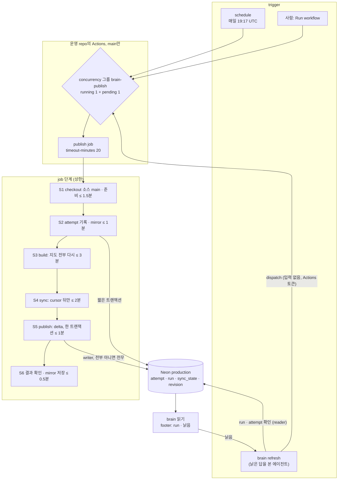
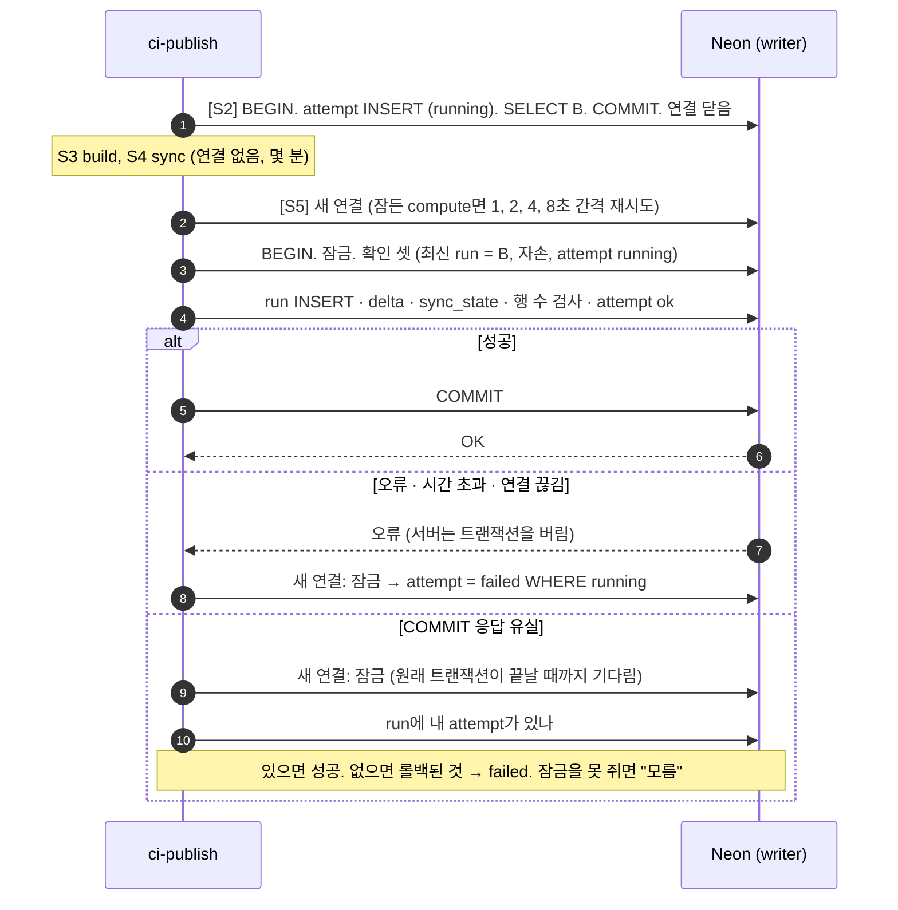
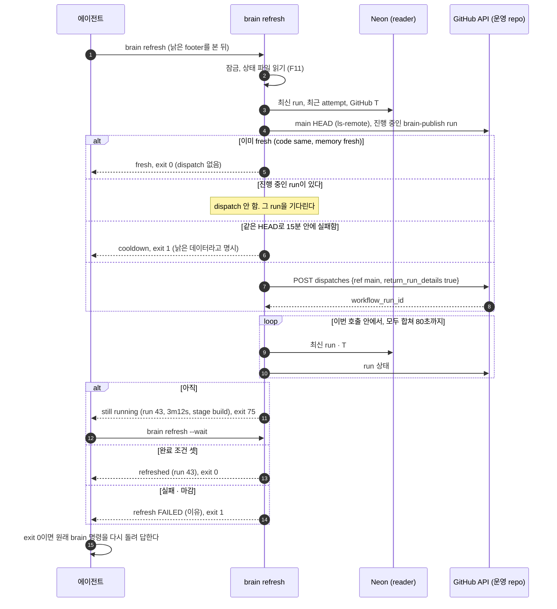
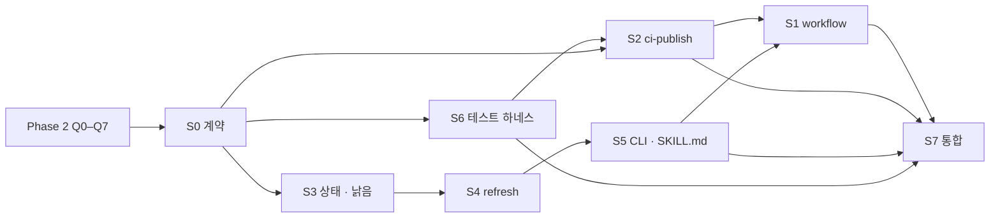

# Phase 3 설계: brain 자동 갱신 (매일 + 필요할 때, 실패하면 전부 되돌림)

- 상태: 설계 리뷰용 (코드 없음) · Codex(gpt-6.1-sol, xhigh) 리뷰 반영
- 날짜: 2026-11-16
- 대상: Phase 2 설계(`docs/phase2-design.md`, Neon 서버 brain, CI 수동 publish) 위에 쌓는다
- 외부 의존 추가: 없음 (GitHub Actions schedule, GitHub REST API)

---

## 0. TL;DR

- **문제.** Phase 2의 brain은 사람이 workflow를 눌러야 갱신된다. 사람은 잊는다. 그러면 brain은 조용히 낡는다. 낡은 맥락은 모르는 것보다 나쁘다. 에이전트가 지난주의 코드와 기억을 근거로 자신 있게 틀린 답을 낸다.
- **Phase 3가 하는 일.** `brain-publish` workflow를 매일 schedule과 `workflow_dispatch`로 돌린다. 지도는 매번 전부 다시 계산하고, DB에는 바뀐 행만 쓴다. 기억은 출처별 cursor 뒤만 가져온다. 쓰기는 한 트랜잭션이다. 어디서 실패하든 지도·기억·cursor가 함께 그대로 남는다.
- **스킬이 스스로 갱신한다.** 코드가 `main`과 다르거나 기억이 24시간보다 오래되면, brain이 workflow를 dispatch한다. 기다림은 90초 이하로 나눈다. 완료 조건은 셋이다. 서버의 최신 run 커밋 = 확인 시점의 `main` HEAD, 기억 cursor가 앞으로 감, 기억 나이 24시간 이내. 셋이 아니면 성공이라고 말하지 않는다.
- **에이전트는 쓰지 못한다.** dispatch는 입력이 없다. 에이전트의 토큰은 운영 repo의 Actions 권한만 있다. writer 비밀은 운영 repo에만 있고, 그 repo에는 관리자만 push한다.
- **시간.** trigger부터 published까지 p95 10분(SLO, hosted runner에서 잰다). 쓰기 트랜잭션은 60초에서 서버가 끊는다.

---

## 1. 왜 이 phase가 필요한가

### 1.1 낡은 brain이 하는 일

| 상황 | 수동 갱신(Phase 2)에서 생기는 일 |
|---|---|
| 어제 머지된 PR이 함수 이름을 바꿈 | `impact`가 옛 이름의 호출처를 보여 준다. 새 호출처는 빠진다 |
| 리뷰어가 오늘 "이 방식은 접자"고 남김 | `search`가 그 리뷰를 못 찾는다. 에이전트는 접은 방식을 다시 제안한다 |
| 일주일 동안 아무도 publish를 안 누름 | 답의 근거가 일주일 전 것이다. footer에 시각은 찍히지만 에이전트는 그 숫자를 근거로 행동하지 않는다 |

- 서비스 repo는 최근 30일에 커밋 208개가 파일 3,076개를 건드렸다. 하루만 지나도 지도의 상당 부분이 바뀐다.
- footer(Phase 1 §6.8)는 낡았다는 사실을 알려 줄 뿐이다. 고치는 사람이 없으면 매번 낡았다고 말만 한다.

### 1.2 왜 스킬이 직접 갱신을 요청하나

- schedule만으로는 하루 사이의 변화를 놓친다. GitHub는 schedule을 늦추거나 빠뜨릴 수 있다고 적는다([GitHub events](https://docs.github.com/en/actions/reference/workflows-and-actions/events-that-trigger-workflows)). schedule은 24시간을 보장하지 못한다.
- 갱신이 필요한지 가장 먼저 아는 쪽은 답을 받는 에이전트다. 답의 footer에 run 커밋과 기억 시각이 있다.
- 에이전트는 brain에 쓰지 않는다. 할 수 있는 것은 "CI야, 다시 만들어 줘"라는 요청뿐이다. 요청에는 내용을 바꾸는 입력이 없다. 그래서 Phase 2의 오염 방지(쓰기는 CI만)가 그대로 유지된다.

---

## 2. Impact와 성공 기준

| 영역 | Phase 2 (수동) | Phase 3 이후 |
|---|---|---|
| 갱신 | 사람이 기억할 때 | 매일 1회 + 낡은 답을 본 에이전트가 요청할 때 |
| 최대 지연 | 제한 없음 | 누군가 물으면: 요청 뒤 약 10분. 아무도 안 물으면: schedule에 기댐(보장 없음, footer가 말함) |
| 실패 | 사람이 job 화면을 봐야 안다 | `brain status`와 모든 답의 footer에 마지막 실패가 뜬다. DB 기록 전에 죽은 실행도 Actions 상태로 보인다. 데이터는 마지막 성공 run 그대로 |
| 에이전트 행동 | 낡은 답을 그대로 씀 | 낡으면 갱신 → 확인 → 다시 답함. 못 하면 낡았다고 밝힘 |

**성공 기준 (구현 후 확인).** 모두 sandbox repo와 Neon sandbox에서 잰다(§4).

1. **SLO.** hosted runner에서 서비스 repo 크기(파일 약 4,600개)의 공개 코드로 dispatch 20회. trigger → published p95 10분 이하. 대기 시간과 실행 시간을 따로 내고, 10분을 넘긴 횟수를 센다.
2. **롤백.** 실패 주입(§7.2)의 기대는 셋으로 나뉜다. F1–F9 · F12 · F13: 도메인 표 전체(이력 포함)가 실패 전과 같다. F10 · F11 · F14(커밋은 됐는데 응답·후처리가 실패): 데이터는 그 publish 한 번만큼 들어가 있고 중복이 없으며 attempt는 `ok`다. F15(기준 run 경쟁): 먼저 커밋한 publish의 run만 남는다. 어느 경우든 그 뒤 정상 run 하나를 돌리면, 실패가 없었던 경우와 정규화 비교(§7)가 같다.
3. **멱등.** GitHub 응답을 고정하고 같은 커밋으로 두 번 돌면 두 번째는 새 행 0개다. 같은 Actions attempt를 두 번 보내면 두 번째는 쓰지 않는다.
4. **스킬.** 낡은 brain에서 질문한 agent trial이 갱신을 요청하고, 완료 조건 셋을 확인하고, 새 run의 footer로 답한다. 여러 에이전트가 동시에 낡음을 보면 dispatch는 최선의 노력으로 줄이고, 실제 publish는 한 번이다.
5. **경계.** 에이전트 토큰으로 운영 repo push · secret 읽기 · workflow 수정 · bootstrap 게이트 열기가 모두 거부된다. `main`이 아닌 ref, `pull_request` 이벤트로는 publish가 돌지 않는다.

---

## 3. 범위

**한다.**

- `brain-publish` workflow에 schedule(하루 1회)을 더한다. concurrency, job 상한, 단계별 상한.
- 출처별 cursor 규칙 정리와 CI 쪽 수집 상한.
- publish를 시간 제한 아래에서 안전하게: 단계 감독(자식 프로세스), 늦은 연결, 연결 재시도, 트랜잭션 시간 제한, 신호 처리, COMMIT 응답 유실 처리.
- 실행 상태와 낡음 판정, footer.
- `brain refresh`: 낡음 판정 → 진행 중인 실행 확인 → dispatch → 나눠서 기다리기 → 완료 조건 확인.
- SKILL.md 규칙: 낡으면 `brain refresh` 뒤에 답한다.
- 실패 주입 훅과 테스트 하네스. SLO 측정.
- 첫 수집 · `--full`용 관리자 workflow(`brain-bootstrap`).

**하지 않는다.**

- push마다 갱신(§9 열린 질문 1). 지금은 schedule + 요청 dispatch.
- 증분 지도 빌드. 지도는 매번 전부 다시 계산한다. 빌드가 2분 안쪽이라 증분의 버그 위험을 질 이유가 없다.
- 실패한 실행의 부분 결과 쓰기(지도만 먼저 쓰기 등). 요구사항대로 전부 아니면 전무다.
- 알림(Slack 등). 실패는 `brain status`와 footer, Actions 화면에 보인다.
- abandoned를 정리하는 별도 job. abandoned는 읽을 때 Actions 상태로 판정해 보여 주기만 한다.
- 로컬에서 production에 publish하기. Phase 2와 같다.
- 서비스 repo 수정. 이번 구현은 sandbox repo에서 검증하고, 적용 방법을 문서로 남긴다(Phase 2 §4).

---

## 4. 요청 해석과 가정

| 요청 원문(전사) | 이 설계의 해석 |
|---|---|
| "메인 브랜치에 매일 스케줄해서 그런 dispatch를 만들어서" | `main`에서 도는 workflow에 `schedule`(하루 1회)과 `workflow_dispatch`를 둘 다 건다 |
| "지도는 매번 전체적으로 계산" | `brain build`를 매 run 처음부터 돌린다 (Phase 2 R4 유지) |
| "데이터베이스는 바뀐 행만 반영" | Phase 2 delta publish. 바뀌지 않은 행은 건드리지 않는다 |
| "cr에서 돌다 보면 1분이 넘어가잖아 … 타임아웃" | CI job은 몇 분 걸린다. 두 쪽의 시간 제한을 설계한다. (1) CI 쪽: job · 단계 상한, 잠든 Neon compute, 긴 트랜잭션. (2) 에이전트 쪽: 에이전트의 명령 한 번은 보통 2분 안에 끝나야 한다. 그래서 기다림을 나눈다 |
| "코드베이스 메모리 파트는 출처별로 커서" | 출처마다 cursor 하나: GitHub(서버 시각 T), git(마지막 run의 커밋). 그 뒤의 것만 새로 들어간다 |
| "라이트가 실패하면 그래프랑 메모리랑 커서 다 같이 롤백" | 지도 delta, 기억 revision, cursor, run 행이 한 트랜잭션이다 |
| "코드가 뒤쳐졌거나, 메모리가 24시간 이상 … 알아서 메인을 솔숲 출수를 해서" | 낡음이면 스킬이 workflow dispatch("솔숲 출수"는 "workflow dispatch"로 들었다)를 요청한다 |
| "성공이랑 그런 것까지 다 확인을 해야지 완료" | run 결론 success만으로는 완료가 아니다. 서버의 최신 run 커밋이 확인 시점의 `main` HEAD와 같고 기억 cursor가 새로워졌는지까지 본다 |
| "푸시 한 번에 10분 안에 끝내야 된다" | run 하나(trigger → published)가 10분 안. push마다 도는 trigger를 뜻했을 수도 있다(§9 열린 질문 1) |

가정:

- Phase 2의 publisher · mirror · 서버 읽기 · `attempt` / `run` 표가 있다.
- workflow는 운영 repo 방식이다(Phase 2 §4). 운영 repo의 workflow가 소스 repo `main`을 소스 읽기 토큰으로 checkout하고 수집한다. writer 비밀은 운영 repo에만 있다.
- Neon Free: compute는 5분 쉬면 잠들고 끌 수 없다([Neon scale to zero](https://neon.com/docs/introduction/scale-to-zero)). 깨는 데 보통 수백 ms다([Neon connection latency](https://neon.com/docs/connect/connection-latency)).
- 에이전트의 dispatch 토큰은 `BRAIN_DISPATCH_TOKEN`이다. fine-grained 토큰, 대상 repo는 운영 repo 하나, 권한은 Actions read · write(와 필수 Metadata read)뿐이다. dispatch API는 fine-grained 토큰에 Actions write를 요구한다([GitHub workflow dispatch](https://docs.github.com/en/rest/actions/workflows#create-a-workflow-dispatch-event)). 개발자의 `gh` 로그인 토큰으로 대신하지 않는다.
- 검증 환경: 사용자 소유의 sandbox repo 둘(소스 역할 · 운영 역할)과 Neon sandbox(production과 다른 project, 또는 test branch). 소스 역할 repo에는 서비스 repo와 크기가 비슷한 공개 TypeScript 코드를 넣는다. 서비스 repo의 코드는 넣지 않는다.

---

## 5. High-level design

### 5.1 그림



### 5.2 구성 요소

| 구성 요소 | 책임 | 새로 / 바뀜 |
|---|---|---|
| `brain-publish.yml` | schedule + dispatch, concurrency, `main` 확인, 최소 권한, 소스 checkout | 바뀜 (Phase 2 Q7) |
| `brain-bootstrap.yml` | 관리자만: 첫 수집 · `--full`. job 상한 6시간, rate limit 대기 허용 | 새로 |
| `brain ci-publish` | 단계 감독(자식 프로세스 · 상한 · 신호), 중복 실행 건너뛰기, 연결 재시도, 실패 주입 훅. Phase 2 publisher · mirror를 부른다 | 새로 |
| 상태 모델 (`src/pg/status.mjs`) | 낡음 판정(코드 · 기억 · 진행 · 마지막 시도를 따로), Actions 상태 맞추기, footer 문구 | 새로 |
| `brain refresh` (`src/refresh.mjs`) | 판정, 진행 중인 실행 찾기, cooldown, dispatch, 나눠 기다리기, 완료 확인, 이어 받기 상태 파일 | 새로 |
| SKILL.md | 낡으면 refresh 뒤에 답한다, 못 하면 낡은 데이터라고 말하고 답한다 | 바뀜 |
| 테스트 하네스 | 고정 GitHub 응답, 실패 주입 실행기, 정규화 dump 비교, SLO 측정, sandbox 준비 스크립트 | 새로 (Phase 2 Q11 위에) |

### 5.3 핵심 결정

| 결정 | 이유 | 버린 대안 |
|---|---|---|
| 하루 1회 schedule + 요청 dispatch | 요구사항. schedule은 "아무도 안 물어도 대개 하루 안"을, dispatch는 "물어본 순간에 최신"을 맡는다 | schedule만: 하루 안의 변화를 놓치고, schedule은 빠질 수 있다 |
| schedule은 정각을 피한 시각(19:17 UTC = 04:17 KST) | GitHub는 부하가 높을 때 schedule을 늦추거나 빠뜨릴 수 있다고 적는다. 정각은 흔히 몰리는 시간이다 | 00:00 UTC |
| concurrency 그룹 하나, `cancel-in-progress: false` | 그룹에는 running 1개와 pending 1개만 있고, 새 pending이 오면 옛 pending은 취소된다([GitHub concurrency](https://docs.github.com/en/actions/how-tos/write-workflows/choose-when-workflows-run/control-workflow-concurrency)). 그룹 이름은 repo 전체에 걸리므로 다른 workflow가 같은 이름을 쓰지 않게 한다. 도는 publish를 끊지 않는다 | `cancel-in-progress: true`: 도는 publish가 계속 끊겨 영영 못 끝날 수 있다 |
| 줄 세우기는 concurrency, 마지막 울타리는 DB | 트랜잭션 안에서 최신 run이 기준 run이고, 새 커밋이 그 자손이고, 내 attempt가 running이어야 쓴다(Phase 2 R9–R10). 실패하면 다시 돌지 않는다 | 실패 뒤 자동 재시도: 옛 checkout이 새 run 위에 쓸 수 있다 |
| 중복 dispatch는 job이 시작할 때 거른다 | dispatch API 호출 자체는 원자적으로 막을 수 없다. 대신 job이 시작하면 "최신 run이 같은 소스 커밋 · 같은 도구 버전이고, 그 run의 GitHub 수집이 내 run이 만들어진 뒤에 시작했나"를 본다(A5). 그러면 attempt를 `skipped`로 끝낸다 | 중앙 조정자 서비스: 이 규모에 과하다 |
| 무거운 일은 트랜잭션 밖, 트랜잭션은 delta만 | 빌드 · sync는 몇 분이다. 그동안 잠금 · 연결을 쥐면 시간 제한과 경쟁에 걸린다 | 시작부터 끝까지 트랜잭션 하나 |
| 단계 상한은 감독 프로세스가 자식 프로세스를 끊어서 지킨다 | Phase 0 build는 동기 코드라 같은 프로세스 안의 시계로는 멈출 수 없다(`src/build.mjs`) | 같은 프로세스에서 시간 재기 |
| 트랜잭션 상한은 서버가 지킨다: `transaction_timeout = 60s` | `statement_timeout`은 문장 하나, `idle_in_transaction_session_timeout`은 쉬는 시간만 잰다([PostgreSQL client config](https://www.postgresql.org/docs/current/runtime-config-client.html)). 트랜잭션 전체는 PostgreSQL 17부터 있는 `transaction_timeout`이 막는다 | 클라이언트 시계만: 클라이언트가 멈추면 소용없다 |
| 스킬은 "요청"만 하고 완료는 서버 상태로 판정 | run 결론은 GitHub가 말하는 것이다. brain이 실제로 새로워졌는지는 서버의 `run` · `sync_state`가 말한다. 어떤 Actions run이 publish했는지는 상관없다 | 내가 dispatch한 run의 결론만 확인: pending 교체 · 합쳐짐을 못 따라간다 |
| 기다림은 한 번에 90초 이하로 나누고, 이어 받기 상태는 파일에 둔다 | 에이전트의 명령 한 번은 보통 2분 상한이 있다(Claude Code Bash 도구 기본값). 한 번에 10분을 기다리면 도구가 끊고, 에이전트는 실패로 읽는다 | `brain refresh --wait 600` 한 번 |
| dispatch에는 입력이 없다. 에이전트 토큰은 운영 repo의 Actions 권한만 | 에이전트가 넣을 수 있는 값이 없으면 내용을 오염시킬 길이 없다. 개발자의 넓은 토큰을 쓰면 workflow를 고칠 수 있다 | `reason` · `ref` 입력, `gh auth token` 재사용 |
| 첫 수집 · `--full`은 관리자 workflow로 따로 | 약 2,700 호출은 `GITHUB_TOKEN` 한도(시간당 1,000)를 넘고 SLO와 job 상한 20분에 맞지 않는다. 소스 읽기 토큰(시간당 5,000)으로 한 job 안에서 끝낸다. 실패하면 처음부터 다시 | 평소 workflow로 여러 번 나눠 돌기: 실패한 run은 아무것도 남기지 않아 이어 받을 수 없다 |

---

## 6. Low-level design

### 6.1 workflow

```yaml
name: brain-publish
on:
  schedule:
    - cron: '17 19 * * *'              # 매일 19:17 UTC
  workflow_dispatch: {}                # 입력 없음
permissions:
  contents: read
  actions: read                        # 이 run의 created_at 읽기 (A5)
concurrency:
  group: brain-publish
  cancel-in-progress: false
env:
  BRAIN_SOURCE_REPO: owner/service     # 소스 repo. 입력으로 받지 않는다
  BRAIN_DIR: skills/codebase-brain     # 운영 repo 안의 brain 코드
jobs:
  publish:
    if: github.ref == 'refs/heads/main'
    runs-on: ubuntu-latest
    timeout-minutes: 20
    steps:
      - uses: actions/checkout@<40자 SHA>      # 운영 repo: brain 코드와 workflow
        timeout-minutes: 1
        with:
          persist-credentials: false
      - uses: actions/checkout@<40자 SHA>      # 소스 repo main
        timeout-minutes: 2
        with:
          repository: ${{ env.BRAIN_SOURCE_REPO }}
          ref: main
          path: src-repo
          fetch-depth: 0
          token: ${{ secrets.BRAIN_SOURCE_TOKEN }}
          persist-credentials: false
      - uses: actions/setup-node@<40자 SHA>
        timeout-minutes: 1
        with:
          node-version: '22'
          cache: npm
          cache-dependency-path: ${{ env.BRAIN_DIR }}/package-lock.json
      - run: npm ci
        working-directory: ${{ env.BRAIN_DIR }}
        timeout-minutes: 2
      - uses: actions/cache/restore@<40자 SHA>
        timeout-minutes: 1
        with:
          path: .brain-mirror
          key: brain-mirror-${{ github.run_id }}-${{ github.run_attempt }}
          restore-keys: brain-mirror-
      # ci-publish runs build and sync as child processes WITHOUT BRAIN_WRITER_URL in their env, with
      # BRAIN_TYPESCRIPT=kit (never the source repo's typescript); only the parent opens the writer connection in S5
      - run: "$BRAIN_DIR/bin/brain ci-publish --source src-repo --mirror .brain-mirror"
        timeout-minutes: 12
        env:
          BRAIN_TYPESCRIPT: kit
          BRAIN_WRITER_URL: ${{ secrets.BRAIN_WRITER_URL }}
          BRAIN_SOURCE_TOKEN: ${{ secrets.BRAIN_SOURCE_TOKEN }}
          GITHUB_TOKEN: ${{ github.token }}        # A5: 이 run의 created_at만 읽는다
          GHA_RUN_ID: ${{ github.run_id }}
          GHA_RUN_ATTEMPT: ${{ github.run_attempt }}
      - uses: actions/cache/save@<40자 SHA>
        if: success()
        timeout-minutes: 1
        with:
          path: .brain-mirror
          key: brain-mirror-${{ github.run_id }}-${{ github.run_attempt }}
```

- `schedule`은 기본 브랜치에서만 돈다. `workflow_dispatch`는 workflow 파일이 기본 브랜치에 있어야 하고, API로 다른 ref에도 보낼 수 있다([GitHub events](https://docs.github.com/en/actions/reference/workflows-and-actions/events-that-trigger-workflows)). 그래서 `if: github.ref == 'refs/heads/main'`로 job을 막는다.
- 운영 repo 구조: brain 코드는 이 kit와 같은 자리(`skills/codebase-brain/`)에 둔다. 고정한 커밋에서 복사하고, 운영 repo PR로만 바꾼다. `bin/brain`은 sh wrapper라 그대로 실행한다(`node bin/brain`이 아니다). cache 열쇠에 `run_attempt`를 넣는다. cache는 한 번 저장하면 바뀌지 않고, 재실행은 같은 `run_id`를 쓰기 때문이다([GitHub caching](https://docs.github.com/en/actions/reference/workflows-and-actions/dependency-caching)).
- 소스 커밋은 `github.sha`가 아니다. `github.sha`는 운영 repo의 커밋이다. `ci-publish`가 `git -C src-repo rev-parse HEAD`로 읽어 attempt에 쓴다.
- `GITHUB_TOKEN`은 다른 비공개 repo를 읽지 못한다. checkout과 GitHub 수집 모두 `BRAIN_SOURCE_TOKEN`을 쓴다. `GITHUB_TOKEN`은 이 run의 `created_at`을 읽는 데만 쓴다(`GET /repos/{운영 repo}/actions/runs/{run_id}`, Actions read).
- action은 40자 커밋 SHA로 고정한다(S1에서 실제 값을 넣고 actionlint로 검사). 자격 증명을 checkout에 남기지 않는다.
- `pull_request` · `pull_request_target` trigger는 없다. 운영 repo 설정에서 fork PR에 secret을 보내지 않는다.
- push마다 돌리려면 `on.push.branches: [main]`를 더하면 된다. 다만 운영 repo 방식에서는 소스 repo의 push가 운영 repo를 깨우지 못하므로, 소스 repo 쪽에 dispatch를 보내는 장치가 필요하다(§9).
- `brain-bootstrap.yml`: 같은 단계에 `ci-publish --full --mode bootstrap`. 상한을 따로 둔다: job 360분, `ci-publish` step 350분, S4 sync 상한과 rate limit 대기 상한 없음(요청 하나 30초는 그대로), S5 `transaction_timeout=10min` · `statement_timeout=5min`(첫 publish는 행을 전부 넣는다). S3 build 3분은 그대로. A5 건너뛰기는 하지 않는다.
- bootstrap 게이트: dispatch 토큰의 Actions write는 repo 전체에 걸려, 그 토큰으로 bootstrap도 dispatch할 수 있다. 그래서 job의 첫 step이 repo 변수 `BRAIN_BOOTSTRAP_UNTIL`(UTC 시각)을 본다. 지금보다 뒤이고 2시간 안일 때만 계속하고, 아니면 DB에 닿기 전에 끝난다. 변수를 바꾸려면 fine-grained 토큰의 Variables write가 필요하고, dispatch 토큰에는 그 권한이 없다([권한 표](https://docs.github.com/en/rest/authentication/permissions-required-for-fine-grained-personal-access-tokens)). 관리자가 `gh variable set`으로 열고 dispatch한다. environment의 required reviewers는 GitHub Free · Pro · Team의 비공개 repo에서 쓸 수 없어 고르지 않았다([GitHub environments](https://docs.github.com/en/actions/reference/workflows-and-actions/deployments-and-environments)).

```yaml
      - name: bootstrap gate                   # brain-bootstrap.yml의 첫 step
        env:
          UNTIL: ${{ vars.BRAIN_BOOTSTRAP_UNTIL }}
        run: |
          now=$(date -u +%s); until=$(date -u -d "${UNTIL:-1970-01-01}" +%s) || exit 1
          [ "$until" -gt "$now" ] && [ "$until" -le $((now + 7200)) ] || { echo "bootstrap gate closed"; exit 1; }
```

### 6.2 단계와 시간

| 단계 | 하는 일 | 상한 (넘으면) | 보통 |
|---|---|---|---|
| S0 대기 | runner 배정, concurrency 대기 | SLO에 포함, 따로 잰다 | 1분 안쪽 |
| S1 준비 | checkout 둘(`fetch-depth: 0`은 커밋 기억에 필요), `npm ci`, cache 복원 | step마다: checkout 1 · 2분, setup-node 1분, `npm ci` 2분, cache 1분 (합 7분) | 1분 |
| S2 기록 · mirror | 짧은 트랜잭션으로 attempt(running) + 기준 run B. 중복이면 `skipped`로 끝. mirror를 B까지 delta로, checksum 확인 | 1분 | 20초 |
| S3 build | 자식 프로세스로 `brain build` (서비스 repo 노트북 56초) | 3분: SIGTERM, 10초 뒤 SIGKILL | 2분 |
| S4 sync | 자식 프로세스로 Phase 1 sync. 요청 하나 30초, rate limit 대기 60초까지 | 2분: 같음 | 1분 |
| S5 publish | 새 연결 → 한 트랜잭션 (Phase 2 R9) | `transaction_timeout 60s`, 서버가 끊음 | 10초 |
| S6 확인 | 새 연결로 최신 run = 이 run인지, mirror를 새 run으로 올려 cache에 저장 | 0.5분. 실패해도 publish는 이미 끝남 | 20초 |

- published 시각은 S5의 COMMIT이다. S1–S5 상한의 합은 약 14분이고(job 상한 20분 안), 보통은 5분 안팎이다. 상한은 고장 난 실행을 끊는 선이지 SLO가 아니다. SLO는 hosted runner에서 잰 뒤에야 말할 수 있다(§7.1).
- S6은 COMMIT 뒤다. S6이 실패해도 데이터는 커밋되어 있다. job은 실패로 표시되지만 attempt는 `ok`다. 다음 refresh가 서버 상태로 성공을 확인한다.
- 신호: GitHub는 취소할 때 SIGINT, SIGTERM 순으로 보낸 뒤 강제로 끝낸다([GitHub cancellation](https://docs.github.com/en/actions/reference/workflows-and-actions/workflow-cancellation)). `ci-publish`는 신호를 받으면 자식 프로세스를 끊고, DB 연결을 닫고(서버가 롤백), 5초 안에 실패 기록(Phase 2 R11)을 시도한다. 롤백은 이 정리에 기대지 않는다.
- 첫 publish와 `--full`은 SLO에서 뺀다(`brain-bootstrap`).

### 6.3 출처별 cursor와 증분

| 출처 | cursor | 이번 run이 넣는 것 | DB에서 |
|---|---|---|---|
| GitHub (PR · 이슈 · 리뷰 · 댓글) | `sync_state[run].github`: 서버 시각 T. sync가 시작할 때 첫 GitHub 응답의 `Date` (Phase 1 R1) | `T − 1시간` 뒤에 바뀐 것 (Phase 1 R2–R8) | 해시가 바뀐 항목만 새 revision |
| git (커밋 메시지) | 마지막 run의 커밋 (`run.commit_sha`) | Phase 0이 매번 최근 5,000개를 읽는다. 서버에 없는 커밋만 delta가 된다. 그래서 cursor 뒤의 커밋만 새로 들어간다 | 새 커밋 항목만 추가. 닫지 않는다 (Phase 2 R8) |
| repo 문서 · `changes/` · CHANGELOG | 없음 (매번 checkout 전체) | 매 run 전부 다시 읽는다 | 내용 해시가 바뀐 문서만 새 revision |
| 지도 | 없음 (매번 전부 계산) | `brain build` | 바뀐 노드 · 간선 · 링크만 |

- cursor는 S5 트랜잭션 안에서만 바뀐다. 그래서 cursor가 데이터보다 앞서 가는 일이 없다.
- T는 모든 GitHub 스트림이 성공했을 때만 앞으로 간다. 응답에 `Date`가 없거나 직전 T보다 이르면 sync가 실패한다.
- `main`이 force-push되어 옛 run 커밋이 사라져도 git 쪽은 그대로 돈다. Phase 0은 cursor를 읽지 않고 최근 5,000개를 읽기 때문이다. 사라진 커밋의 기억은 서버에 남는다(Phase 2 R8). 기준 run 커밋이 새 커밋의 조상이 아니면 Phase 2 R9의 "자손" 확인에 걸린다. 그래서 force-push 뒤에는 관리자가 게이트를 열고 `brain-bootstrap`으로 한 번 돌린다. bootstrap은 잠금과 "최신 run = B" 확인은 그대로 하고 자손 확인만 건너뛴다(Phase 2 R9 예외, `run.mode = bootstrap`).
- 한 run 사이에 커밋이 5,000개 넘게 들어오면 빠진 커밋이 생긴다. 그 경우 `coverage`에 `git: truncated`가 붙는다.

### 6.4 원자성과 롤백



| # | 규칙 | 근거 |
|---|---|---|
| A1 | 데이터 쓰기는 S5의 트랜잭션 하나뿐이다. S2의 attempt 행은 실행 기록이고 데이터가 아니다 | 요구사항. 지도 · 기억 · cursor가 같이 움직인다 |
| A2 | 쓰기 연결은 direct endpoint, 연결 옵션 `transaction_timeout=60s`. 트랜잭션 안에서 `SET LOCAL statement_timeout = '30s'`, `lock_timeout = '15s'` | 트랜잭션 전체 시간을 서버가 막는다. 실측 기본값은 `statement_timeout = 0`이라 따로 걸어야 한다 |
| A3 | 연결이 끊기면 서버가 트랜잭션을 버린다. 클라이언트는 같은 delta를 다시 쓰지 않는다 | 이중 쓰기가 없다 |
| A4 | 결과 확인과 실패 기록은 같은 advisory 잠금을 쥔 뒤에 한다(Phase 2 R11–R12). `failed`는 `status = 'running'`일 때만 쓴다 | 커밋 중인 트랜잭션을 롤백으로 오판하지 않는다 |
| A5 | 중복 실행 건너뛰기: S2에서 넷이 모두 맞을 때만 attempt를 `skipped`로 끝내고 job은 성공한다. (1) 평소 workflow의 첫 attempt(bootstrap · `--full` 아님, `run_attempt` = 1), (2) 최신 run 커밋 = 내 소스 커밋, (3) 최신 run의 GitHub T ≥ 이 Actions run의 `created_at`(둘 다 GitHub 시계), (4) 최신 run의 `tool_version` · `sanitize_version` = 내 것. 하나라도 아니면 평소대로 돈다 | (3)이 맞으면 내 dispatch가 생긴 뒤에 시작한 수집이 같은 커밋 · 같은 도구로 이미 publish했다. 내가 돌아도 더 볼 것이 없다. 몰린 dispatch가 publish 하나로 합쳐진다 |
| A6 | 실패 주입 훅: `BRAIN_FAULT=<단계>:<지점>`(§7.2). `BRAIN_FAULT_ALLOW=1`이 없으면 무시한다. production workflow에는 둘 다 없다 | 실제 코드 경로에서 실패를 일으킨다 |

<!--widget:run-->

### 6.5 실행 상태와 낡음

**attempt 상태** (Phase 2 `attempt`, 읽을 때 Actions 상태와 맞춘다). Actions run과 attempt는 `(run id, run attempt)`로 맞춘다. 재실행은 다른 attempt다.

| DB 상태 | Actions run | 보여 주는 상태 |
|---|---|---|
| (attempt 없음) | queued · in_progress | `queued` |
| (attempt 없음) | 실패 · 취소 | `failed before start` (checkout · 준비 단계) |
| running | in_progress | `running` |
| running | 끝남(실패 · 취소) | `abandoned` |
| running | 모름(GitHub 안 됨) | 30분 넘으면 `abandoned?`, 아니면 `running?` |
| ok · failed · skipped | — | 그대로 |
| — | — | COMMIT 결과를 확인 못 한 attempt는 `outcome unknown` |

**낡음 판정.** 네 칸을 따로 계산한다. 모든 brain 답의 footer에 찍는다.

| 칸 | 값 | 계산 |
|---|---|---|
| code | `same` · `behind N` · `differs` · `unknown` | 최신 run 커밋과 `git ls-remote origin refs/heads/main`. 다르면 로컬 git 객체가 있을 때만 조상 관계와 N을 센다. 없거나 조상이 아니면 `differs`. `ls-remote` 실패면 `unknown` |
| memory | `fresh` · `old` · `never` · `unknown` | 나이 = DB의 `now()` − GitHub T. 24시간 미만이면 fresh. 노트북 시계는 쓰지 않는다 |
| activity | `idle` · `queued` · `running` | 위 표 |
| last | `ok` · `skipped` · `failed (단계)` · `failed before start` · `abandoned` · `outcome unknown` | 가장 최근 실행. DB attempt와 Actions에만 있는 실패(`failed before start`)를 합쳐 **그 실행(attempt)이 시작된 시각** 순으로 고른다: DB attempt는 `started_at`, Actions 쪽은 그 attempt의 `run_started_at`. 재실행(`run_attempt` 2 이상)은 원래 run의 `created_at`을 물려받으므로 `created_at`으로 고르면 새 실패가 가려진다. cooldown(F3)도 같은 시각을 쓴다 |

- refresh가 필요하다: code가 `behind` · `differs`이거나 memory가 `old` · `never`.
- `unknown`만 있으면 dispatch하지 않는다. footer에 `(freshness unknown)`을 붙인다.
- footer 예: `brain data: run 42 @9f3c2e1a · 3 commits behind main · github as of 27h ago (stale) · last attempt FAILED 40m ago (sync)`.
- 로컬 작업 트리의 HEAD와 비교한 "code @a · HEAD @b"(Phase 1 §6.8)는 그대로 남는다. 그것은 "내 브랜치가 brain과 얼마나 다른가"이고, 위 판정은 "brain이 `main`보다 얼마나 낡았나"다.

### 6.6 `brain refresh` (스킬의 자동 갱신)



| # | 규칙 | 근거 |
|---|---|---|
| F1 | **새로 시작하는** refresh가 이미 fresh(§6.5: code `same`, memory `fresh`)를 보면 dispatch도 기다림도 없이 바로 exit 0. 상태 파일이 있는(이어 가는) refresh는 이 지름길을 쓰지 않는다: 시작 때 적은 T와 HEAD를 기준으로 F7의 세 조건을 다 봐야 exit 0이다. 낡음 판정이 refresh 필요일 때만 dispatch한다. activity가 `queued` · `running`이면 dispatch하지 않고 기다린다 | 불필요한 run을 만들지 않는다 |
| F2 | 같은 노트북의 refresh끼리는 상태 파일 잠금(F11)으로 dispatch를 하나로 줄인다. 다른 노트북끼리는 막지 못한다. 그래서 job 시작의 건너뛰기(A5)가 실제 publish를 하나로 만든다 | dispatch API 호출 자체는 원자적으로 막을 수 없다 |
| F3 | cooldown: 15분 안에 같은 `main` HEAD로 `failed` · `abandoned`가 된 attempt, 또는 `failed before start`(소스 커밋을 모름)가 있으면 다시 dispatch하지 않는다. exit 1과 마지막 실패를 보고한다 | 실패하는 run을 에이전트가 반복해서 부르지 않게. 시작 전 실패는 소스 커밋이 없어 HEAD와 상관없이 센다 |
| F4 | dispatch는 `POST /repos/{운영 repo}/actions/workflows/brain-publish.yml/dispatches`, body `{"ref": "main", "return_run_details": true}`. 응답 200의 `workflow_run_id`를 상태 파일에 적는다([GitHub workflow dispatch](https://docs.github.com/en/rest/actions/workflows#create-a-workflow-dispatch-event), [changelog 2026-02-19](https://github.blog/changelog/2026-02-19-workflow-dispatch-api-now-returns-run-ids)). 운영 repo와 workflow 이름은 `brain.binding`에서 읽는다 | 기다릴 대상을 안다. 시각으로 run을 추측하지 않는다 |
| F5 | dispatch 응답을 못 받으면 다시 보내지 않는다. 진행 중인 run 목록을 보고, 없으면 다음 호출에서 한 번만 다시 보낸다 | 응답 유실로 dispatch가 두 번 가는 일을 줄인다 |
| F6 | 완료 판정은 특정 Actions run이 아니라 서버 상태로 한다. 내 run이 pending 교체로 취소되거나 다른 run에 합쳐져도, 완료 조건이 맞으면 성공이다 | concurrency의 pending 교체(§5.3) |
| F7 | 완료 조건 셋: (1) 서버 최신 run 커밋 = **확인하는 순간** 다시 읽은 `main` HEAD, (2) GitHub T > refresh 시작 때의 T(시작 때 T가 없었으면 T가 생기면 된다), (3) DB `now()` − T < 24시간. (1)만 틀리고 그 사이 `main`이 앞으로 갔다면, 진행 중인 run이 없을 때 한 번 더 dispatch하고 마감까지 기다린다 | "run 결론 success"는 job의 말이다. brain이 실제로 새로워졌는지는 서버가 말한다 |
| F8 | 한 번 호출은 80초 안에 끝낸다. 남은 시간을 모든 작업에 건다: HTTP는 `AbortSignal.timeout(min(남은 시간, 20초))`, DB는 `connect_timeout`과 `statement_timeout`을 남은 시간으로 주고, 그와 별도로 **클라이언트 쪽 마감 타이머**가 남은 시간이 지나면 연결의 socket을 직접 끊는다(`client.connection.stream.destroy()` 뒤 `client.end()`). 서버 timeout은 멈춘 TCP 연결을 끊지 못하기 때문이다. `git ls-remote`는 자식 프로세스 timeout으로 끊는다. 재시도도 남은 시간 안에서만 한다. 아직이면 exit 75와 `still running (run 43, 3m12s, stage: build)`를 찍는다. 마감(처음 호출부터 15분)은 다시 불러도 늘지 않고, 지나면 exit 1 | 에이전트 도구의 명령 시간 상한 안에서 끝나고, 무한히 기다리지 않는다. 지금 Phase 1 `gh-client`의 fetch와 git 도우미에는 시간 상한이 없다 |
| F9 | `BRAIN_DISPATCH_TOKEN`이 없거나 403이면 "refresh 불가: dispatch 권한 없음", exit 2. GitHub에 닿지 않으면 exit 2. 다른 토큰(`gh auth token` 등)으로 대신하지 않는다 | 갱신 실패가 일을 막지 않는다. 넓은 토큰을 쓰지 않는다 |
| F10 | refresh는 brain DB에 쓰지 않는다. reader로 읽기만 한다 | Phase 2의 쓰기 경계 유지 |
| F11 | 상태 파일 `~/.cache/brain/refresh/<binding id>.json`: 시작 시각, 마감, 시작 때의 T와 HEAD, dispatch한 run id, 추가 dispatch 횟수(F7, 최대 1). 만든다: dispatch하거나 진행 중인 run을 기다리기로 할 때. 이어 쓴다: 파일이 있고 마감 전일 때(`--wait`든 아니든). `--wait`인데 파일이 없으면 새로 시작한다. 지운다: exit 0 · 1 · 2로 끝날 때. 마감이 지난 파일은 exit 1을 한 번 보고하고 지운다. 잠금: Phase 1의 `withWriteLock(<파일>)`(SQLite 배타 락, `src/gh-schema.mjs`)을 그대로 쓴다. 잠근 프로세스가 죽으면 OS가 풀어 주므로, 낡은 잠금을 찾아 지우는 단계가 없다(pid 파일 + 지우기 방식은 지우는 쪽끼리 경쟁해 둘이 동시에 들어갈 수 있다. Phase 1 계약 변경 A11). 잠금을 못 쥐면(`LockBusyError`) dispatch하지 않고 상태만 읽어 exit 75 | 죽은 호출이 남긴 파일 · 잠금이 다음 refresh를 막지 않는다. 마감은 고정으로 남는다 |

**exit 코드.**

| exit | 뜻 | 에이전트가 할 일 |
|---|---|---|
| 0 | 이제 fresh (`refreshed` 또는 이미 `fresh`) | 원래 brain 명령을 다시 돌려 답한다 |
| 75 | 아직 도는 중 | `brain refresh --wait`를 다시 부른다 |
| 1 | 실패 · cooldown · 마감 · `main`이 계속 움직임 | 낡은 데이터라고 사용자에게 밝히고 답한다 |
| 2 | refresh 불가 (토큰 · 권한 · GitHub 연결) | 같음 |

**SKILL.md에 들어갈 규칙.**

> brain 답의 footer에 `behind main`, `differs from main`, `(stale)`, `never synced`가 있으면, 그 답으로 일하기 전에 `brain refresh`를 실행한다. exit 75면 `brain refresh --wait`를 다시 실행한다. exit 0이면 원래 명령을 다시 실행해 새 답을 쓴다. exit 1 · 2면 낡은 데이터라는 사실과 이유를 사용자에게 밝히고 답한다. refresh는 처음 호출부터 15분이 지나면 스스로 멈춘다.

### 6.7 보안

- 에이전트가 할 수 있는 것: brain 읽기(reader), 운영 repo workflow dispatch와 run 상태 읽기(`BRAIN_DISPATCH_TOKEN`). 할 수 없는 것: brain 쓰기, 운영 repo push, secret 읽기, workflow 수정, 다른 ref로 publish, publish 내용 바꾸기, bootstrap 게이트 열기(repo 변수 쓰기).
- 경계가 서는 조건: 운영 repo의 쓰기 권한은 관리자만 갖는다. 에이전트가 쓰는 개발자 계정은 운영 repo 협업자가 아니다. 이 조건은 사람의 운영 규칙이라 S7에서 sandbox로 실제로 확인한다(§7.3 P17).
- 소스 repo에는 brain 비밀이 없다. 소스 repo에 push한 브랜치 workflow가 비밀을 꺼낼 길이 없다.
- fork PR: 기본값으로 secret이 넘어가지 않는다([GitHub secrets](https://docs.github.com/en/actions/how-tos/write-workflows/choose-what-workflows-do/use-secrets)). 비공개 repo의 fork PR secret 설정은 끈다. workflow에 `pull_request` · `pull_request_target`이 없다.
- `GITHUB_TOKEN`은 `contents: read` · `actions: read`만. 수집은 `BRAIN_SOURCE_TOKEN`(시간당 5,000)이 한다. 평소 증분 run은 약 80 요청이다.
- 로그와 `attempt.error`에는 단계 이름과 오류 종류만 쓴다. Phase 2 R16의 검사를 로그에도 돌린다(§7.3 P5).

---

## 7. 테스트 계획

- **비교 방법.** "그대로" = 도메인 표 전체(identity · revision · 사실 · `run` · `sync_state`, 이력과 유효 구간 포함)의 dump가 같다. `attempt`는 뺀다. "실패가 없었던 경우와 같다" = dump를 정규화해 비교한다: id를 정규 키로, run id를 run 순번으로 바꾼다(롤백된 트랜잭션도 sequence 값을 쓰기 때문).
- **환경.** 실패 · 롤백 테스트는 Neon branch에서 한다(Phase 2 Q11 하네스). 실제 workflow 테스트는 sandbox 두 repo와 Neon sandbox로 한다. GitHub 응답은 Phase 1 fixture replay로 고정할 수 있다.

### 7.1 시간 (SLO)

| # | 시나리오 | 통과 조건 |
|---|---|---|
| T1 | hosted runner, 소스 repo에 서비스 repo 크기의 공개 코드, 평소 증분(커밋 몇 개 · PR 몇 개 바뀜). dispatch 20회. cache 있음 15회, 없음 5회 | trigger → published p95 ≤ 10분. 대기와 실행을 따로, 단계별 시간 표, 10분 넘은 횟수 |
| T2 | compute가 잠든 상태에서 시작 (6분 넘게 쉼) | S2 · S5 연결 재시도로 성공, 추가 시간 기록 |
| T3 | S3에 sleep 주입 | 감독 프로세스가 3분에 끊고 attempt failed (build timeout). job 상한까지 가지 않음 |
| T4 | 두 run이 줄을 섬 (앞 run이 도는 중에 dispatch) | 뒤 run의 대기 시간이 SLO에 들어감. 결과를 따로 보고 |

### 7.2 실패 주입과 롤백

| # | 주입 지점 | 통과 조건 |
|---|---|---|
| F1 | checkout 실패 (틀린 소스 토큰) | attempt 없음. `brain status`가 Actions 상태로 `failed before start` |
| F2 | mirror: Neon 연결 실패 · checksum 불일치 | 연결 실패면 attempt failed (mirror). 불일치면 전부 다시 받고 계속 |
| F3 | build 실패 · build 시간 초과 | 트랜잭션 없음. 도메인 dump 그대로 |
| F4 | GitHub 500 (3회 재시도 뒤) | 같음. GitHub T 그대로 |
| F5 | rate limit, reset 5분 뒤 | 60초 대기 상한으로 failed. 다음 run이 같은 창부터 |
| F6 | 업로드 전 검사에 걸림 (Phase 2 R16) | 쓰기 연결을 열지 않음. 그대로 |
| F7 | 트랜잭션 안: 노드 쓴 뒤, 항목 쓴 뒤, `sync_state` 쓴 뒤, `attempt ok` 쓴 뒤 (네 지점) | 매번 롤백. 그대로 |
| F8 | 트랜잭션 중 `kill -9` | 서버가 버림. 그대로. 표시는 `abandoned` (Actions 상태) |
| F9 | COMMIT 직전 연결 끊기 | 그대로, failed |
| F10 | COMMIT 응답 유실 (커밋됨, 테스트 proxy) | 잠금 뒤 확인으로 성공. 다시 쓰지 않음 |
| F11 | COMMIT 5초 지연, 그 사이 복구 시작 | 복구가 잠금을 기다린 뒤 성공 판정. `failed`로 덮지 않음 |
| F12 | `transaction_timeout` 초과 (`pg_sleep` 주입) | 서버가 끊음. 롤백, failed (publish timeout) |
| F13 | job 취소 · job 상한 초과 | SIGINT · SIGTERM 처리 로그. 그대로. 표시는 `abandoned` 또는 failed |
| F14 | COMMIT 뒤, S6 전에 프로세스 죽음 | 데이터는 커밋됨. attempt ok. 다음 refresh가 fresh로 판정 |
| F15 | 기준 run 경쟁 (다른 publish가 먼저 커밋) | 내 쪽은 stale-base로 끝, 다시 돌지 않음. 먼저 커밋한 run만 남음 |
| 공통 | F1–F15마다 실패 뒤 정상 run 1회 | 정규화 dump = 실패가 없었던 경우 |

### 7.3 상태 · 스킬 · 권한

| # | 시나리오 | 통과 조건 |
|---|---|---|
| P1 | 멱등: GitHub replay 고정, 같은 커밋으로 두 번 publish. 같은 Actions attempt를 두 번 | 두 번째 새 행 0. 같은 attempt는 유일 제약이 막음 |
| P2 | 같은 커밋인데 replay에 새 PR 댓글 | 그 항목만 새 revision, T 앞으로 |
| P3 | 낡음 판정 표: code(same · behind · differs · unknown) × memory(fresh · old · never · unknown) | footer와 `brain status` 문구가 §6.5 표와 같음. refresh 필요 판정이 맞음 |
| P4 | 실패 표시: F1 · F4 · F8 뒤 | `failed before start` · `failed (sync)` · `abandoned`. `last`도 같은 값(시작 전 실패가 더 새로우면 그것) |
| P5 | 로그 · `attempt.error`에 비밀 없음 | writer URL · 토큰 · 마스킹 corpus 원문 grep 0건 |
| P6 | `brain refresh` 동시 5개, 노트북 둘 | dispatch 2회 이하, 실제 publish 1회(나머지 `skipped`), 다섯 모두 exit 0 |
| P7 | schedule과 dispatch가 같이 옴 | publish 1회, 다른 하나는 `skipped` 또는 줄을 서서 `skipped` |
| P8 | 내 dispatch가 pending에서 다른 dispatch로 교체됨 | 서버 상태로 완료 판정, exit 0 |
| P9 | refresh 도중 `main`에 커밋 | 확인 순간의 HEAD로 비교. 마감 안이면 한 번 더 dispatch해 exit 0, 아니면 exit 1 (`main moved`) |
| P10 | `main` force-push | code = `differs`, refresh 요청. 평소 publish는 자손 확인에 걸려 실패하고 `brain-bootstrap` 안내. 관리자가 게이트를 열고 bootstrap → 성공, `run.mode = bootstrap` |
| P11 | 나눠 기다리기 | 매 호출 90초 이하(API 포함). 75 → `--wait` → 0. 마감 15분은 다시 불러도 안 늘고, 지나면 exit 1 |
| P12 | dispatch 응답 유실 (테스트 proxy) | 바로 다시 보내지 않음. 진행 중 run을 찾아 기다리거나 다음 호출에서 한 번만 |
| P13 | GitHub API 안 됨 | exit 2, footer에 `(freshness unknown)` |
| P14 | 노트북 시계 +2시간 | 판정이 바뀌지 않음 (서버 시계만 씀) |
| P15 | cooldown: 실패하는 상태에서 refresh 3번. attempt 실패와 `failed before start` 각각 | dispatch 1회, 나머지 exit 1 cooldown |
| P16 | `BRAIN_DISPATCH_TOKEN` 없음 · 권한 부족 | exit 2. `gh auth token`을 부르지 않음 (호출 기록으로 확인) |
| P17 | 경계: dispatch 토큰으로 운영 repo push · secret 목록 · workflow 파일 수정. 소스 repo 브랜치 workflow로 writer 비밀 읽기 | 모두 거부 또는 빈 값 |
| P18 | `main`이 아닌 ref로 dispatch | job이 시작 안 함 (`if`), DB 변화 없음 |
| P19 | `pull_request` 이벤트 | workflow가 돌지 않음 (정적 검사 + sandbox 실제 PR) |
| P20 | schedule | actionlint 통과, 기본 브랜치 파일에 cron, sandbox에서 실제 schedule run 2회 관찰 |
| P21 | agent trial (skill-eval): 낡은 brain에서 "오늘 머지된 PR이 바꾼 것" 질문 | refresh → 확인 → 새 run footer로 답함. 낡은 답을 근거로 쓴 trial 0 |
| P22 | A5 경계: 같은 커밋인데 (a) 앞 run의 T가 내 run `created_at`보다 이름, (b) `run_attempt` 2, (c) `tool_version` 다름, (d) bootstrap | 넷 다 건너뛰지 않고 publish. 네 조건이 다 맞을 때만 `skipped` |
| P23 | bootstrap 게이트: dispatch 토큰으로 bootstrap dispatch(변수 없음 · 지난 시각 · 3시간 뒤). dispatch 토큰으로 변수 쓰기 | 게이트 step에서 끝남, attempt 없음, DB 변화 없음. 변수 쓰기 403 |
| P24 | 상태 파일 수명: 이미 fresh에서 refresh. 처음(T 없음)에서 refresh. `kill -9`로 남은 잠금. 마감 지난 파일 | 바로 exit 0, dispatch 0. T가 생기면 exit 0. 낡은 잠금을 치우고 진행. exit 1 한 번 뒤 다음 호출은 새로 시작 |
| P25 | 멈춘 작업: GitHub stub 무응답, DB `pg_sleep`, `git ls-remote` 멈춤 | 호출마다 90초 안에 끝남(exit 75 또는 2). 자식 프로세스 · 연결이 남지 않음 |

---

## 8. 구현 계획

### 8.1 작업 표

의존 칸에는 완료 기준을 확인하는 데 필요한 작업까지 적었다. Phase 2 작업은 `Phase 2 Q#`로 적는다. 스키마(`attempt` · `run` · `sync_state` · `binding`)는 Phase 2 Q0 · Q1이 소유한다. Phase 3는 새 표를 만들지 않는다.

| ID | 작업 | 받는 것 | 내놓는 것 (소유 파일) | 의존 | 크기 | 완료 기준 |
|---|---|---|---|---|---|---|
| S0 | 계약 고정: 낡음 네 칸과 footer 문구, attempt 보여 주기 표, refresh exit 코드 · 출력 · 상태 파일 형식, `ci-publish` 단계 상한 · 신호 규칙, `BRAIN_FAULT` 지점 이름, 정규화 dump 정의 | Phase 2 스키마 · publisher 서명 | `src/pg/contract.mjs`에 상수 · 서명 추가 | Phase 2 Q0 | S | 다른 레인이 이것만 보고 시작한다 |
| S6 | 테스트 하네스 확장: GitHub replay로 CI 실행, 실패 주입 실행기, 정규화 dump, SLO 측정기, sandbox 준비 스크립트(두 repo · secret · Neon 대상) | Phase 2 Q11 하네스 | `test/pg/faults.mjs`, `test/pg/slo.mjs`, `scripts/sandbox-setup.mjs` | S0, Phase 2 Q11 | M | 빈 시나리오로 branch 만들기 · 지우기 · dump 왕복 |
| S2 | `brain ci-publish`: 단계 감독, 중복 건너뛰기(A5), bootstrap 모드, 연결 재시도, 신호 처리, 실패 주입 훅. build · sync는 writer 비밀 없는 자식 프로세스 + `BRAIN_TYPESCRIPT=kit` | Phase 2 `beginAttempt` · `publish` · `failAttempt` · `resolveAttempt` · `pullMirror`, Phase 1 `brain sync` | `src/pg/ci-publish.mjs`: `ciPublish(opts) → exit code`(CLI 등록은 S5) | S0, S6, Phase 2 Q3, Phase 2 Q4 | L | `node test/pg/faults.mjs` F2–F15 · P22 통과 |
| S3 | 상태 모델: 낡음 네 칸, Actions 상태 맞추기, footer | 서버 `run` · `attempt` · `sync_state`, `git ls-remote`, Actions run 목록 | `src/pg/status.mjs`: `staleness({store, repo, gh}) → {code, memory, activity, last}`, `footerLine(s)` | S0, Phase 2 Q5 | M | P3 · P4 · P13 · P14 통과 |
| S4 | `brain refresh`: F1–F11, 상태 파일, Actions API 어댑터 | `staleness()`, `BRAIN_DISPATCH_TOKEN` | `src/refresh.mjs`: `refresh({wait, now, statePath}) → {exit, message, runId}`; `src/gh-actions.mjs`: 운영 repo의 Actions API만 부르는 작은 client. POST는 `…/actions/workflows/<file>/dispatches` 하나, 나머지는 runs · jobs GET. 모든 호출에 `AbortSignal.timeout`(F8). Phase 1 `gh-client`는 GET 전용이라 쓰지 않는다 | S0, S3 | M | `node test/refresh.test.mjs`: P6 · P8 · P9 · P11 · P12 · P15 · P16 · P24 · P25 (GitHub stub + Neon branch) |
| S5 | CLI 연결과 SKILL.md · README | S2, S3, S4 | `src/cli.mjs`(`refresh` · `ci-publish` 명령 등록, footer), `SKILL.md`, `README.md` | S3, S4, Phase 2 Q6 | S | Phase 0–2 테스트 전부 + `brain refresh --help` |
| S1 | workflow: `brain-publish.yml`(schedule · dispatch · 운영 repo 방식), `brain-bootstrap.yml`(게이트) | Phase 2 `ci/brain-publish.yml` | `ci/brain-publish.yml`, `ci/brain-bootstrap.yml` | S0, S2, S5, Phase 2 Q7 | S | actionlint와 SHA 고정 검사 통과, sandbox에서 dispatch 1회 성공 (P18 · P19 · P23) |
| S7 | 통합: sandbox 두 repo 연결, T1–T4, P1 · P2 · P5 · P7 · P10 · P17 · P20 · P21, Codex 리뷰 | S1–S6 | `runs/` 기록, 보고서 | S1, S2, S5, S6 | M | §2 성공 기준 1–5 |

### 8.2 의존 그래프와 병렬 레인



| 레인 | 맡는 작업 | 소유 파일 | 동시에 도는 것 |
|---|---|---|---|
| lead | S0, S7 | `src/pg/contract.mjs` 추가분 | — |
| A | S6 → S2 → S1 | `test/pg/faults.mjs`, `test/pg/slo.mjs`, `scripts/sandbox-setup.mjs`, `src/pg/ci-publish.mjs`, `ci/brain-publish.yml`, `ci/brain-bootstrap.yml` | B |
| B | S3 → S4 → S5 | `src/pg/status.mjs`, `src/refresh.mjs`, `src/gh-actions.mjs`, `src/cli.mjs`, `SKILL.md`, `README.md` | A |

- critical path(크기 S=1 · M=2 · L=3): S0 → S6 → S2 → S1 → S7. B 레인(S3 M → S4 M → S5 S)도 길이가 비슷하다. lead는 A를 먼저 본다.
- A는 S6의 dump 함수 서명(S0에 고정)으로 S2를 먼저 짜고, S6이 끝나면 실제 branch에서 F 테스트를 돌린다.
- 동시 에이전트: 2. Neon branch는 레인마다 하나.

---

## 9. 열린 질문 (리뷰에서 정해 주세요)

1. **push마다 돌릴까?** "푸시 한 번에 10분"이 push trigger를 뜻했다면, 운영 repo 방식에서는 소스 repo에 작은 workflow(운영 repo로 dispatch만 보냄)가 필요합니다. 서비스 repo를 건드리는 일이라 이번에는 넣지 않았습니다. 기본안은 "schedule + 요청 dispatch"입니다.
2. **낡음 기준.** 기억은 요구사항대로 24시간입니다. 코드는 "`main`과 다르면"입니다. refresh가 너무 자주 돌면 "N커밋 이상 또는 2시간 이상"으로 늘릴 수 있습니다.
3. **dispatch 토큰을 누가 갖나.** 기본안은 팀 공용 fine-grained 토큰 하나(운영 repo의 Actions 권한만)입니다. 사람마다 만들면 끊기는 쉽지만, 운영 repo 소유자가 토큰마다 승인해야 할 수 있습니다.
4. **실패 알림.** 지금은 footer · `brain status` · Actions 화면뿐입니다. 연속 2회 실패에 알림(이메일 · Slack)을 원하시면 알려 주세요.

---

## 10. 한계

- GitHub schedule은 늦거나 빠질 수 있다. 빠진 날의 갱신은 다음 질문의 refresh에 기댄다. 아무도 묻지 않으면 그날은 낡은 채로 있고 footer가 그렇게 말한다.
- 전부 아니면 전무라서, GitHub API가 오래 실패하면 지도도 갱신되지 않는다. 지도만 먼저 쓰는 길은 요구사항 때문에 열지 않았다.
- 여러 노트북에서 동시에 refresh하면 dispatch가 두 번 갈 수 있다. publish는 job 시작의 건너뛰기로 한 번이 된다.
- 경계는 "운영 repo에 관리자만 push한다"는 운영 규칙에 기댄다. 이 규칙이 깨지면 writer 비밀도 지켜지지 않는다.
- dispatch 토큰이 없는 사람의 에이전트는 낡았다고 말만 한다.
- 에이전트 도구의 명령 시간 상한이 90초보다 짧은 환경이면 한 번 호출의 기다림을 줄여야 한다(`BRAIN_REFRESH_CALL_S`).
- force-push 뒤에는 관리자가 게이트를 열고 `brain-bootstrap`을 한 번 돌려야 한다. 그때까지 평소 publish는 멈춘다.
- 실패 주입은 프로그램 안의 훅과 테스트 proxy다. 바깥 장비 고장은 연결 끊기와 응답 버리기로만 흉내 낸다.

---

## 부록: 리뷰 반영 기록

**1차 (Codex gpt-6.1-sol, xhigh, 전체 리뷰).** 판정 "not ready". 지적 22건: blocker 4 · major 18. Over-engineering 5건.

| 지적 | 처리 |
|---|---|
| [blocker] 새 연결로 상태를 읽어서는 롤백을 확정할 수 없음 | 반영. 같은 잠금을 쥔 뒤 판정, `failed`는 running일 때만, "모름" 상태(A4, Phase 2 R11–R12). F10 · F11 |
| [blocker] 기준 확인만으로는 publish 순서가 뒤집힐 수 있고, run id가 커밋 순서가 아님 | 반영. run 행을 publish 트랜잭션 안에서 잠금을 쥔 채 만든다(Phase 2 `attempt`/`run` 분리). 자손 확인, 재시도 없음 |
| [blocker] 개발자의 넓은 `gh` 토큰과 repo secret으로는 "에이전트는 못 쓴다"가 서지 않음 | 반영. 운영 repo 방식, Actions 권한만 있는 dispatch 토큰, 대체 토큰 금지(F9), P17 |
| [blocker] `main`이 움직였을 때 dispatch 때 HEAD를 성공으로 봄 | 반영. 확인 순간의 HEAD로 비교, 필요하면 다시 dispatch(F7), P9 |
| [major] 확인 뒤 dispatch 사이의 경쟁 | 반영. dispatch 중복은 최선의 노력이라고 적고, job 시작의 건너뛰기로 publish를 하나로(A5, F2). 성공 기준 4를 고침. concurrency 범위가 repo 전체라는 점을 고침 |
| [major] dispatch · 후속 run 식별이 모호 | 반영. body에 `return_run_details`, 시각 추측 삭제, 서버 상태로 완료 판정(F4–F6) |
| [major] abandoned가 나이만 보고, 울타리가 없음 | 반영. Actions 상태와 맞춰 바로 판정, 나이는 GitHub가 안 될 때만. 울타리는 트랜잭션 안의 확인 셋 |
| [major] 시간 제한이 약속한 마감을 지키지 못함 | 반영. `transaction_timeout`, 자식 프로세스 감독, 요청별 상한, 신호 처리. "정리할 기회가 없다"는 문장을 고침 |
| [major] COMMIT 뒤 실패와 롤백이 섞임 | 반영. S6은 COMMIT 뒤 확인일 뿐이라고 분리. 게이트(행 수 검사)는 COMMIT 전. F14. E3 smoke는 publish에서 뺌 |
| [major] cursor 시계가 섞임 | 반영. T는 sync 시작의 첫 응답 `Date`, 나이는 DB `now()` 기준, 완료 조건은 "T가 앞으로 감" |
| [major] exit 75의 이어 받기 계약 없음 | 반영. 상태 파일과 고정 마감(F8) |
| [major] force-push · 모름 상태를 분류 못 함 | 반영. 네 칸 판정, `differs` · `unknown`(§6.5) |
| [major] git cursor 구현 주인이 없음 | 반영. Phase 0을 바꾸지 않는다: git cursor는 마지막 run 커밋이고, delta가 새 커밋만 넣는다(§6.3) |
| [major] 운영 repo 방식의 SHA · 토큰 | 반영. 소스 SHA를 따로 읽고 소스 토큰을 checkout과 수집에 같이 씀(§6.1) |
| [major] 첫 수집 · full sync를 평소 토큰과 상한으로 못 함 | 반영. `brain-bootstrap`(6시간, 소스 토큰) |
| [major] 10분은 그럴듯하지만 근거 없음 | 반영. hosted runner 20회, 대기 · 실행 분리, 넘은 횟수(T1) |
| [major] 기록 전에 죽은 실행이 안 보임 | 반영. Actions 상태와 맞추기(§6.5), F1 · P4 |
| [major] 지문이 이력을 증명하지 못함 | 반영. 전체 dump와 정규화 비교(§7) |
| [major] 시나리오와 테스트 ID 누락 | 대부분 반영(F1–F15, P1–P21). 다만 "표에 P1–P3만 있다"는 사실과 다름: 1차 원고에도 P1–P12 행이 있었다 |
| [major] 같은 커밋이면 새 revision 0개라는 가정 | 반영. replay 고정(P1)과 같은 커밋의 새 댓글(P2) 분리 |
| [major] 계약 · 의존이 병렬에 부족 | 반영. 상태 파일 · attempt 영수증 · 순서 · 취소 규칙을 S0에, 스키마는 Phase 2가 소유, 완료 기준용 의존을 칸에 포함 |
| [major] YAML의 중요한 설정이 주석에만 있음 | 반영. 실제 키로(§6.1). SHA는 S1에서 고정 |
| Over-engineering: 로컬 publisher 빼기 · 시각 추측 빼기 · abandoned 정리 job 빼기 · 게이트는 COMMIT 전 · 운영 repo 방식 먼저 | 모두 반영 |

**2차 (Codex gpt-6.1-sol, xhigh, 확인 라운드).** 판정 "not ready". 1차 항목 23개(지적 22 + over-engineering 묶음): 해결 17 · 일부 6(5 · 8 · 11 · 15 · 17 · 22) · 미해결 0. 새 지적 10건: major 9 · minor 1. 새 지적이 일부 항목의 남은 부분을 덮는다. 모두 고쳤다. 지침대로 3차는 돌리지 않았다.

| 지적 | 처리 |
|---|---|
| [major] A5: "같은 커밋 + T 10분 이내"는 중복의 증거가 아님 (1차 5) | 반영. 네 조건: 첫 attempt · 같은 커밋 · 최신 run T ≥ 내 run `created_at` · 같은 도구 버전. bootstrap · `--full`은 건너뛰지 않음(A5). P22 |
| [major] 이미 fresh면 F7 완료가 불가능 | 반영. F1에서 바로 exit 0. 시작 때 T가 없으면 T가 생기면 완료(F7). P24 |
| [major] 상태 파일에 끝 · 크래시 규칙이 없음 (1차 11) | 반영. F11: 만들기 · 이어 쓰기 · 지우기 · 낡은 잠금 · 마감 지난 파일. P24 |
| [major] 80초 예산에 끊는 장치가 없음 | 반영. HTTP · DB · git 모두 남은 시간으로 끊음(F8). P25. `gh-client` timeout은 Phase 1 요구로 보고 |
| [major] Actions에서 맞춘 실패가 `last` · cooldown에 안 들어감 (1차 17) | 반영. `(run id, run attempt)`로 맞춤. `last`에 `skipped` · `failed before start`. cooldown이 시작 전 실패를 셈(§6.5, F3). P4 · P15 |
| [major] "관리자만 bootstrap"이 강제되지 않음 | 반영. repo 변수 게이트 `BRAIN_BOOTSTRAP_UNTIL`. Variables write는 dispatch 토큰에 없음(권한 표 확인). environment required reviewers는 Free · Pro · Team 비공개 repo에 없어 버림. P23 |
| [major] bootstrap이 force-push를 복구하지 못함 | 반영. Phase 2 R9 예외(자손 확인만 건너뜀, `run.mode = bootstrap`), Phase 2 V23, P10 |
| [major] `node bin/brain`은 sh script를 JS로 실행 (1차 22) | 반영. `bin/brain`이 sh wrapper임을 확인. 운영 repo 구조, `working-directory`, `cache-dependency-path`(§6.1) |
| [major] workflow 상한이 단계 · bootstrap 상한과 어긋남 (1차 8 · 15) | 반영. step마다 상한(S1 합 7분), S1–S5 합 약 14분, bootstrap의 step · sync · 트랜잭션 상한을 따로(§6.1–6.2) |
| [minor] 재실행이 mirror cache를 갱신하지 못함 | 반영. 열쇠에 `run_attempt` |
| 확인 안 됨: actionlint · 실제 PAT 거부 시험 | S1 · S7에서(P17 · P20 · P23) |

**3차 (lead 검토 + Codex gpt-6.1-sol, xhigh, 구현 전 마지막 확인).** 판정 "not ready". 지적 8건(Phase 3 몫): blocker 1 · major 6 · minor 1. 모두 코드와 문서로 확인한 뒤 반영했다. 이 판 그대로 구현한다(사용자 지시: 리뷰 뒤 승인 없이 구현).

| 지적 | 처리 |
|---|---|
| [blocker] CI의 `loadTypeScript()`가 소스 repo의 `typescript`를 불러 writer 비밀이 있는 환경에서 소스 repo 코드를 실행할 수 있다 | 반영. `BRAIN_TYPESCRIPT=kit`(§6.1), build · sync는 writer 비밀 없는 자식 프로세스(S2). `src/index-ts.mjs` 변경은 Phase 2 Q7 |
| [major] F11 상태 파일 잠금이 "낡은 잠금 지우기"라 두 refresh가 동시에 들어갈 수 있다 | 반영. Phase 1 `withWriteLock`(SQLite 배타 락) 재사용 |
| [major] DB `statement_timeout`은 멈춘 socket을 끊지 못한다 | 반영. 클라이언트 마감 타이머가 socket을 직접 끊는다(F8) |
| [major] `last` · cooldown을 run `created_at`으로 고르면 재실행의 새 실패가 가려진다 | 반영. attempt 시작 시각으로 고른다(§6.5, F3) |
| [major] dispatch POST를 할 client가 없다(Phase 1 client는 GET 전용) | 반영. `src/gh-actions.mjs`를 S4에 |
| [major] `ci-publish` CLI 등록 주인이 없다 | 반영. S5가 등록, S1이 S5에 의존 |
| [major] 성공 기준 2가 F10 · F11 · F14 · F15에도 "그대로"를 요구한다 | 반영. 기대를 셋으로 나눴다 |
| [minor] 이어 가는 refresh가 fresh 지름길로 F7을 건너뛸 수 있다 | 반영. 지름길은 새 refresh만(F1) |

**S0 계약 고정 (lead).** `src/pg/contract.mjs` 끝의 "Phase 3 contract (S0)" 절이 기준이다. 낡음 네 칸의 값과 `needsRefresh`, footer 문구와 SKILL.md가 찾는 네 문구(`behind main` · `differs from main` · `(stale)` · `never synced`), attempt 보여 주기(`attemptDisplay`, 30분 규칙), refresh exit 코드 · 출력 문장 · 상태 파일(`v: 1`, 0600, `withWriteLock`), `ci-publish` 단계 이름 · 상한(평소 · bootstrap) · 연결 재시도 1 · 2 · 4 · 8초 · 신호 정리 5초 · exit 코드(0 ok/skipped, 1 failed, 2 usage, 3 verify 실패(데이터는 커밋됨), 4 결과 모름), `attempt.error` = `<단계>:<종류>`, A5 `shouldSkip`, `BRAIN_FAULT` 지점 15개(F2–F14), 정규화 dump(제외 표 · 자연 키 · run 순번 · 변하는 열). 정한 것: 단계 이름은 `prepare` · `record` · `mirror` · `build` · `sync` · `outbound` · `publish` · `verify`. F10 · F11 · F15는 지점 이름 없이 proxy와 두 publish 경쟁으로 만든다.

**S0 보강 (레인 B 질문, lead 결정).** `REFRESH_MESSAGES.noServer`(새 refresh가 reader DB에 닿지 못함: exit 2), `FOOTER_PHRASES.noRun`(run이 아직 없음). `still running`은 Actions run id를 `actions run N`으로, `refreshed`는 brain run id를 `run N`으로 쓴다(footer와 같음). 읽기 규칙: `abandoned?`는 last `abandoned`, `running?`는 activity `running`으로 센다. DB attempt 없이 `cancelled`로 끝났고 같은 workflow의 더 새 run이 있는 Actions run은 concurrency의 pending 교체로 보고 `failed before start` · cooldown에서 뺀다(P8). F5 재전송과 F7 추가 dispatch는 `extraDispatches` 하나(최대 1)를 같이 쓴다. 한 refresh의 dispatch는 최대 2번이다. 호출당 80초와 15분 마감은 노트북 시계로 재고, 낡음 · 기억 나이 · cooldown은 DB `now()`로만 잰다.

상태 파일 이름은 `binding.source_repo_id`로 정한다(`binding.id`는 늘 1이라 한 노트북의 여러 brain이 겹친다).
